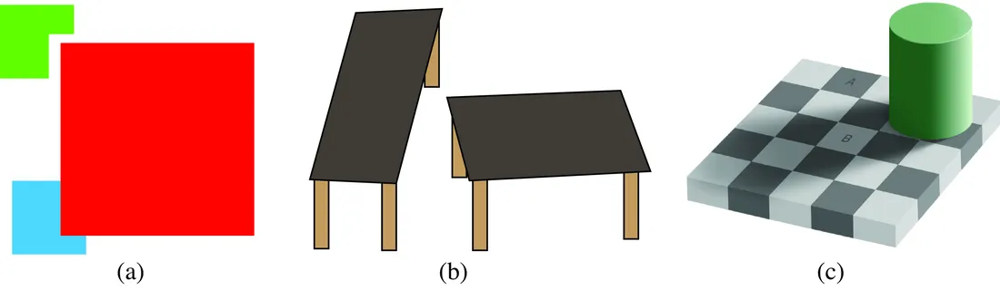
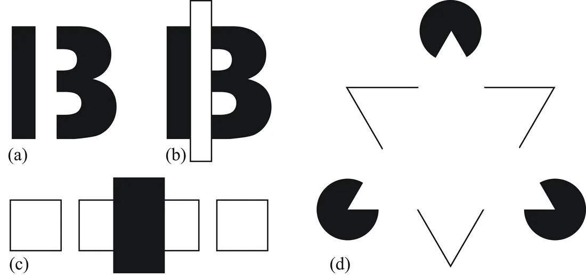
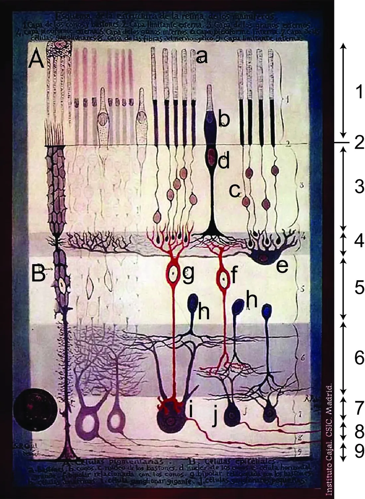
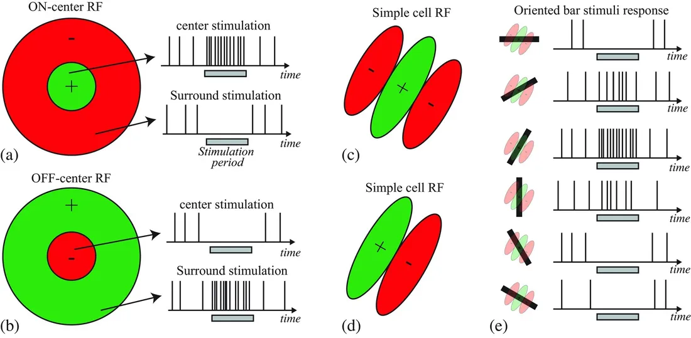
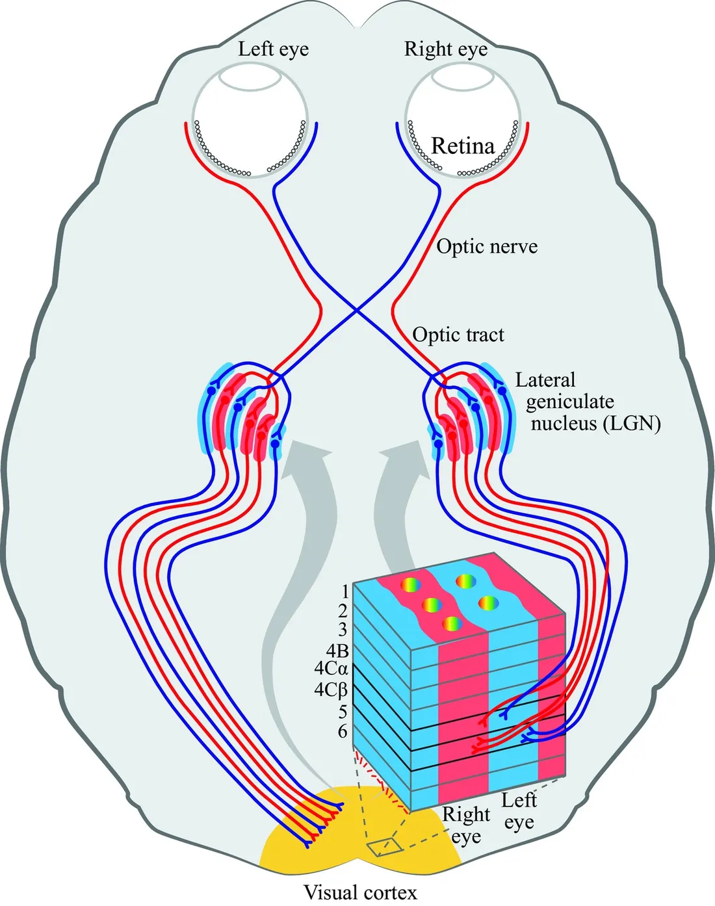
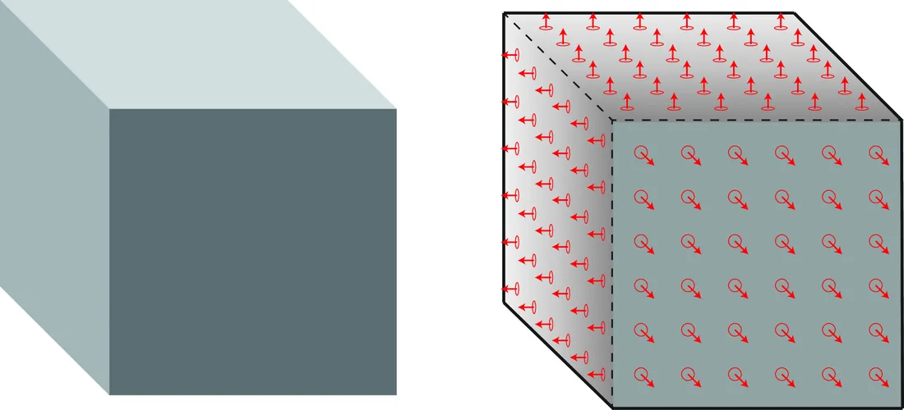

# 第 1 章 · 视觉的挑战

本页为《Foundations of Computer Vision》第 1 章的<b>学习笔记摘要</b>，由 AI 辅助整理，<b>非原文翻译</b>。原书 © 2024 Antonio Torralba、Phillip Isola、William T. Freeman，MIT Press 出版，<a href="https://visionbook.mit.edu/taxonomy.html" target="_blank" rel="noopener">官网免费公开</a>，采用 <a href="https://creativecommons.org/licenses/by-nc-nd/4.0/" target="_blank" rel="noopener">CC BY-NC-ND 4.0</a> 授权。插图版权归原作者所有，此处仅作非商业学习引用。

## 本章定位

全书开篇纲领。本章不讲任何具体算法，而是回答「视觉为什么难」以及「人类和学术界用哪些理论框架逼近过这个问题」——从古希腊的光线学说、Helmholtz 的无意识推理、格式塔组织律、Gibson 的生态光学，一直到神经机制、Marr 的计算理论、计算机视觉与深度学习。后续所有章节的具体技术，几乎都能在本章找到思想源头。

## 本篇要点

- 视觉系统的输入只是**光场函数**（plenoptic function）的一个微小切片，输出却是对场景的解释；两者之间的鸿沟靠先验与假设填补。
- 环境光（ambient light）经无数次反射、阴影与遮挡充满空间；**遮挡**（occlusion）是视觉最核心的困难之一，而且不可恢复的光场信息占绝大多数。
- 视觉的目标不是测量光强，而是测量场景属性（表面、物体、材料）——Checkershadow 错觉证明视觉系统在主动「去除光照、估计反射率」。
- Marr 三层次（计算理论 / 表示 / 硬件）与「图像 → 原始草图 → 2.5D 草图 → 3D 模型」的表示序列，是全书的组织线索；Marr 的短板是低估了学习。
- 基于学习的视觉没有改变「输入—输出—映射」的结构，只是换了一种寻找映射的方式：数据 + 可微架构 + SGD。

## 关键插图

原书标注为最高优先级（三星）的核心插图，共 6 幅。

<figure class="book-fig">

<figcaption>图 1.2：我们无法关闭那些把图像自动解释为真实三维（3D）场景画面（而非光图案）的机制。(a) 遮挡图形；(b) R. Shepard 的「转桌」错觉；(c) E. Adelson 的「棋盘阴影」错觉。</figcaption>
</figure>

💡 为什么重要：这三个错觉共同说明「看 ≠ 测光」：视觉系统内置了「世界由典型形状组成、遮挡很常见、光照会变化」的先验，主动做场景解释。

<figure class="book-fig">

<figcaption>图 1.8：无模态完形与有模态完形。(a) 这是 13 还是被遮挡的 B？(b) 给遮挡物加上边界后，字母 B 更清楚了。(c) 有几个正方形？遮挡物后面是两个正方形还是一个矩形？(d) Kanizsa 三角；三角形各边出现虚幻轮廓（illusory contours）。</figcaption>
</figure>

💡 为什么重要：Kanizsa 三角同时展示了 amodal completion（被圆盘遮住的三角）与 modal completion（浮现的三角），是「幻觉轮廓/边缘补全」类算法的认知源头，与本书后续的边缘检测、图像分割内容直接相关。

<figure class="book-fig">

<figcaption>图 1.10：Santiago Ramón y Cajal 的视网膜绘图。图中感光细胞在上方、光从下方入射：1. 视杆视锥层；2. 外界膜；3. 外颗粒层；4. 外网状层；5. 内颗粒层；6. 内网状层；7. 神经节细胞层；8. 视神经纤维层；9. 内界膜。A. 色素细胞；B. 上皮细胞；a. 视杆；b. 视锥；c. 视杆细胞核；d. 视锥细胞核；e. 大型水平细胞；f. 视锥关联双极细胞；g. 视杆关联双极细胞；h. 无长突细胞；i. 巨大神经节细胞；j. 小型神经节细胞。来源：《哺乳动物视网膜结构》（Santiago Ramon y Cajal，约 1900）。</figcaption>
</figure>

💡 为什么重要：这张分层图是「视觉 = 层级化特征处理」的最早证据，直接启发了 CNN 的层级结构设计。

<figure class="book-fig">

<figcaption>图 1.11：视网膜神经节细胞的感受野（RF）与初级视觉系统的朝向感受野。(a) ON 中心 RF；(b) OFF 中心 RF；(c-d) 两类朝向性简单细胞；(e) (c) 中细胞对朝向条（不同朝向、投射在 RF 中心）响应的示意；灰条表示条可见的时刻。</figcaption>
</figure>

💡 为什么重要：中心-周边 RF ≈ 高斯差分（DoG）滤波，朝向选择性细胞 ≈ 方向滤波器——CNN 浅层学到的滤波器与它们高度相似，这就是「生物视觉启发深度学习」的实证锚点。

<figure class="book-fig">

<figcaption>图 1.12：视觉通路。视网膜把神经节细胞轴突投射到外侧膝状体（LGN）。每个半球的 LGN 接受双眼输入（右侧 LGN 接受每侧视网膜的右半，对应视野左侧）。LGN 的输出分为三条通道——大细胞（magnocellular）、小细胞（parvocellular）与 k 细胞（koniocellular，未画出）——它们以高度规则的超柱架构投射到初级视皮层；k 细胞通路投射到视皮层上层的颜色斑点。图改自 [38]。</figcaption>
</figure>

💡 为什么重要：把这张图与一千年前 Ibn al-Haytham 的图 1.4 对照读——从「画下眼睛」到「画清通路」，就是视觉科学两千年的缩影；腹侧/背侧双流至今仍是场景理解与导航任务的架构母题。

<figure class="book-fig">

<figcaption>图 1.14：立方体图像及其 2.5D 草图。图形参照 [1] 中图 4-2 绘制。</figcaption>
</figure>

💡 为什么重要：2.5D 草图（深度图 + 表面朝向 + 遮挡边界）几乎就是本书第 38 章之后多视几何/深度估计部分要重建的东西，是全书技术路线图的原型。

## 本章小结

- 视觉的输入是光场函数 $P(\theta,\Phi,\lambda,t,X,Y,Z)$ 的一个贫乏切片（大部分被遮挡、大部分信息丢失），输出却是场景解释；桥梁是先验、假设与主动推理。
- 「看」不等于「测光」：视觉系统估计表面反射率、去除光照与阴影（Checkershadow），并把 2D 图像解释为 3D 场景。
- 理论脉络：希腊入射/出射说 → Ibn al-Haytham（光沿直线、针孔/暗箱、科学方法）→ Kepler（视网膜成像）→ Helmholtz（无意识推理、主动观察者）→ 格式塔（知觉组织律、明度上下文、amodal/modal completion）→ Gibson（生态光学、环境光阵列、affordance）→ 神经科学（感受野、中心-周边、朝向选择性、超柱、双流）→ Marr（三层次 + 表示序列）→ 计算机视觉（几何 → 手工特征 → 深度学习）。
- 神经机制给算法的直接遗产：RGB 编码、线性滤波器 + 整流非线性、对比度控制、层级结构、注意力。
- Marr 的短板是低估学习；2012 AlexNet 之后，端到端学习成为主导，但「输入—输出—映射」的问题结构未变，变的是找映射的方法。

## 复习自检清单

- ☐ 能写出光场函数 $P(\theta,\Phi,\lambda,t,X,Y,Z)$ 并解释每个参数的含义、为什么说观察者只能看到它的一个切片
- ☐ 能论证「视觉的目标不是测光而是测场景属性」，并用 Checkershadow 错觉说明视觉系统在做什么
- ☐ 能列出格式塔主要聚合律（邻近/相似/闭合/良好连续/共同命运/过去经验），各举一个图 1.6 或日常例子
- ☐ 能区分 amodal completion 与 modal completion，各举一例（被遮挡的蓝方块 / Kanizsa 三角与虚幻轮廓）
- ☐ 能陈述 Gibson 的 ambient optic array 与 affordance 概念，并说明直接知觉论与间接知觉论的分歧
- ☐ 能描述视网膜 → LGN → V1 的通路与功能组织：中心-周边感受野、on/off-center、朝向选择性简单细胞、朝向柱/眼优势柱/超柱、腹侧/背侧流
- ☐ 能写出 Marr 三层次（计算理论/表示/硬件）及其四级表示序列（image / primal sketch / 2.5D sketch / 3D model），并说明 2.5D sketch 包含什么
- ☐ 能按时间线复述计算机视觉从几何方法 → 手工特征 + 浅层学习 → AlexNet 端到端学习的演进，各阶段举出代表性方法或基准

---

原文：[The Challenge of Vision](https://visionbook.mit.edu/taxonomy.html)
