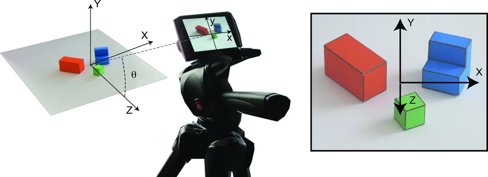
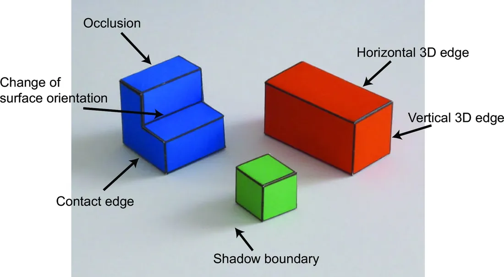
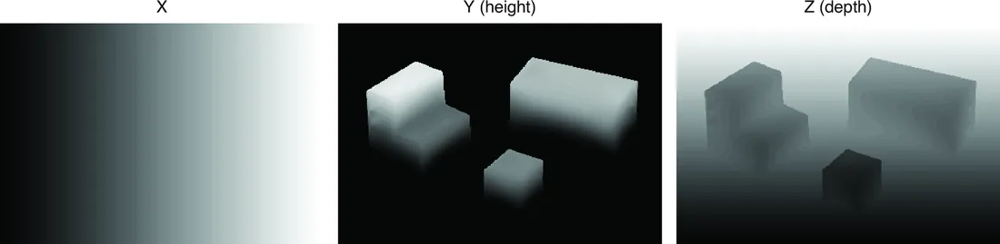

# 第 2 章 · 简单视觉系统

本页为《Foundations of Computer Vision》第 2 章的<b>学习笔记摘要</b>，由 AI 辅助整理，<b>非原文翻译</b>。原书 © 2024 Antonio Torralba、Phillip Isola、William T. Freeman，MIT Press 出版，<a href="https://visionbook.mit.edu/simplesystem.html" target="_blank" rel="noopener">官网免费公开</a>，采用 <a href="https://creativecommons.org/licenses/by-nc-nd/4.0/" target="_blank" rel="noopener">CC BY-NC-ND 4.0</a> 授权。插图版权归原作者所有，此处仅作非商业学习引用。

## 本章定位

本章是全书的开篇 toy problem。1960 年代的乐观主义让 MIT 学者想用一个暑假造出视觉系统（Seymour Papert 的夏季视觉项目），结果任务比任何人预期的都难。本章在 Larry Roberts 的「积木世界」里端到端搭建一个简单视觉系统，把全书主线——成像模型、边缘提取、几何约束、线性求解——完整预演一遍。本书最后（第 55 章）会回到这个玩具系统，因此这里的每一个假设、每一步 pipeline 都要吃透。

## 本篇要点

- 世界被简化为「积木世界」：由水平/竖直平面组成的彩色纸块放在白色水平地面上，不预设物体的精确几何。
- 成像用正交（平行）投影：$x=X,\ y=\cos(\theta)Y-\sin(\theta)Z$（式 2.1）；$Y$、$Z$ 投影后混叠，单视角丢失一个维度。
- 边缘按成因分类（物体边界/表面朝向变化/阴影边）；物体边界再分接触边与遮挡边，且每条边界只归属一个表面。
- 一般视点（generic view）与非偶然属性（nonaccidental properties）：图像中的竖直线可推断为 3D 竖直线；共线/共端/平滑在投影下保持不变。
- 全部几何约束汇成一个超定稀疏线性方程组 $\mathbf{A}\mathbf{Y}=\mathbf{b}$，用伪逆做最小二乘求解。
- 结果可换视角重渲染来验证；系统在域外输入上会失效——这正是全书后续要逐章补的课。

## 关键插图

原书标注为最高优先级（三星）的核心插图，共 3 幅。

<figure class="book-fig">

<figcaption>图 2.3：一个简单投影模型。(a) 世界坐标轴与相机平面。(b) 世界坐标轴平行投影到相机平面的可视化：Z 轴与 Y 轴只差一个符号反转和一个缩放。</figcaption>
</figure>

💡 为什么重要：这张图定义了全书反复回扣的玩具问题的坐标系与投影关系，是本章所有推导的基准。

<figure class="book-fig">

<figcaption>图 2.5：边缘表示图像强度急剧变化的图像区域；这些变化可能由众多场景因素造成（如遮挡边界、表面朝向变化、表面反照率变化、阴影）。</figcaption>
</figure>

💡 为什么重要：这张图给出本章边缘分类的标注实例，是理解后续所有边缘约束的前提。

<figure class="book-fig">

<figcaption>图 2.10：对图 2.5 的输入图像，本章视觉问题的求解结果：世界坐标 X、Y、Z 以图像形式展示。</figcaption>
</figure>

💡 为什么重要：这是整章 pipeline 的最终产物——把 3D 结构恢复成逐像素坐标图，一眼即可检验算法成败。

## 本章小结

- 简单视觉系统 = 正交投影成像 + 边缘分类与提取 + 几何约束线性求解，端到端恢复积木世界的逐像素 3D 坐标。
- 投影方程 (2.1) 把 $Y$、$Z$ 混叠：单视角必然丢失一个维度，这是所有 3D 视觉问题的根源。
- 边缘不只是「强度变化」：遮挡边（有深度跳变）、接触边（无跳变但有遮挡）、朝向变化边、阴影边各有不同的几何含义，且每条边界只归属一个表面。
- 一般视点 + 非偶然属性是「从 2D 反推 3D」的合法性基础；要清楚它何时失效（偶然对齐）。
- 所有约束（边缘上的方向导数、平面区域的零二阶导）汇成超定稀疏系统 $\mathbf{A}\mathbf{Y}=\mathbf{b}$，伪逆最小二乘求解。
- 该系统依赖大量只对积木世界成立的假设；域外输入会失效，评估与泛化是全书后续的主线。

## 复习自检清单

- ☐ 能写出简单世界的投影方程 (2.1)，解释为什么 $Y$、$Z$ 混叠、单视角丢失了哪个维度
- ☐ 能解释平行投影与透视投影的区别，并说出本章为何选正交投影（积木世界 + 远距变焦近似）
- ☐ 能用梯度定义边缘强度与边缘朝向，说清「边缘方向垂直于梯度方向」，并写出离散差分近似 (2.2)
- ☐ 能列出本章的边缘分类（物体边界/表面朝向变化/阴影边；接触边 vs 遮挡边），并解释「边界归属」为什么重要
- ☐ 能解释一般视点与非偶然属性，并用图 2.9 的立方体例子说明它何时失效
- ☐ 能推导 (2.3)–(2.5)：由竖直/水平 3D 边缘推出关于 $Y$ 的线性约束
- ☐ 能写出平面区域的三个零二阶导约束、加权最小二乘代价 $J$ 与伪逆解，并说明 $\mathbf{A}$ 为什么稀疏、该如何高效求解
- ☐ 能说出这个系统在哪些假设被违反时会失败（对照图 2.12、2.13），以及如何用「换视角重渲染」做定性评估

---

原文：[A Simple Vision System](https://visionbook.mit.edu/simplesystem.html)
