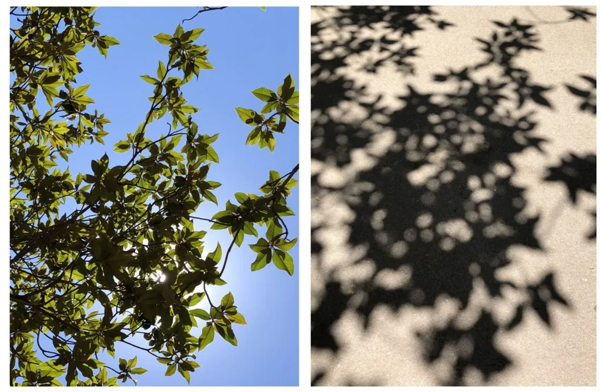
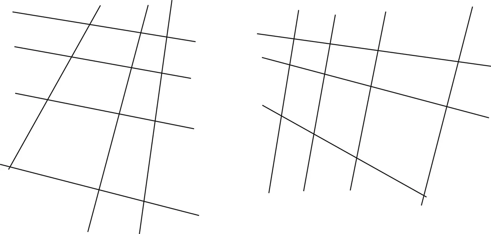
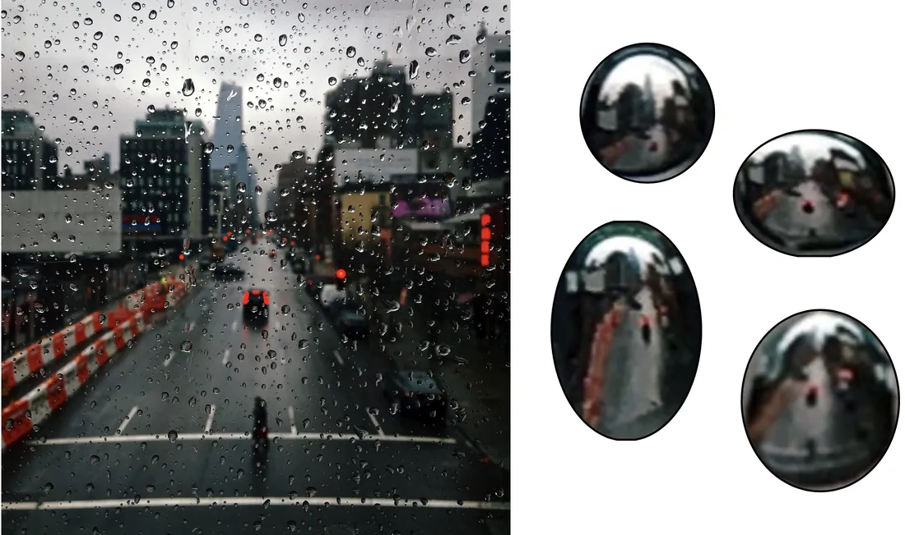

# 第 3 章 · 观看图像

本页为《Foundations of Computer Vision》第 3 章的<b>学习笔记摘要</b>，由 AI 辅助整理，<b>非原文翻译</b>。原书 © 2024 Antonio Torralba、Phillip Isola、William T. Freeman，MIT Press 出版，<a href="https://visionbook.mit.edu/visionscience.html" target="_blank" rel="noopener">官网免费公开</a>，采用 <a href="https://creativecommons.org/licenses/by-nc-nd/4.0/" target="_blank" rel="noopener">CC BY-NC-ND 4.0</a> 授权。插图版权归原作者所有，此处仅作非商业学习引用。

## 本章定位

本章是全书第一部分「视觉问题」的动机章，风格与其他章截然不同：不教算法、不给新数学，而是带读者重新「看」日常图像，提出视觉科学家研究了几十年的问题。它像一张地图——后面几乎每一章（成像、边缘、遮挡、光场、多视几何）都能回扣到本章的某个现象。读完本章你应该获得的能力不是实现什么，而是提出正确的问题。

## 本篇要点

- 视觉不是简单的输入-输出函数，而是动态系统：盯得越久看到越多，但「全看懂了」是错觉。
- 孤立图像块几乎无法识别，语义来自全图上下文——一张大图 = 成千上万张小图。
- 树影下的圆形光斑 = 树叶缝隙形成的针孔相机投下的太阳像；日食时光斑呈月牙形。
- 消失点与地平线的排布，决定我们把线条画感知为水平面还是竖直面。
- 照片里充满偶然对齐，格式塔连续性原则经常被违反——纯规则系统必须容错。
- 图像是物理世界的粗糙投影（柏拉图洞穴）：看不见的比看得见的多，视觉 = 推断看不见的部分。

## 关键插图

原书标注为最高优先级（三星）的核心插图，共 3 幅。

<figure class="book-fig">

<figcaption>图 3.6：晴天里这棵树的影子，在地面上投下几十张太阳的像。</figcaption>
</figure>

💡 为什么重要：日常树影背后是「树叶缝隙 = 针孔相机」的成像原理——把看得见却想不到的现象和第 5 章的相机模型直接连起来。

<figure class="book-fig">

<figcaption>图 3.8：线条画。左边那幅看起来对应水平表面，右边那幅看起来像竖直表面。</figcaption>
</figure>

💡 为什么重要：消失点的位置与地平线的朝向，是判断平面朝向的几何依据——这条直觉会在后续多视几何章节中被形式化。

<figure class="book-fig">

<figcaption>图 3.12：一台天然形成的光场相机：这张窗户上雨滴的照片中，每颗雨滴都含着场景的一张小图像。右侧是左侧照片中几颗雨滴的放大图。</figcaption>
</figure>

💡 为什么重要：雨滴就是微透镜阵列——光场相机的天然原型。「记录 4D 光场（2D 位置 + 2D 方向）、事后重聚焦」是计算摄影学的经典范例，后续章节会讲光场采集。

## 本章小结

- 看图像要看到「像素级」：语义来自上下文而非孤立小块；视觉理解是动态的、渐进的，且「完全理解」是错觉。
- 树影光斑、雨滴折射、运动模糊、线条画的朝向感——每个日常现象背后都对应一个成像/几何原理，后续章节会逐一形式化。
- 一般视点会被偶然对齐打破；基于规则的方法必须为「意外」留有余地。
- 物体/材料/接触关系（湿/干、支撑/接触）靠的是阴影、悬绳等间接线索，而不是像素本身。
- 图像是不完整投影（柏拉图洞穴）：视觉系统的核心任务之一是推断看不见的部分。

## 复习自检清单

- ☐ 能解释「孤立图像块无法识别、语义来自上下文」（图 3.1/3.2），并说明这对深度学习 patch 级训练与感受野设计的启示
- ☐ 能解释树影下圆形光斑的成因（树叶缝隙 = 针孔相机），并预测日食时同一现象的光斑形状
- ☐ 能根据线条画中消失点的位置与地平线朝向，判断画面被感知为水平面还是竖直面
- ☐ 能解释运动模糊为什么「远近模糊程度不同」，并说出模糊量与哪些因素有关
- ☐ 能定义格式塔连续性原则，并在名作类照片中找出违反它的偶然对齐
- ☐ 能列出判断「一个物体是否支撑/接触另一个物体」的视觉线索（阴影位置、悬绳松紧等）
- ☐ 能用柏拉图洞穴比喻说明「图像是不完整投影」，并指出视觉系统要推断的是哪些看不见的信息
- ☐ 能自己提出至少三个「为什么东西看起来是这样」的问题（如湿沙为何更暗、天空为何是蓝的），并指出它们分别对应本书哪类模型

---

原文：[Looking at Images](https://visionbook.mit.edu/visionscience.html)
