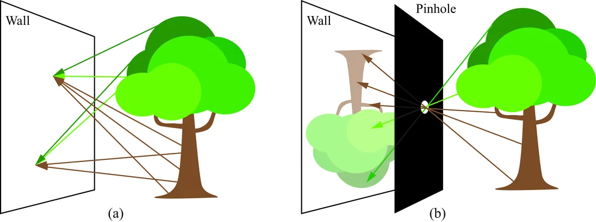
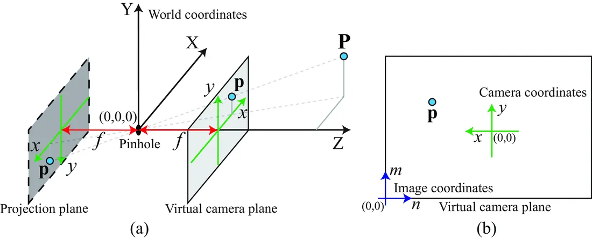

# 第 5 章 · 成像

本页为《Foundations of Computer Vision》第 5 章的<b>学习笔记摘要</b>，由 AI 辅助整理，<b>非原文翻译</b>。原书 © 2024 Antonio Torralba、Phillip Isola、William T. Freeman，MIT Press 出版，<a href="https://visionbook.mit.edu/imaging.html" target="_blank" rel="noopener">官网免费公开</a>，采用 <a href="https://creativecommons.org/licenses/by-nc-nd/4.0/" target="_blank" rel="noopener">CC BY-NC-ND 4.0</a> 授权。插图版权归原作者所有，此处仅作非商业学习引用。

## 本章定位

全书 Part II「图像形成」的第一章。前面几章建立了「视觉要解决什么问题」的框架，从本章开始回答最基础的问题——光线如何与表面作用、又如何被相机记录成图像。针孔相机模型是后续所有几何章节（第 38-45 章）的根基。

## 本篇要点

- 表面的反射特性用 BRDF 描述；朗伯（Lambertian）模型是最常用的漫反射近似，亮度只取决于反照率与入射角。
- 相机的本质是「筛选光线」：让成像面上每个位置只接收来自一个方向的光线，从而把方向信息固定成空间位置信息。
- 针孔相机给出透视投影 $x=fX/Z,\ y=fY/Z$；平行投影（正交投影）是另一个常用模型。
- 相机坐标与像素坐标之间差一个仿射变换（含主点与缩放）。

## 关键插图

原书标注为最高优先级（三星）的核心插图，共 2 幅。

<figure class="book-fig">

<figcaption>图 5.3：(a) 为什么墙壁上不会出现画面？(b) 针孔相机限制到达墙面的光线，从而产生图像。</figcaption>
</figure>

💡 为什么重要：这一张图把「相机 = 方向选择器」的本质讲透了，是理解全部成像模型的起点。

<figure class="book-fig">

<figcaption>图 5.8：(a) 针孔相机几何。三维点 P 投影到距针孔 f 的投影面上的位置 p；虚拟像面是投影面的径向对称面。(b) 相机坐标 (x,y) 与图像坐标 (n,m) 的关系。</figcaption>
</figure>

💡 为什么重要：这张图是后续所有多视几何（第 38-44 章）的坐标系基准，务必把三个坐标系的关系看清楚。

## 本章小结

- 表面反射由 BRDF 描述；朗伯模型（亮度 ∝ 反照率 × 入射角余弦）是最常用的漫反射近似，Phong 模型在其上叠加镜面高光。
- 反射是线性的，多光源效果可叠加。
- 相机的本质是方向选择器：针孔让每个感光点只接收一个方向的光，从而把方向信息转成位置信息。
- 针孔相机 → 透视投影 $x=fX/Z,\ y=fY/Z$；正交投影 $x=kX,\ y=kY$ 是另一常用模型（长焦/吸管相机/远心镜头）。
- 像素坐标与相机坐标之间是仿射变换，主点 $(n_0,m_0)$ 与缩放 $a$。

## 复习自检清单

- ☐ 能写出 BRDF 的定义（式 5.1）并说明它为什么是「双向」的
- ☐ 能写出朗伯模型（式 5.2），解释为什么漫反射与观察方向无关
- ☐ 能写出 Phong 镜面分量公式，说明 $\alpha$ 和 $\mathbf{r}$ 的作用
- ☐ 能解释「为什么白墙上没有像」，以及针孔是如何解决这个问题的
- ☐ 能独立由相似三角形推出透视投影方程 (5.3)(5.4)
- ☐ 能说出虚拟像面的作用，以及相机坐标到像素坐标的仿射变换
- ☐ 能比较透视投影与正交投影的适用场景（各举一例）

---

原文：[Imaging](https://visionbook.mit.edu/imaging.html)
