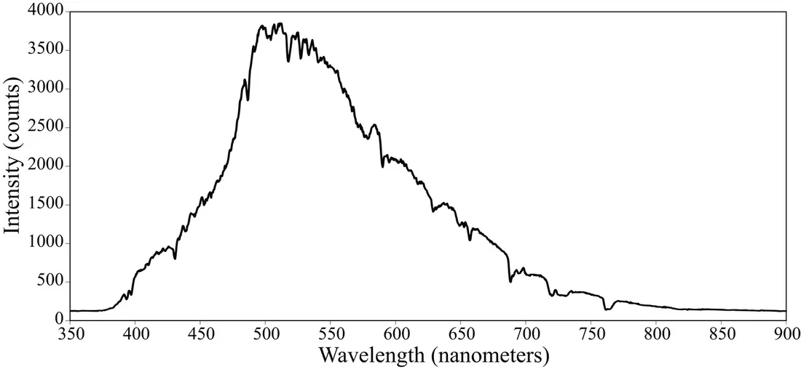
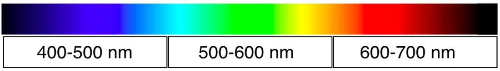
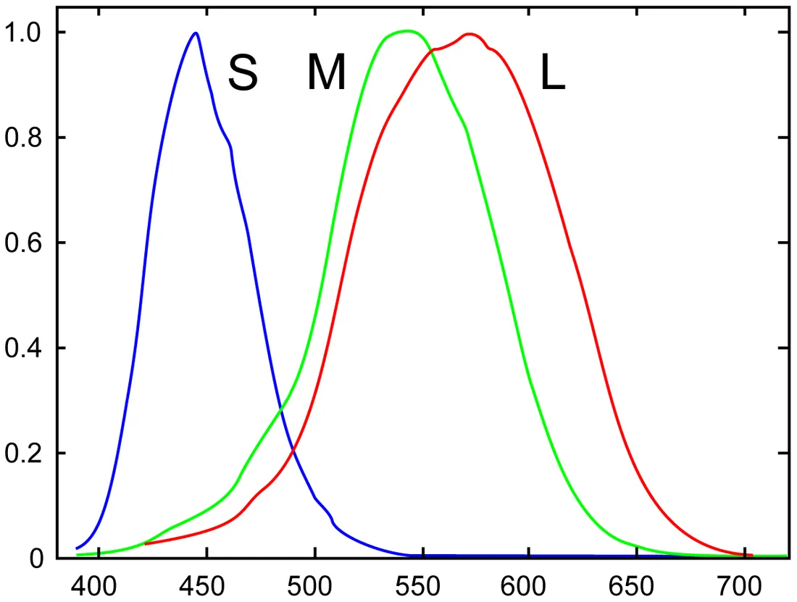
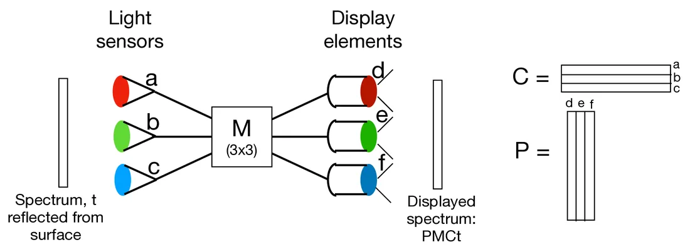
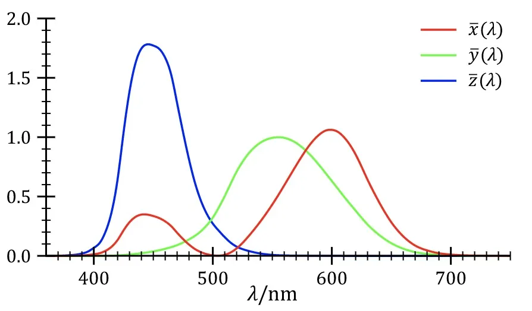
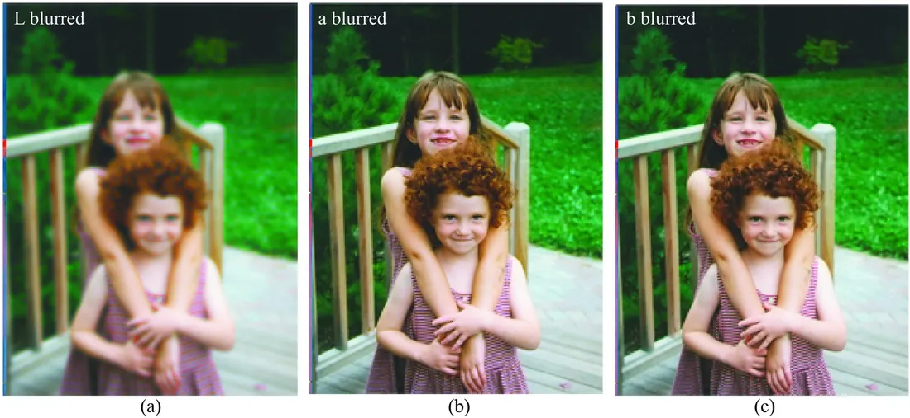

# 第 8 章 · 颜色

本页为《Foundations of Computer Vision》第 8 章的<b>学习笔记摘要</b>，由 AI 辅助整理，<b>非原文翻译</b>。原书 © 2024 Antonio Torralba、Phillip Isola、William T. Freeman，MIT Press 出版，<a href="https://visionbook.mit.edu/color.html" target="_blank" rel="noopener">官网免费公开</a>，采用 <a href="https://creativecommons.org/licenses/by-nc-nd/4.0/" target="_blank" rel="noopener">CC BY-NC-ND 4.0</a> 授权。插图版权归原作者所有，此处仅作非商业学习引用。

## 本章定位

本章承接第 5 章「成像」：第 5 章讨论光的方向与强度如何形成图像，本章讨论被记录下来的光的另一个核心属性——颜色。内容自底向上分三层：颜色物理（光谱功率分布与表面反射）、人眼机制（三种视锥细胞把高维光谱压成 3D 颜色感知）、颜色工程（CIE 色度学标准与颜色复现系统的线性代数条件），最后落到颜色与空间分辨率的相互作用——这是图像压缩中色度下采样的理论根源。

## 本篇要点

- 颜色的物理载体是光谱功率分布（SPD）；表面反射与滤色都是「逐波长相乘」：$r(\lambda)=k\,\ell_{\texttt{in}}(\lambda)\,s(\lambda)$。
- 人眼只有 L/M/S 三种视锥细胞，颜色感知本质是把高维光谱投影到 3D 子空间（式 8.1）——三原色、三层彩色胶片、三色显示点皆源于此。
- 颜色复现系统 = 敏感曲线 $\mathbf{C}$ + 基色光谱 $\mathbf{P}$ + 混合矩阵 $\mathbf{M}$；完美匹配的条件是 $\mathbf{C}=\mathbf{R}\mathbf{C}_{eye}$（8.5）与 $\mathbf{M}=(\mathbf{CP})^{-1}$（8.6），且 $\mathbf{P}$ 非负。
- CIE XYZ 色匹配函数全波段为正，是颜色测量的通用语言，但没有全正的物理基色与之配套；色品坐标 $x=X/(X+Y+Z)$、$y=Y/(X+Y+Z)$ 用于剥离强度。
- 人眼对亮度（L）通道的空间细节远比对色度（a/b）通道敏感，因此压缩时色度通道可以更粗地采样。

## 关键插图

原书标注为最高优先级（三星）的核心插图，共 6 幅。

<figure class="book-fig">

<figcaption>图 8.4：蓝天的光谱功率分布 [3]。</figcaption>
</figure>

💡 为什么重要：这是全书第一条真实测量的光谱曲线，直观建立「功率随波长分布」的直觉；此后所有颜色讨论的基本对象都是 SPD。

<figure class="book-fig">

<figcaption>图 8.5：不同光谱区域的光的大致颜色外观。</figcaption>
</figure>

💡 为什么重要：一张图把「波长区间 → 颜色」的映射立起来，是复习光谱学时最常用的速查直觉。

<figure class="book-fig">

<figcaption>图 8.9 (b)：L、M、S 视锥细胞的光谱敏感曲线，测自中央凹附近（该处无视杆细胞、视锥紧密堆积）。</figcaption>
</figure>

💡 为什么重要：三色视觉的生理基础——三条敏感曲线就是后续全部「三通道」论述的出发点，色匹配函数的推导也以此为准。

<figure class="book-fig">

<figcaption>图 8.11：颜色复现系统。光传感器 a、b、c 响应输入光谱 t，给出传感器激活 Ct；这些激活的组合驱动显示元件 d、e、f，产生输出光谱 PMCt。对 P、M、C 的条件约束可确保输入与输出颜色对观察者而言匹配。</figcaption>
</figure>

💡 为什么重要：全章骨架图——颜色复现的线性代数全貌（C 感知、M 混合、P 发光）都浓缩在这张系统图里，后面三条匹配条件的推导都围绕它展开。

<figure class="book-fig">

<figcaption>图 8.13：CIE 色匹配函数 [19]。</figcaption>
</figure>

💡 为什么重要：色度学的标准「接收机」——测量设备、颜色空间换算、色差计算最终都以它为中间语言；三条全正曲线是 XYZ 空间能表示所有可见色的原因。

<figure class="book-fig">

<figcaption>图 8.17：由图 8.16 (b) 与 (c) 的清晰、模糊分量组合成的彩色图像。(a) L 分量模糊、a 与 b 分量清晰。(b) a 分量模糊、L 与 b 分量清晰。(c) b 分量模糊、L 与 a 分量清晰。只要亮度分量清晰，只模糊 a 或 b 分量得到的全彩图像看上去仍然清晰。</figcaption>
</figure>

💡 工程师视角：JPEG/视频编码里的 YCbCr 4:2:0（色度通道半分辨率采样）就是这条性质最直接的工程变现。

## 本章小结

- 颜色的物理载体是光谱功率分布（SPD）；表面漫反射与滤色都是逐波长相乘：$r(\lambda)=k\,\ell_{\texttt{in}}(\lambda)\,s(\lambda)$。
- 人眼只有 L/M/S 三种视锥细胞；颜色感知 = 把高维光谱投影到 3D 子空间（式 8.1）。三原色、三层感色胶片、三色显示点皆源于此。
- 任意颜色可由三种基色的线性组合匹配；匹配可传递，故基色用量可作颜色坐标；不同光谱可同色异谱（metamerism）。
- 颜色复现系统由 $\mathbf{C}$（敏感曲线）、$\mathbf{P}$（基色光谱）、$\mathbf{M}$（混合矩阵）构成；完美匹配的条件是 $\mathbf{C}=\mathbf{R}\mathbf{C}_{eye}$（8.5）与 $\mathbf{M}=(\mathbf{CP})^{-1}$（8.6），且 $\mathbf{P}$ 非负（超出正值组合范围即出色域）。
- CIE XYZ 色匹配函数全正，是颜色测量的通用中间语言，但没有全正物理基色与之配套；色品坐标 $x=X/(X+Y+Z)$、$y=Y/(X+Y+Z)$ 用于剥离强度。
- 人眼对 L（亮度）通道的空间细节远比对 a/b（色度）通道敏感 → Lab/YCbCr 类空间允许色度下采样，是图像压缩的基石。

## 复习自检清单

- ☐ 能解释棱镜为何能把白光分成颜色，以及折射与衍射两种分光方式的区别
- ☐ 能写出漫反射光谱模型 $r(\lambda)=k\,\ell_{\texttt{in}}(\lambda)\,s(\lambda)$，并说明它同样适用于滤色片透射
- ☐ 能说出可见光波段范围、三个 100 nm 波段各自的颜色外观，以及青/品红/黄分别是哪两个色带相加、对应「减哪色」
- ☐ 能写出视锥响应矩阵式 (8.1)，并解释三类视锥为何决定了三原色、三层感光胶片与三色显示点
- ☐ 能解释同色异谱（metamerism）的含义及其对颜色测量与工业检测的影响
- ☐ 能复述颜色复现完美匹配的条件（式 8.3–8.6），说清 $\mathbf{C}$、$\mathbf{P}$、$\mathbf{M}$ 各自的角色与 $\mathbf{P}$ 非负的物理意义
- ☐ 能解释 CIE XYZ 色匹配函数为何设计成全正、为何没有全正物理基色与之配对，以及三刺激值到色品坐标的换算
- ☐ 能解释为什么模糊 RGB 的 R/G 分量会让整图发糊，而模糊 Lab 的 a/b 分量图像仍显清晰，以及这如何用于压缩

---

原文：[Color](https://visionbook.mit.edu/color.html)
