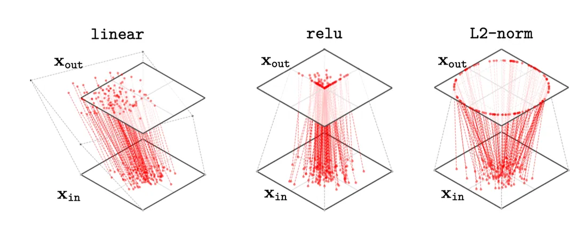
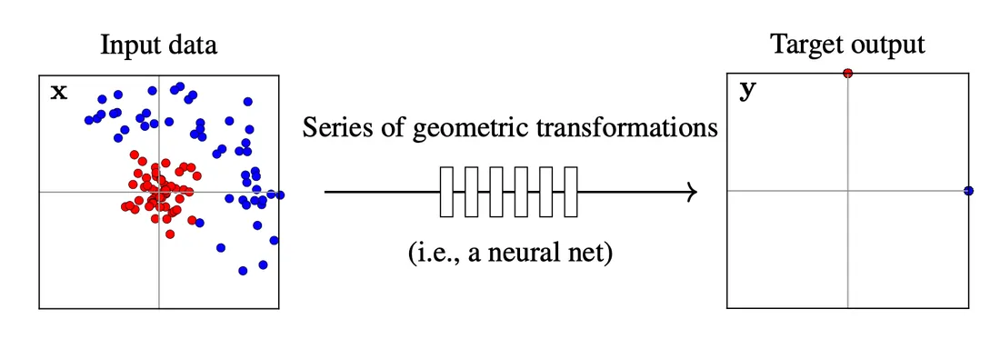
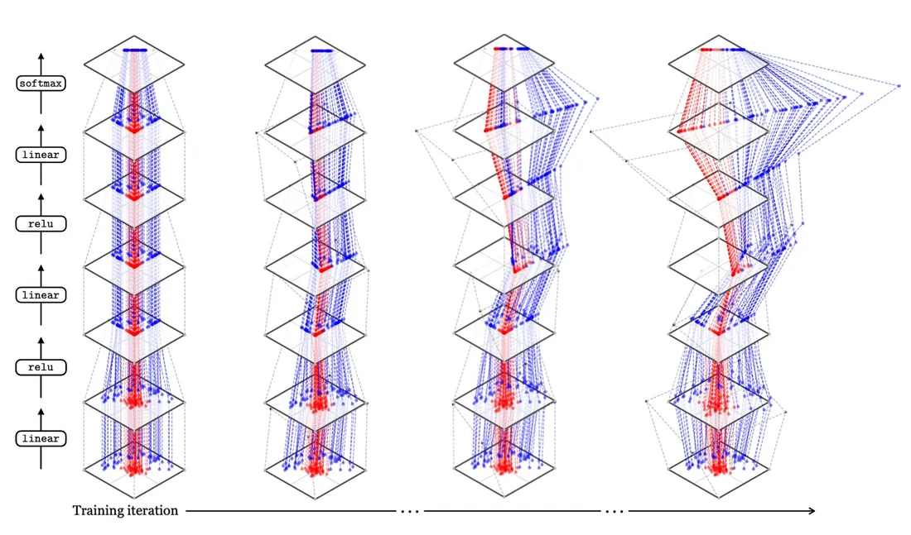

# 第 13 章 · 作为分布变换器的神经网络

本页为《Foundations of Computer Vision》第 13 章的<b>学习笔记摘要</b>，由 AI 辅助整理，<b>非原文翻译</b>。原书 © 2024 Antonio Torralba、Phillip Isola、William T. Freeman，MIT Press 出版，<a href="https://visionbook.mit.edu/neural_nets_as_distribution_transformers.html" target="_blank" rel="noopener">官网免费公开</a>，采用 <a href="https://creativecommons.org/licenses/by-nc-nd/4.0/" target="_blank" rel="noopener">CC BY-NC-ND 4.0</a> 授权。插图版权归原作者所有，此处仅作非商业学习引用。

## 本章定位

第 12 章告诉我们深度网络是简单函数的堆叠；本章换一个几何视角——把每一层看作对数据分布的一次几何变换，整个网络就是把输入分布一步步「整理」成目标分布的过程。这一「分布变换器」观点是理解深层表征几何（稀疏性、解缠）以及第 26 章 Transformer、第 51 章对比学习表征的直觉基础。

## 本篇要点

- 把函数图像横过来画（输入在水平轴上）：网络层 = 对输入空间的重排，恒等映射 = 直线。
- 线性层对分布做拉伸/压缩/旋转（仿射变换）；ReLU 把负值压到 0；sigmoid 把数据拉向 0/1。
- 网络整体把 $p_{\text{data}}$ 逐层变换为 $p_1 \to p_2 \to \cdots \to p_{\text{out}}$；多数损失函数惩罚 $p_{\text{out}}$ 与 $p_{\text{target}}$ 的差异。
- ReLU 网络中数据密度沿坐标轴堆积：宽度 $N$ 的层中「严格正」区域仅占嵌入空间的 $1/2^N$，高维表征因此非常稀疏。
- 二分类 softmax 的目标可表述为：把两类点分别搬到单形顶点（one-hot 编码），训练 = 寻找达成该重排的几何变换序列。

## 关键插图

原书标注为最高优先级（三星）的核心插图，共 3 幅。

<figure class="book-fig">

<figcaption>图 13.5：几种网络层的 2D 映射图。线性层映射将根据其权重和偏置发生平移、拉伸与旋转。</figcaption>
</figure>

💡 为什么重要：ReLU 把正象限中的点「啪」地贴到坐标轴上——这是理解 ReLU 网络表征稀疏性几何根源的关键图。

<figure class="book-fig">

<figcaption>图 13.7：神经网络分类器的目标是把输入数据分布重排成匹配目标标签分布的样子。（左）红蓝两类的输入数据集；（右）目标输出（one-hot 编码）。</figcaption>
</figure>

💡 为什么重要：把「训练」理解为「寻找一串几何变换，把输入分布搬到目标分布」，是本章的核心心智模型。

<figure class="book-fig">

<figcaption>图 13.8：深度网络如何逐层重映射输入数据。目标输出是把所有红点移到 (0,1)、所有蓝点移到 (1,0)（两类的 one-hot 编码）。随着训练推进，网络逐渐实现这种分离。</figcaption>
</figure>

💡 为什么重要：一张图看尽训练全程——分布从「纠缠」到「分离」是一个渐进的几何过程，可作为理解训练动态的直觉模板。

## 本章小结

- 把函数图像横过来画（输入在水平轴）：网络层 = 对输入空间的重排；恒等层 = 直线（不重排）。
- 线性层 = 仿射变换（平移 + 拉伸/压缩 + 旋转）；ReLU = 负值清零（正象限的点贴到坐标轴）；sigmoid = 数据拉向 0/1。
- 网络整体 = 把 $p_{\text{data}}$ 逐层变换为 $p_1 \to p_2 \to \cdots \to p_{\text{out}}$；大多数损失函数惩罚 $p_{\text{out}}$ 与 $p_{\text{target}}$ 之间的差异。
- 分类目标可表述为「把各类点搬到单形顶点（one-hot 编码）」；训练 = 寻找达成该重排的几何变换序列，训练过程就是把两类逐步解缠、拉向顶点。
- ReLU 网络的表征几何非常稀疏：宽度 $N$ 的层中严格正区域仅占 $1/2^N$，密度沿坐标轴堆积。
- 高维表征靠 t-SNE 等降维手段可视化（仅是近似观察）；ViT + CLIP 的网络逐层把语义类别解缠分离。

## 复习自检清单

- ☐ 能说明「把函数图像横过来画」带来了什么新直觉（恒等映射 = 直线，层 = 重排空间）
- ☐ 能描述线性层、ReLU、sigmoid 各自对数据分布的几何作用
- ☐ 能写出 $p_{\text{data}} \to p_1 \to p_2 \to \cdots \to p_{\text{out}}$ 的逐层变换观点，并说明损失函数在此视角下的含义（惩罚与 $p_{\texttt{target}}$ 的差异）
- ☐ 能写出 13.4 节 MLP 的完整前向公式（三个线性层 + 两个 ReLU + softmax），并解释检查点是什么
- ☐ 能解释为什么 one-hot 编码对应单形顶点，以及分类目标为何是「把点搬到顶点」
- ☐ 能解释「宽度 $N$ 的 ReLU 层中严格正区域占 $1/2^N$」的推导与它对表征稀疏性的影响
- ☐ 能说明 t-SNE 可视化的能力与局限（投影保持距离、但只是近似观察而非精确嵌入）
- ☐ 能向同事讲解「训练一个分类网络 = 学习一串几何变换」，并用图 13.8 的过程佐证

---

原文：[Neural Networks as Distribution Transformers](https://visionbook.mit.edu/neural_nets_as_distribution_transformers.html)
