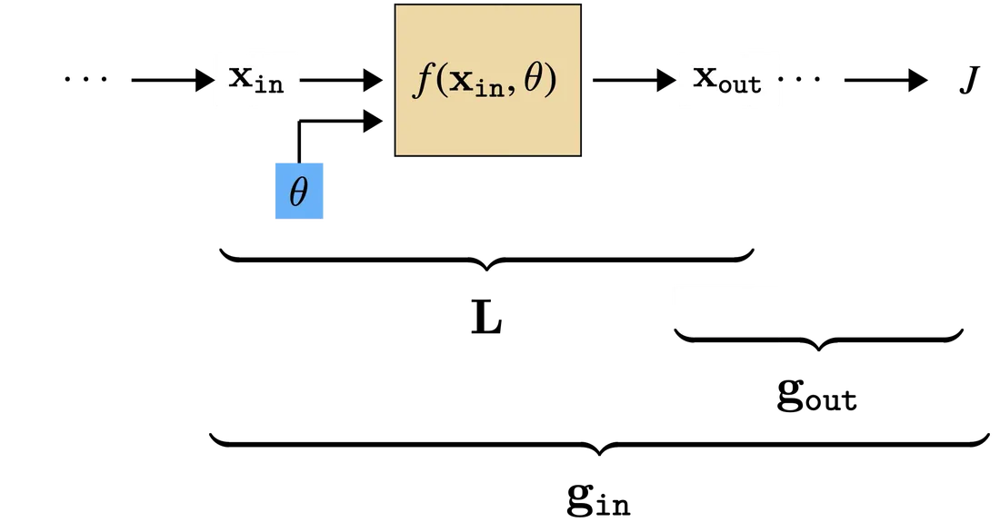
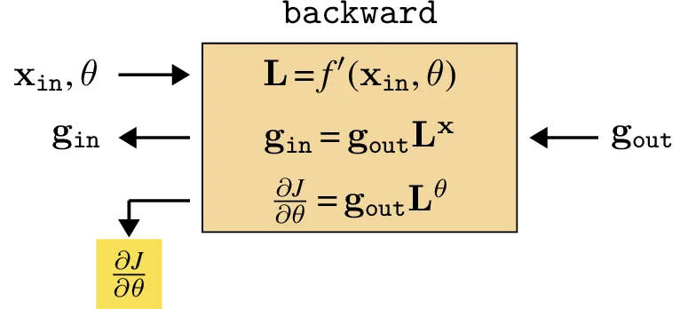
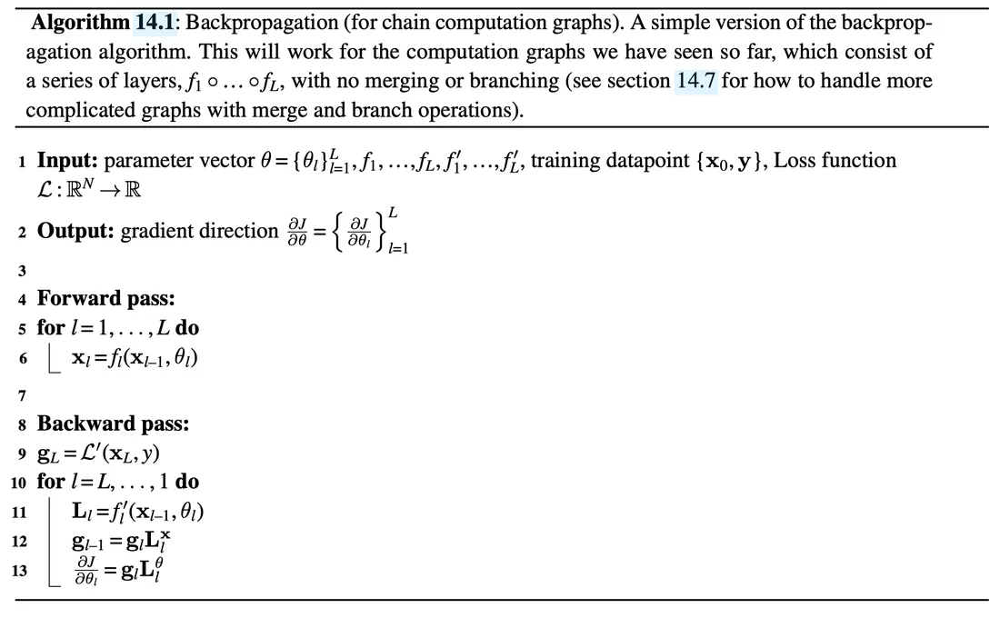
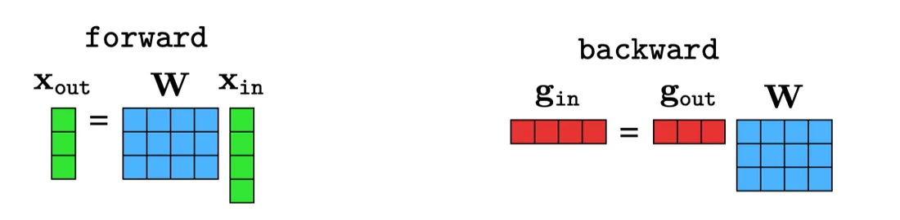
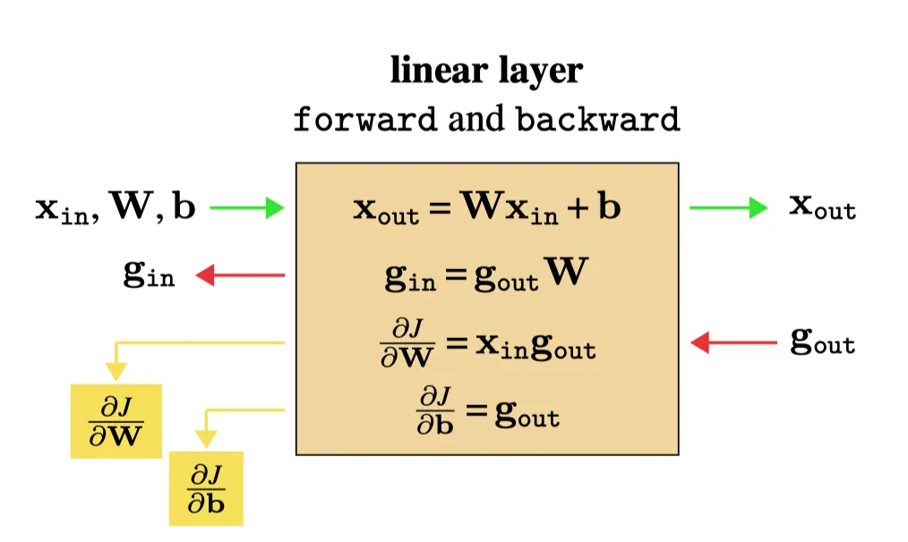
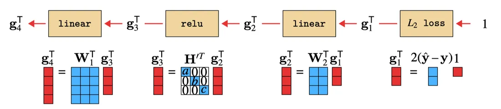
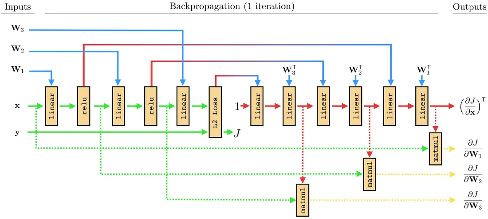

# 第 14 章 · 反向传播

本页为《Foundations of Computer Vision》第 14 章的<b>学习笔记摘要</b>，由 AI 辅助整理，<b>非原文翻译</b>。原书 © 2024 Antonio Torralba、Phillip Isola、William T. Freeman，MIT Press 出版，<a href="https://visionbook.mit.edu/backpropagation.html" target="_blank" rel="noopener">官网免费公开</a>，采用 <a href="https://creativecommons.org/licenses/by-nc-nd/4.0/" target="_blank" rel="noopener">CC BY-NC-ND 4.0</a> 授权。插图版权归原作者所有，此处仅作非商业学习引用。

## 本章定位

Part III「学习」中承上启下的一章。第 9-10 章建立了学习问题与梯度下降优化框架，第 12 章给出了多层感知机（MLP）；本章回答训练神经网络的核心工程问题——**梯度到底怎么算**。反向传播把「求计算图上损失对每个参数的梯度」变成每层一个局部操作，是后续所有深度模型（第 25 章的循环网络及其时间维度反向传播等）的计算基石。

## 本篇要点

- 反向传播是在计算图上高效求梯度的算法；核心技巧是链式法则展开式中大量子表达式被各参数共享，只需算一次即可复用——本质是动态规划。
- 每层只需跟踪两个局部量：$\mathbf{L}$（层输出对输入/参数的 Jacobian）与 $\mathbf{g}$（损失对层输出的梯度）；递推式 $\mathbf{g}_{\texttt{in}} = \mathbf{g}_{\texttt{out}}\mathbf{L}^{\mathbf{x}}$ 把误差信号逐层回传。
- 线性层反向：$\mathbf{g}_{\texttt{in}} = \mathbf{g}_{\texttt{out}}\mathbf{W}$、$\partial J/\partial\mathbf{W} = \mathbf{x}_{\texttt{in}}\mathbf{g}_{\texttt{out}}$（外积）、$\partial J/\partial\mathbf{b} = \mathbf{g}_{\texttt{out}}$；线性层的反向就是「权重转置的前向」。
- 逐点非线性（如 ReLU）反向是对角门控矩阵 $\mathbf{H}'$，逐元素缩放梯度；$L_2$ 损失层反向输出每维误差 $2(\hat{\mathbf{y}}-\mathbf{y})$。
- branch 的反向 = 各路梯度求和；merge 的反向 = 按位置切取；参数共享处梯度自动累加。
- 反向传播不区分参数与数据：对输入数据同样能求梯度（特征可视化、对抗样本的思想源头）。

## 关键插图

原书标注为最高优先级（三星）的核心插图，共 7 幅。

<figure class="book-fig">

<figcaption>图 14.4：计算图中的一个通用层。大括号标出的是为计算 g_out、L 与 g_in 所需考虑的计算图部分。</figcaption>
</figure>

💡 为什么重要：这张图界定了反向传播的「作用域」——每层的 backward 只需要本层的输入、参数和上游传来的 g_out，这是理解「反向传播是逐层局部操作」的钥匙。

<figure class="book-fig">

<figcaption>图 14.5：通用层的 backward。图中用颜色标示参数梯度。</figcaption>
</figure>

💡 为什么重要：这是全章的核心抽象——任何层（线性、ReLU、损失、乃至自定义层）的 backward 都统一为「一个 Jacobian 左乘上游梯度」的局部模块，框架自动微分正是按这个契约实现的。

<figure class="book-fig">

</figure>

<figure class="book-fig">

<figcaption>图 14.8：线性层的前向与反向矩阵乘法。</figcaption>
</figure>

💡 为什么重要：左看前向、右看反向——反向就是把前向的矩阵乘法「逆着数据流」再做一遍， Jacobian L^x=W 直接充当反向的变换矩阵。这个对照是本章最值得记住的画面之一。

<figure class="book-fig">

<figcaption>图 14.10：线性层的前向与反向。</figcaption>
</figure>

💡 为什么重要：这是使用频率最高的「层的反向规则图」：g_in=g_outW 回传激活梯度，∂ J/partialW=x_inotimesg_out 外积出参数梯度，∂ J/partialb=g_out。复习时能默画这张图，线性层的反向就永远不会忘。

<figure class="book-fig">

<figcaption>图 14.16：穿过 MLP 的反向传播。</figcaption>
</figure>

💡 为什么重要：这张图揭示了线性层前向与反向的优美对应——反向传播就是权重转置后的前向传播；ReLU 在反向则变成由前向激活决定的门控矩阵。理解了它，「反向网络本身是个线性网络」（14.6.5 节）就是顺理成章的结论。

<figure class="book-fig">

<figcaption>图 14.17：穿过三层 MLP 的反向传播计算图。它只是另一个神经网络！实线参与计算数据/激活梯度，虚线参与计算参数梯度。</figcaption>
</figure>

💡 为什么重要：这是全章视角最高的一幅图：前向网络 + 反向网络拼成一个大网络，ReLU 的激活值摇身一变成为反向网络线性层的参数——原网络成了参数化反向网络的「超网络」。它解释了为什么任何可微计算的反向都必然只剩线性层。

## 本章小结

- 反向传播 = 计算图上高效求损失对每个参数梯度的算法；链式法则展开式中的共享子表达式只算一次（动态规划），这是全部技巧所在。
- 每层跟踪两个数组：$\mathbf{L}$（本层 Jacobian，局部可算）与 $\mathbf{g}$（损失对本层输出的梯度）；递推 $\mathbf{g}_{\texttt{in}}=\mathbf{g}_{\texttt{out}}\mathbf{L}^{\mathbf{x}}$ 逐层回传误差，$\partial J/\partial\theta=\mathbf{g}_{\texttt{out}}\mathbf{L}^{\theta}$ 得参数梯度。
- 完整流程 = 前向缓存激活序列 → 反向回传 $\mathbf{g}$ 序列并逐层算参数梯度；批量梯度 = 单样本梯度平均（式 14.3）。
- 线性层：$\mathbf{g}_{\texttt{in}}=\mathbf{g}_{\texttt{out}}\mathbf{W}$、$\partial J/\partial\mathbf{W}=\mathbf{x}_{\texttt{in}}\otimes\mathbf{g}_{\texttt{out}}$、$\partial J/\partial\mathbf{b}=\mathbf{g}_{\texttt{out}}$；逐点非线性：$\mathbf{g}_{\texttt{in}}=\mathbf{g}_{\texttt{out}}\mathbf{H}'$；$L_2$ 损失层：回传 $2(\hat{\mathbf{y}}-\mathbf{y})$。
- 线性层反向 = 权重转置的前向；ReLU 反向 = 由前向激活决定的门控矩阵；一切 backward 操作都是矩阵乘法。
- branch 反向求和、merge 反向切分、参数共享梯度累加；前向+反向合起来是一个更大的（反向部分全线性的）神经网络。
- 反向传播对称地对待数据与参数：对输入求梯度可做特征可视化，也是对抗样本的基础。

## 复习自检清单

- ☐ 能写出 $\mathbf{g}_l$ 与 $\mathbf{L}$（含 $\mathbf{L}^{\mathbf{x}}$、$\mathbf{L}^{\theta}$）的定义及各自形状，并说明为什么计算 $\mathbf{L}$ 是局部过程
- ☐ 能推出式 (14.1) 与 (14.2)，解释转置从何而来，以及「计算复用」为什么等价于动态规划
- ☐ 能默写算法 14.1 的前向-反向两步流程，说明批量梯度如何由单样本梯度组合（式 14.3）
- ☐ 对线性层能独立推出 $\mathbf{L}^{\mathbf{x}}=\mathbf{W}$、$\mathbf{g}_{\texttt{in}}=\mathbf{g}_{\texttt{out}}\mathbf{W}$ 与 $\partial J/\partial\mathbf{W}=\mathbf{x}_{\texttt{in}}\mathbf{g}_{\texttt{out}}$（外积），并讲清 $\partial J/\partial\mathbf{W}$ 的形状为何与 $\mathbf{W}$ 转置
- ☐ 能写出 ReLU 层的 $h'$ 与 $\mathbf{g}_{\texttt{in}}[i]=\mathbf{g}_{\texttt{out}}[i]\,h'(\mathbf{x}_{\texttt{in}}[i])$（式 14.7），解释门控矩阵如何掩蔽负侧梯度
- ☐ 能推出 $L_2$ 损失层的反向信号 $2(\hat{\mathbf{y}}-\mathbf{y})$，并说明为何 $\mathbf{g}_{\texttt{out}}=1$
- ☐ 能解释「线性层反向 = 权重转置的前向」以及「反向网络只含线性层、前向网络是超网络」两个结论的来由
- ☐ 能写出 merge 与 branch 的前向定义和反向规则（切分 / 求和），并说明参数共享处梯度为何自动累加

---

原文：[Backpropagation](https://visionbook.mit.edu/backpropagation.html)
