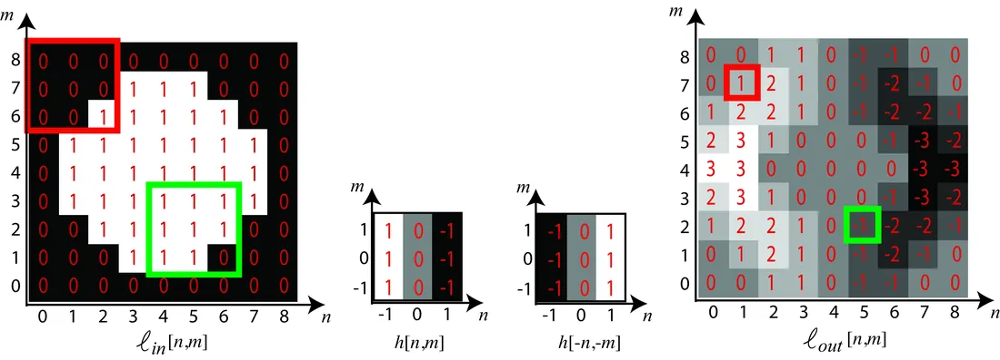
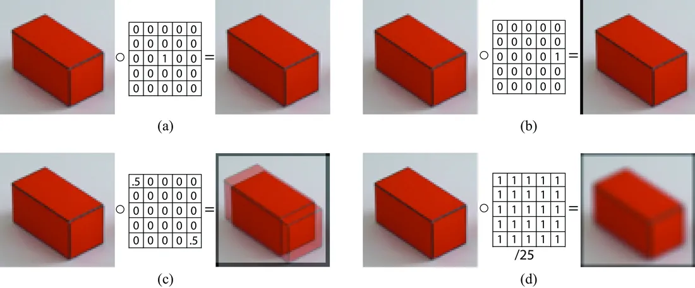
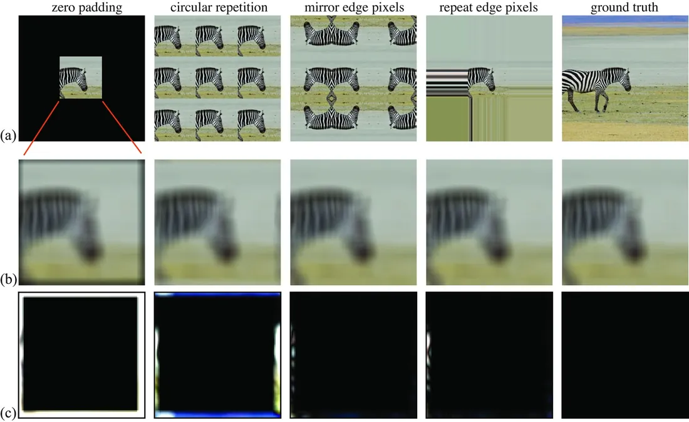
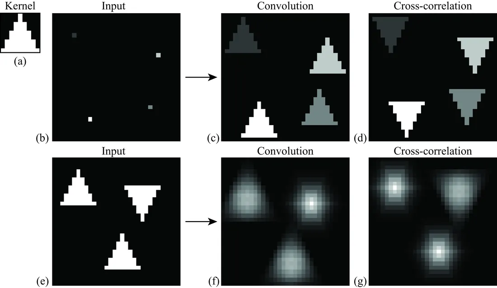
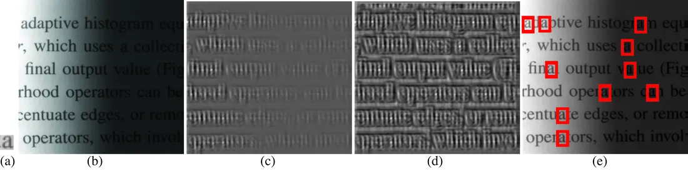

# 第 15 章 · 线性图像滤波

本页为《Foundations of Computer Vision》第 15 章的<b>学习笔记摘要</b>，由 AI 辅助整理，<b>非原文翻译</b>。原书 © 2024 Antonio Torralba、Phillip Isola、William T. Freeman，MIT Press 出版，<a href="https://visionbook.mit.edu/linear_image_filtering.html" target="_blank" rel="noopener">官网免费公开</a>，采用 <a href="https://creativecommons.org/licenses/by-nc-nd/4.0/" target="_blank" rel="noopener">CC BY-NC-ND 4.0</a> 授权。插图版权归原作者所有，此处仅作非商业学习引用。

## 本章定位

本章开启 Part IV「图像处理基础」。前几章解决了「图像如何形成、如何表示」的问题，从这里开始回答「如何对图像做最简单的数学处理」：建立信号—系统—卷积的语言，说明线性平移不变（LTI）系统为何等价于卷积、卷积有哪些好用性质、图像边界如何处理、互相关与卷积差在哪里。这些工具是后续傅里叶分析（第 16 章）、采样理论（第 20 章）以及一切滤波器与卷积神经网络设计的直接基础。

## 本篇要点

- 线性 + 平移不变 ⇒ 卷积：输出是输入与核的加权和，权重只取决于相对位置。这是全章的枢纽结论。
- 卷积六性质：交换、结合、分配、平移、支撑（长度 $L \le M+N-1$）、恒等（冲激 $\delta$ 是恒等核）。
- 边界处理没有万能答案：零填充是神经网络默认，镜像填充在经典滤波中通常误差最小（见图 15.10 的真值对比）。
- 互相关与卷积只差一个核翻转；深度框架里的「卷积」实际是互相关；归一化互相关用局部标准差归一化，实现亮度不变的模板匹配。
- 冲激响应就是 LTI 系统的核：给未知系统灌一个冲激就能测出它——房间声学是最漂亮的例子。
- 连续域卷积把求和换成积分；$\delta(t)$ 是卷积恒等元，其采样性质是第 20 章采样理论的基石。

## 关键插图

原书标注为最高优先级（三星）的核心插图，共 5 幅。

<figure class="book-fig">

<figcaption>图 15.7：输入图像与 3 × 3 核的二维卷积示例。边界像素假设输入图像外部值为零；红框与绿框显示计算对应输出像素所用到的输入像素。</figcaption>
</figure>

💡 为什么重要：这张图把「翻转核—对齐—内积」的机械步骤画得一清二楚，是手推卷积题和写实现的基准；零边界假设也在这里首次出现。

<figure class="book-fig">

<figcaption>图 15.9：(a) 冲激核与输入图像卷积，图像不变；(b) 平移的冲激核使图像平移；(c) 两个平移拷贝的叠加；(d) 用 5 × 5 窗口局部平均实现图像模糊。所有例子均用零填充处理边界条件。</figcaption>
</figure>

💡 为什么重要：四个小图分别对应恒等、平移、叠加、平均四种基本功，后面所有滤波器（高斯、Sobel、DoG 等）都是它们的组合与推广。

<figure class="book-fig">

<figcaption>图 15.10：每一行分别为：(a) 不同类型的边界扩展，最后一张图是真值（ground truth）；(b) 用 11 × 11 均匀核（元素全为 1/121）卷积后的输出，仅显示与未扩展输入图像对应的中心区域；(c) 每种输出与真值输出的差异，真值见 (b) 最后一列。注意真值在实际中无法获得。</figcaption>
</figure>

💡 **实战提示**：PyTorch/TensorFlow 的卷积层默认零填充（`padding='same'` 即补零保持尺寸）；而传统图像处理（去噪、锐化）里 `cv2.copyMakeBorder` 的镜像填充通常边缘效果更好——图 15.10 的实验正是依据。

<figure class="book-fig">

<figcaption>图 15.11：互相关与卷积。(a) 卷积核；(b)(e) 两个输入图像；(c)(f) 与核 (a) 卷积的输出；(d)(g) 与核 (a) 互相关的输出。</figcaption>
</figure>

💡 为什么重要：「卷积与互相关差一个核翻转」是面试与调试中的经典混淆点；这张图用三角核一眼讲清两者输出的朝向差异。

<figure class="book-fig">

<figcaption>图 15.12：(a) 模板；(b) 输入图像；(c) 输入 (b) 与模板 (a) 的互相关；(d) 归一化互相关；(e) 归一化互相关值超过其最大值 75% 的位置（检测框）。</figcaption>
</figure>

## 本章小结

扎实的信号处理功底对计算机视觉学者和工程师都是宝贵的背景。本章只是一个简短导论，读者可借此深入专门的信号处理教材。但还没结束——下一章将学习傅里叶变换，它为信号和图像提供有用的刻画。

- 信号经采样进入计算机：$\ell[n] = \ell(n\Delta T)$；DC 值即均值，能量即平方和；有限长信号能量有限、周期信号能量无限。
- 线性系统是一般的 $M \times N$ 权重矩阵 $\mathbf{H}$（可看作全连接层，式 15.1–15.2）；叠加上平移不变性（等变性）后，系统就唯一地变成卷积——这是本章的枢纽结论。
- 卷积六性质：交换、结合、分配、平移、支撑（$L \le M+N-1$）、恒等（$\delta$ 是恒等核）；二维卷积 = 翻转核后在图像上滑动求内积（式 15.3–15.4）。
- 边界扩展四选一：零填充（神经网络默认）、循环填充（便于解析，导出循环卷积）、镜像填充（效果最好、误差最小）、重复填充。
- 互相关与卷积只差一个核翻转：互相关不满足交换律、核不对称时结果不同；深度学习框架里的「卷积」实为互相关；归一化互相关（局部均值/方差归一化）实现亮度不变的模板匹配，但对旋转、尺度、形变脆弱。
- LTI 系统的核就是冲激响应：给未知系统灌一个冲激即可测出它（房间声学实例）；连续域把求和换成积分，$\delta(t)$ 是恒等元，其采样性质 $\int \ell(t)\delta(t-a)dt = \ell(a)$ 是采样理论的基石。

## 复习自检清单

- ☐ 能写出采样关系 $\ell[n] = \ell(n\Delta T)$，并说明圆括号/方括号的记号约定
- ☐ 能写出信号 DC 值与能量的定义，并解释为什么周期信号在整轴上能量无限
- ☐ 能写出线性系统的两条性质，并判断图 15.3 中四个变换是否线性、其中哪些能写成卷积（提示：旋转为何不是）
- ☐ 能写出一维与二维卷积的定义（式 15.3、15.4），并用「翻转—平移—相乘—求和」描述其计算过程
- ☐ 能列举卷积的六条性质，并说明为什么有限长信号下结合律会受边界条件影响
- ☐ 能比较四种边界扩展方式，解释零填充为何让图像边缘变暗、为何镜像填充误差最小
- ☐ 能区分卷积与互相关（核是否翻转、是否可交换），说明核中心对称时二者为何等价、神经网络里为何把互相关叫卷积
- ☐ 能写出归一化互相关的公式及局部均值/方差的计算，说明它如何解决普通互相关对亮度敏感的问题，以及它为什么不鲁棒

---

原文：[Linear Image Filtering](https://visionbook.mit.edu/linear_image_filtering.html)
