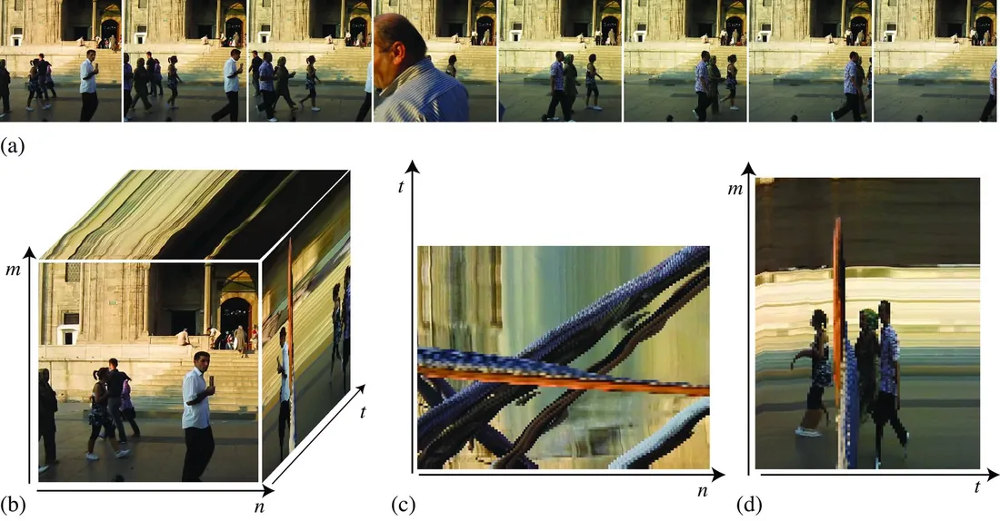
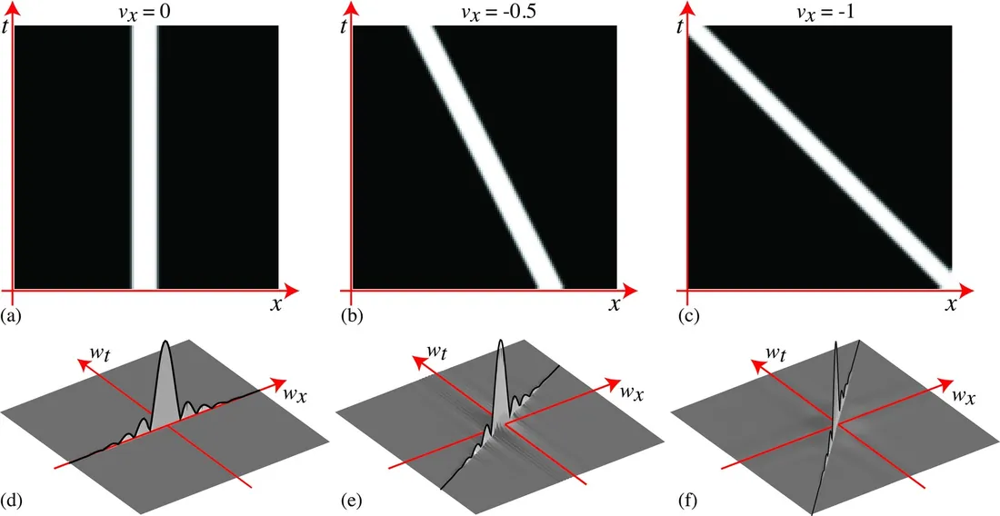
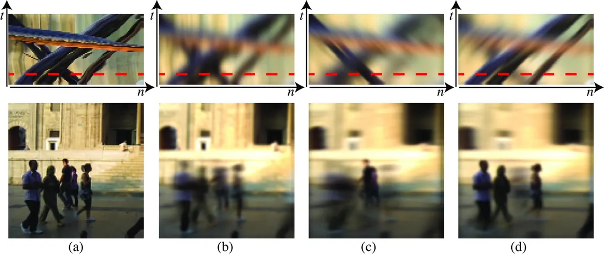
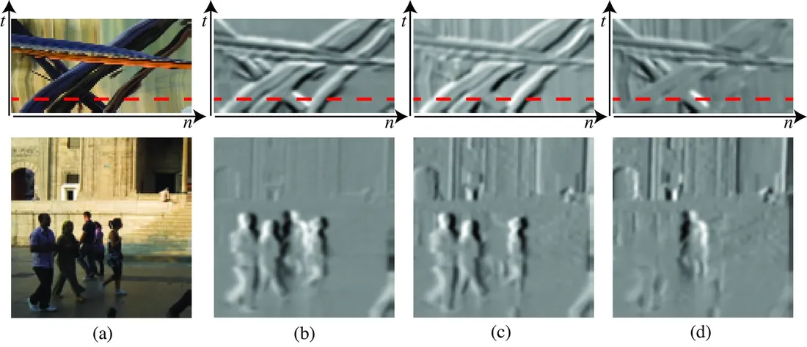

# 第 19 章 · 时域滤波器

本页为《Foundations of Computer Vision》第 19 章的<b>学习笔记摘要</b>，由 AI 辅助整理，<b>非原文翻译</b>。原书 © 2024 Antonio Torralba、Phillip Isola、William T. Freeman，MIT Press 出版，<a href="https://visionbook.mit.edu/temporal_filters_v2.html" target="_blank" rel="noopener">官网免费公开</a>，采用 <a href="https://creativecommons.org/licenses/by-nc-nd/4.0/" target="_blank" rel="noopener">CC BY-NC-ND 4.0</a> 授权。插图版权归原作者所有，此处仅作非商业学习引用。

## 本章定位

把前几章的 2D 空间滤波扩展到 3D 时空信号 $\ell[n,m,t]$（视频）。本章讨论序列的建模、时空傅里叶分析（运动在频域中表现为倾斜的「δ 墙」），以及几类时空滤波器：帧间平均（运动模糊）、时域差分（导数）与零化滤波器（nulling filter）。这里建立的匀速运动与亮度恒定假设，是后面「理解运动」部分做运动估计的出发点。

## 本篇要点

- 序列是 3D 信号，但物体的时间行为与空间行为本质不同：物体不会凭空出现/消失（除非遮挡或进出场景），而是在时间中沿连续轨迹运动、变形。
- 匀速全局运动模型 $\ell(x,y,t)=\ell_0(x-v_xt,\ y-v_yt)$；亮度恒定假设（constant brightness assumption）是大多数运动估计算法的初始假设。
- 其时空傅里叶变换是 $\mathscr{L}_0(w_x,w_y)$ 乘以一面 δ 墙：$\mathscr{L}=\mathscr{L}_0(w_x,w_y)\,\delta(w_t+v_xw_x+v_yw_y)$——速度编码在频率平面的倾斜方向上。
- 时域滤波多出一个「因果性」维度：因果滤波器只依赖过去；时域高斯是非因果的，离线处理没问题，流式处理必须截断并平移冲激响应（引入延迟）。
- 把高斯沿速度矢量倾斜 $g(x-v_xt,\ y-v_yt,\ t)$，可只让特定速度的物体保持清晰（类似追拍快门）；沿 $\nabla g\cdot(1,v_x,v_y)$ 构造的零化滤波器可精确滤除特定速度的物体。

## 关键插图

原书标注为最高优先级（三星）的核心插图，共 4 幅。

<figure class="book-fig">

<figcaption>图 19.1：(a) 行人行走序列中的 8 帧（按等时间间隔显示；完整序列共 90 帧，对应 3 秒视频）；(b) 128× 128× 90 的时空数组 ℓ[n,m,t]；(c) m=50 处的截面；(d) n=75 处的截面。静止物体呈现为直线。</figcaption>
</figure>

💡 为什么重要：这张图建立了「视频 = 时空立方体」的核心直觉——看截面（而非单帧）才能直观看到速度与遮挡结构。

<figure class="book-fig">

<figcaption>图 19.2：(a) 含一个空间维度、静止矩形脉冲的序列；(b) 矩形脉冲以 v=-0.5 像素/帧向左运动；(c) 以 v=-1 像素/帧向左运动；(d)–(f) 分别为 (a)–(c) 的傅里叶变换。由于我们处理离散化信号，速度单位为像素/帧。</figcaption>
</figure>

💡 为什么重要：这张图是「速度 = 频域倾斜方向」的唯一直观证据，运动估计的频域方法都建立在这面 δ 墙上。

<figure class="book-fig">

<figcaption>图 19.4：(a) 输入序列的一帧及时空截面（上方）；(b) 与图 19.3 (a) 高斯卷积的输出——运动物体出现运动模糊；(c) 与图 19.3 (b) 倾斜高斯卷积的输出；(d) 与图 19.3 (c) 倾斜高斯卷积的输出——特定速度物体保持清晰，类似追拍。</figcaption>
</figure>

💡 为什么重要：这一组图把「帧间平均 = 运动模糊」和「按速度倾斜 = 选择性追拍」讲透了，是视频去噪/稳像类算法的直觉来源。

<figure class="book-fig">

<figcaption>图 19.7：(a) 输入序列；(b) h 取 v_x=v_y=0 的输出；(c) v_x=1 像素/帧；(d) v_x=-1 像素/帧——不同速度的物体被分别滤除。</figcaption>
</figure>

💡 为什么重要：它证明「速度选择」可以用一个简单的线性时空核完成——这是视频分层、背景/前景分离、运动选择性滤波等算法的原型。

## 本章小结

- 视频可以看作 3D 时空信号 $\ell[n,m,t]$；与任意 3D 信号不同，物体的时间行为是连续的轨迹，遮挡才会造成出现/消失。
- 匀速全局运动由 $\ell(x,y,t)=\ell_0(x-v_xt,\ y-v_yt)$ 描述（亮度恒定假设）；其时空傅里叶变换是 δ 墙上的 sinc，速度编码在频率平面的倾斜方向上。
- 时域滤波器除低通/高通外还有「因果性」属性：因果滤波器只依赖过去；非因果滤波器（如时域高斯）离线可用，流式必须截断加平移（引入延迟）。
- 时空高斯做帧间平均会让运动物体产生运动模糊；沿速度矢量倾斜的高斯 $g(x-v_xt,\ y-v_yt,\ t)$ 只让特定速度物体保持清晰。
- 时域差分（导数）可定位运动物体；沿 $\nabla g\cdot(1,v_x,v_y)$ 构造的零化滤波器可精确滤除特定速度的物体，且对多物体、多透明层情形同样有效。
- 本章未涉及如何用这些滤波器估计速度——那是「理解运动」部分运动估计章节的任务。

## 复习自检清单

- ☐ 能写出匀速运动序列的模型 (19.1) 与亮度恒定假设，以及「静态背景 + 运动物体 + 掩模」的复合模型
- ☐ 能解释时空立方体三种截面（$t$ 恒定、$m$ 恒定、$n$ 恒定）各看到什么，为什么运动物体呈倾斜条带、静止物体呈直线条纹
- ☐ 能写出全局运动序列的傅里叶变换「δ 墙」形式，并解释速度如何体现在频率平面的倾斜方向上、为什么这不是旋转
- ☐ 能区分因果/非因果/反因果滤波器（写出 $h[n,m,t]$ 的约束条件），并说明非因果滤波器在流式处理中如何近似
- ☐ 能写出一阶 IIR 差分方程及其冲激响应 $\alpha^t u[t]$，说明稳定条件 $|\alpha|<1$
- ☐ 能写出时空高斯 (19.2) 及其可分离实现（3 个 1D 核级联），解释为什么 $\sigma_x$ 与 $\sigma_t$ 不能取同值
- ☐ 能推导零化滤波器 $h=g_t+v_xg_x+v_yg_y$（式 19.6），解释它为什么能精确滤除特定速度的物体
- ☐ 能解释倾斜高斯为什么「不是旋转」，以及它的视觉效果类似于什么拍摄手法

---

原文：[Temporal Filters](https://visionbook.mit.edu/temporal_filters_v2.html)
