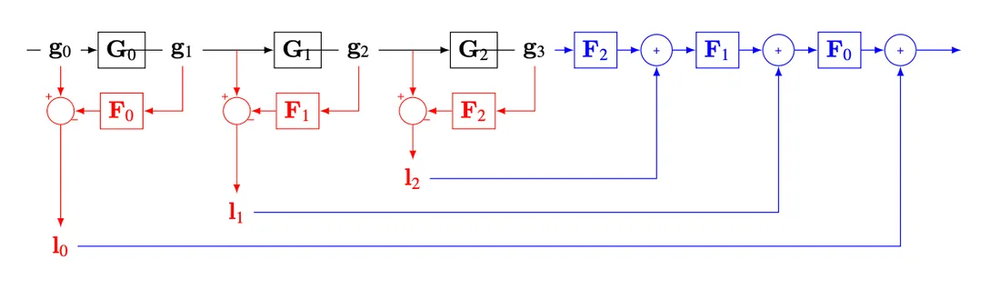
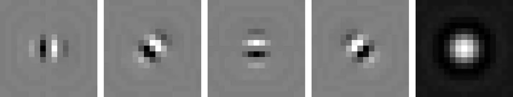
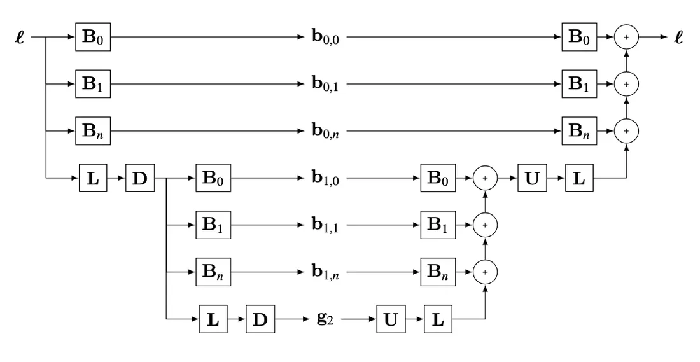
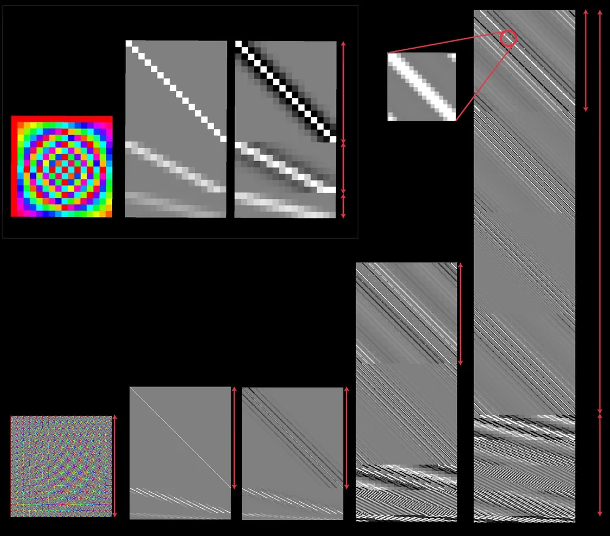

# 第 23 章 · 图像金字塔

本页为《Foundations of Computer Vision》第 23 章的<b>学习笔记摘要</b>，由 AI 辅助整理，<b>非原文翻译</b>。原书 © 2024 Antonio Torralba、Phillip Isola、William T. Freeman，MIT Press 出版，<a href="https://visionbook.mit.edu/pyramids_new_notation.html" target="_blank" rel="noopener">官网免费公开</a>，采用 <a href="https://creativecommons.org/licenses/by-nc-nd/4.0/" target="_blank" rel="noopener">CC BY-NC-ND 4.0</a> 授权。插图版权归原作者所有，此处仅作非商业学习引用。

## 本章定位

本书 Part VI「多尺度图像表示」的末章。第 22 章用滤波器组从频率与方向上分解图像；本章换一个角度——用递归下采样构造**多分辨率表示**，解决"同一算法要对付任意大小的目标"的尺度不变问题。依次讨论高斯金字塔（多分辨率）、拉普拉斯金字塔（各向同性频带分解，含经典图像融合算法）与可转向金字塔（尺度 + 方向），最后用投影矩阵的可视化统一比较。金字塔"编码器-解码器"的思想，将在第 24 章起的神经网络中反复出现。

## 本篇要点

- 尺度不变有两条路：放大模板（计算贵）或缩小图像（金字塔，高效）；模板固定、跨层匹配，即可检测不同大小的目标。
- 高斯金字塔：四阶二项式滤波器 $[1,4,6,4,1]/16$ + 步长 2 下采样，递归生成，每层分辨率减半；是过完备表示。
- 拉普拉斯金字塔：$\mathbf{l}_k = \mathbf{g}_k - \mathbf{F}_k \mathbf{g}_{k+1}$，即"本级有、下一级没有"的细节；保留低通残差即可完全重建。
- Burt-Adelson 拉普拉斯金字塔融合：两幅图与掩膜分别建塔、逐层加权合并、再重建，实现无缝过渡，至今仍是经典基线。
- 可转向金字塔：低通递归 + 多方向子带，平移不变、无混叠、可自反；非常过完备。
- 傅里叶变换是全局的；金字塔变换是局部卷积的（投影矩阵呈对角带状）。除 QMF/Haar 金字塔是完备（临界采样）表示外，其余金字塔均过完备。

## 关键插图

原书标注为最高优先级（三星）的核心插图，共 6 幅。

<figure class="book-fig">

<figcaption>图 23.3：六级高斯金字塔。第一层 g_0 是输入图像。高斯金字塔对每个颜色通道独立构建。</figcaption>
</figure>

💡 为什么重要：这是全部多尺度处理的"默认底座"——后面两种金字塔都建立在它之上，务必看清"每层减半、逐级模糊"的结构。

<figure class="book-fig">

<figcaption>图 23.4：拉普拉斯金字塔，最后是微小的低通残差。拉普拉斯金字塔对每个颜色通道独立构建。</figcaption>
</figure>

💡 为什么重要：一眼看清"每层 = 该层高斯 − 下一层高斯的放大"，即逐层剥离细节；低通残差是保证可重建的关键，别丢掉。

<figure class="book-fig">

<figcaption>图 23.5：框图展示了三层拉普拉斯金字塔的高斯金字塔（黑）、拉普拉斯金字塔（红）与拉普拉斯反变换（蓝）。</figcaption>
</figure>

💡 为什么重要：这是全书反复出现的"编码器-解码器"原型——分析网络把图像变成 l_0,l_1,... 加低通残差，合成网络再还原，先在这里把数据流看熟。

<figure class="book-fig">

<figcaption>图 23.11：可转向金字塔中使用的定向滤波器与低通核。</figcaption>
</figure>

💡 为什么重要：多方向带通核 + 配套低通核是整套表示的"硬件"；平方幅度在频域铺满（tiling）是可重建性的设计约束。

<figure class="book-fig">

<figcaption>图 23.12：可转向金字塔架构。</figcaption>
</figure>

💡 为什么重要：与图 23.5 对读——同一个"分析/合成"骨架，只是每层从 1 个低通子带换成 n 个定向子带，方向选择性从此而来。

<figure class="book-fig">

<figcaption>图 23.14：本章讨论的线性图像变换表示的可视化比较。所有变换都可视化为矩阵：行数为输入尺寸，列数为输出尺寸。除傅里叶变换外的所有变换都是卷积式的——矩阵中的对角带状结构揭示了这一点。</figcaption>
</figure>

💡 为什么重要：一张图把"局部 vs 全局、带通 vs 低通、过完备 vs 完备"全部讲完；矩阵的"高宽比"直观读出各表示的过完备程度，复习时建议以这张图为索引。

## 本章小结

简要回顾：傅里叶变换极好地揭示了图像的空间频率内容，但没有空间局部性。高斯金字塔提供图像的多尺度表示，适合把固定尺度的算法应用于一定范围的空间尺度；但它只是把图像分解成一系列低通滤波版本，没有更细的分解。该表示是过完备的，即金字塔表示中的像素多于图像本身。

拉普拉斯金字塔揭示了高斯金字塔某一空间尺度上捕获、而更高一层（更低分辨率）看不到的内容。与高斯金字塔一样，它也是过完备的；它适用于各种图像操作任务，让你能分别处理不同的空间频率带。

可转向金字塔把方向信息加入表示，该表示可以非常过完备（矩阵远高于宽）；它几乎没有混叠伪影，因此适用于各种图像分析应用。

在图像处理应用（如图像压缩、去噪等）中，人们还用过其他变换。例如 Haar/小波/QMF 金字塔 [1] 带来了有限的方向分析，且与其他金字塔表示不同，它是完备而非过完备的。这有助于图像压缩应用，但在其他方面不利，因为每个子带都依赖其他子带中的信息才能无伪影地重建原图——所以只改一个子带而不改相应的其他子带，很容易引入伪影（尽管过完备表示中也会出现伪影）。

多尺度图像分析的另一个重要框架（本书未介绍）是尺度空间（scale space），深入介绍可参阅 [4]。

## 复习自检清单

- ☐ 能写出线性变换 $\mathbf{r}=\mathbf{P}^\mathsf{T}\boldsymbol\ell$ 及其可逆条件，解释临界采样/过采样/欠采样与"完备"的含义
- ☐ 能写出 QMF 的 $4\times4$ 矩阵，验证 $\mathbf{Q}=(\mathbf{P}^\mathsf{T})^{-1}=\mathbf{P}^\mathsf{T}$（自反性）
- ☐ 能写出高斯金字塔的矩阵递推 $\mathbf{g}_{k+1}=\mathbf{G}_k\mathbf{g}_k$，说明二项式滤波器 $[1,4,6,4,1]/16$ 与步长 2 下采样的分工
- ☐ 能推导拉普拉斯金字塔系数公式 (23.1) 与重建公式 (23.2)，解释低通残差的角色及为何不可丢弃
- ☐ 能解释"重建不依赖于下采样/上采样滤波器"这一结论及其含义
- ☐ 能口述 Burt-Adelson 图像融合的四个步骤，说明为何掩膜金字塔比拉普拉斯金字塔多一层
- ☐ 能说明可转向金字塔为何能做到平移不变、无混叠、可自反（平方幅度铺满频域）
- ☐ 能比较高斯/拉普拉斯/可转向/QMF 金字塔在频率分解、方向选择性与完备性上的差异，并说明各自的适用场景

---

原文：[Image Pyramids](https://visionbook.mit.edu/pyramids_new_notation.html)
