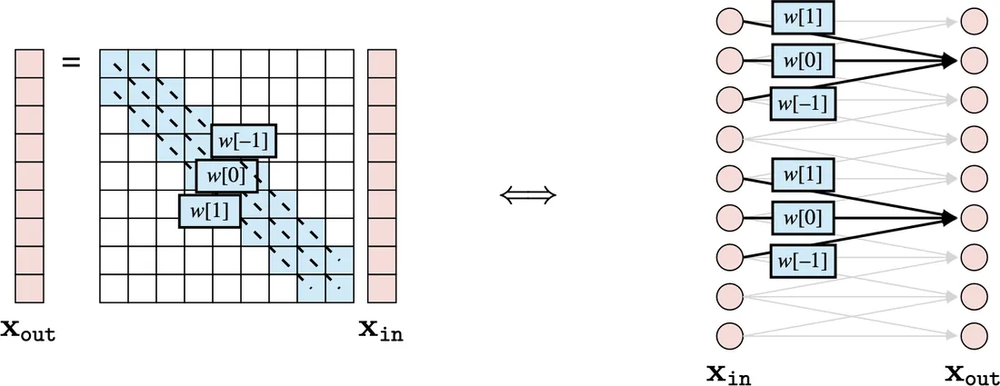
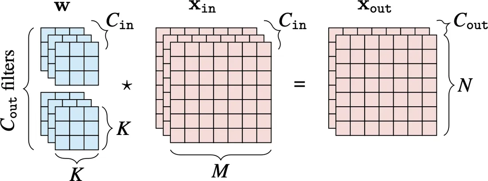
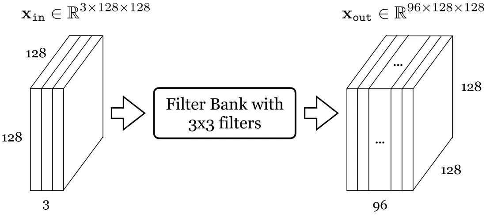
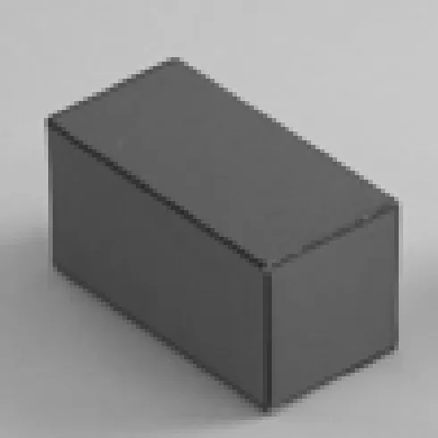
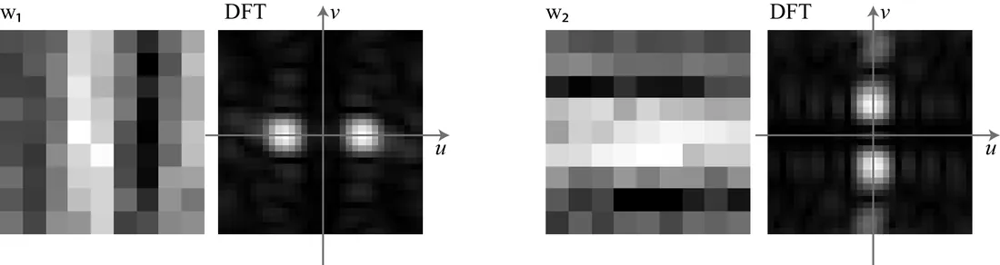
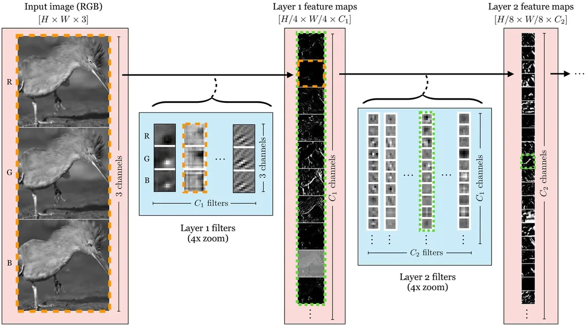
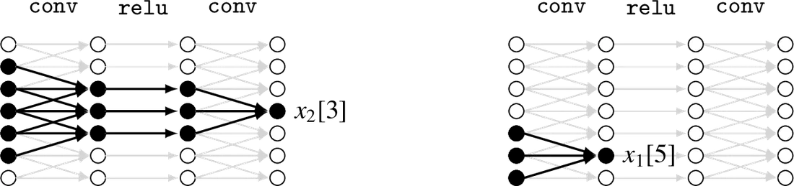
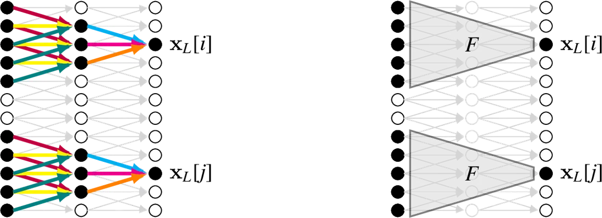
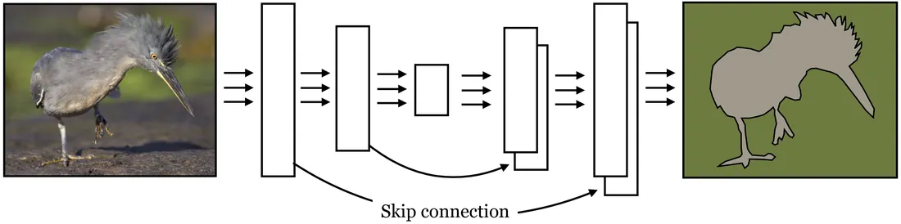

# 第 24 章 · 卷积神经网络

本页为《Foundations of Computer Vision》第 24 章的<b>学习笔记摘要</b>，由 AI 辅助整理，<b>非原文翻译</b>。原书 © 2024 Antonio Torralba、Phillip Isola、William T. Freeman，MIT Press 出版，<a href="https://visionbook.mit.edu/convolutional_neural_nets.html" target="_blank" rel="noopener">官网免费公开</a>，采用 <a href="https://creativecommons.org/licenses/by-nc-nd/4.0/" target="_blank" rel="noopener">CC BY-NC-ND 4.0</a> 授权。插图版权归原作者所有，此处仅作非商业学习引用。

## 本章定位

本章开启 Part VII「视觉神经网络架构」。第 12 章的通用神经网络把输入当作无结构向量，而视觉信号天然具有空间结构；卷积神经网络（CNN）正是把「滑动窗口 + 权重共享」这一结构先验编码进架构的模型。本章讲清 CNN 的全部基本构件——卷积层、步长/空洞卷积、池化、归一化、感受野，并用一个可完全手工分析的微型例子完整演示「训练评估 → 可视化 → 域外测试 → 对抗分析」的流程，最后给出编码器-解码器、U-Net、ResNet 等主流架构。后续的 Transformer（第 26 章）等新架构，仍沿用本章的核心原理。

## 本篇要点

- CNN 的本质：把输入切成小块（patch），对每个小块用同一个函数独立、同样地处理——整体等价于一个非线性滑动滤波器。
- 卷积层即 Toeplitz 矩阵对应的线性层；滤波器组把 $C_{\texttt{in}}$ 通道映射为 $C_{\texttt{out}}$ 个特征图，参数量与图像大小无关。
- 步长卷积/池化做下采样，空洞卷积/可分离卷积用少量参数获得大核；步长会引入混叠伪影，膨胀会改变核的频谱行为。
- 池化把卷积的平移等变转成（近似）平移不变；跨通道池化还可获得方向不变性；全局池化让每个输出覆盖全图。
- 感受野随深度与下采样快速增长，通常希望最后一层能覆盖整个输入（用 gap 层即可保证）。
- 权重共享、局部性、平移不变性，是 CNN 适用于图像的三个理由；主流架构都是这些构件的组合。

## 关键插图

原书标注为最高优先级（三星）的核心插图，共 9 幅。

<figure class="book-fig">

<figcaption>图 24.4：卷积层的两种等价可视化。</figcaption>
</figure>

💡 为什么重要：左看是 Toeplitz 矩阵乘法，右看是权重共享的网络——同一件事的两种语言。后面「等效核」「感受野合并」等全部推导都靠在两种视角间切换。

<figure class="book-fig">

<figcaption>图 24.5：多通道卷积。</figcaption>
</figure>

💡 为什么重要：这一张图把式 (24.4) 的四个维度 C_in × C_out × K × K 如何对起来讲清楚了；写错维度是搭网络时最常见的 bug。

<figure class="book-fig">

<figcaption>图 24.6：施加 3 × 3 滤波器组的卷积层。每个滤波器有多少参数？滤波器组里有多少个滤波器？来源：Jonas Wulff 制作。</figcaption>
</figure>

💡 为什么重要：这是全书少有的「带着数字查理解」的例题——答案是每个滤波器 27 个参数（3 通道 × 3×3）、滤波器组有 96 个滤波器。参数量 = C_in × C_out × K × K、与图像大小无关，务必做到脱口而出。

<figure class="book-fig">

<figcaption>图 24.8：步长卷积的结果及其傅里叶变换。</figcaption>
</figure>

💡 为什么重要：stride=2 就已经出现明显混叠（aliasing），stride=4 时部分边界直接消失。工程上做下采样前先低通滤波（如 blur-pool）就是为了压这个伪影；看 DFT 是诊断它的标准手段。

<figure class="book-fig">

<figcaption>图 24.19：学到的核的可视化。</figcaption>
</figure>

💡 为什么重要：这是「特征可视化」的标准动作——把学到的核画出来、做 DFT，一眼看出网络在用什么基函数解决问题；下一小节的对抗分析结论全靠它推出。

<figure class="book-fig">

<figcaption>图 24.24：AlexNet 中精选的特征图与滤波器。橙色虚线框的 layer 1 滤波器滑过输入图像，产生橙色虚线框的 layer 1 特征图；绿色虚线框的 layer 2 滤波器滑过 layer 1 特征图，产生绿色虚线框的 layer 2 特征图。</figcaption>
</figure>

💡 为什么重要：「浅层边缘 → 深层语义」的层次化特征可视化全部浓缩在这一张图里，是理解 CNN 表示的最经典证据。

<figure class="book-fig">

<figcaption>图 24.26：CNN 中的感受野。黑色填充的神经元在相应标注神经元的感受野内（左：x_2[3]；右：x_1[5]）。</figcaption>
</figure>

💡 为什么重要：感受野是排查「网络为什么看不到大目标/长程依赖」的第一诊断工具；务必会按核尺寸、步长、层数手算任意神经元的感受野。

<figure class="book-fig">

<figcaption>图 24.28：CNN 是一个非线性滤波器。边的颜色表示共享的权重，同色边权重相同。颜色说明同一个函数 F 被施加到每组输入节点上。</figcaption>
</figure>

💡 为什么重要：这张图是本章的「定理证明」——从此以后，任何 FCN 都可以整体当作一个（可学习的）滑动滤波器来推理：算等效核、与经典滤波器做等价替换，都有了依据。

<figure class="book-fig">

<figcaption>图 24.31：U-Net 架构。每个块包含一系列层。跳跃连接拼接激活。</figcaption>
</figure>

💡 为什么重要：U-Net 是分割、检测乃至扩散模型等现代图像到图像系统的默认骨架；「瓶颈 + 跨层拼接」的设计模式值得刻进肌肉记忆。

## 本章小结

- CNN 的本质是「分块 + 同一个函数独立同样处理」，整体等价于一个非线性滑动滤波器；输出与输入同拓扑（图像到图像）。
- 卷积层是 Toeplitz 线性层：$\mathbf{x}_{\texttt{out}} = \mathbf{w} \star \mathbf{x}_{\texttt{in}} + b$；滤波器组实现 $C_{\texttt{in}} \to C_{\texttt{out}}$ 通道映射，参数量与图像尺寸无关。
- 架构旋钮：步长（下采样，小心混叠）、空洞（大核少参数，小心频谱畸变）、可分离/SVD 分解（低秩）、池化（下采样 + 不变性）、跳跃连接（ResNet 相加、U-Net 拼接）。
- 池化把卷积的平移等变转成不变性；全局池化（gap）让每个输出神经元覆盖全图，也保证感受野覆盖整个输入。
- 分析一个网络要靠四件事：训练评估、核与特征图可视化、域外泛化测试、对抗样本构造。
- 主流架构：分类器（逐层下采样到单标签）、FCN（图像到图像）、编码器-解码器（瓶颈 + 抽象）、U-Net（保高频）、ResNet（可训练的超深网络）。

## 复习自检清单

- ☐ 能写出单通道、多通道输入、滤波器组三种情形下的卷积层公式（24.1–24.4），并说明参数量为什么与图像大小无关
- ☐ 能解释为什么深度网络里的「卷积层」实际是互相关，以及这对学习没有影响的原因
- ☐ 给定输入 $128\times128\times3$ 和 96 个 $3\times3$ 滤波器，能算出每个滤波器的参数量与输出张量形状
- ☐ 能说明步长卷积与空洞卷积的区别，并解释它们各自会引入什么伪影、为什么
- ☐ 能写出最大池化/平均池化公式，并解释池化如何把等变性变成不变性、跨通道池化如何获得方向不变性
- ☐ 能按核尺寸、步长、深度手算 CNN 中任意神经元的感受野，并说明 gap 层为什么能保证覆盖全图
- ☐ 能说明「只含卷积层与点对点非线性的网络整体等价于一个非线性滤波器」的论证过程（式 24.28 的视觉证明）
- ☐ 能复述 24.5 节微型例子的完整分析流程，并解释为什么学到的「线分类器」其实检测的是频谱能量
- ☐ 能区分编码器、解码器、编码器-解码器、U-Net、ResNet 五种架构，并各说一个典型应用

---

原文：[Convolutional Neural Nets](https://visionbook.mit.edu/convolutional_neural_nets.html)
