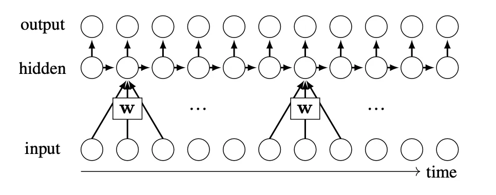
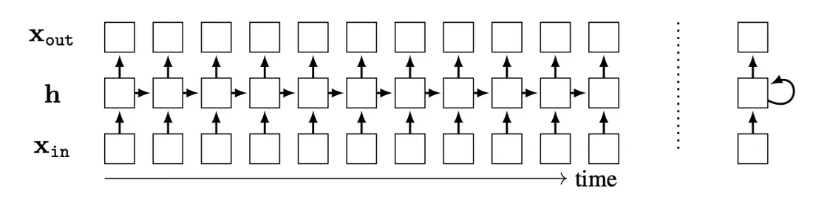

# 第 25 章 · 循环神经网络

本页为《Foundations of Computer Vision》第 25 章的<b>学习笔记摘要</b>，由 AI 辅助整理，<b>非原文翻译</b>。原书 © 2024 Antonio Torralba、Phillip Isola、William T. Freeman，MIT Press 出版，<a href="https://visionbook.mit.edu/recurrent_neural_nets.html" target="_blank" rel="noopener">官网免费公开</a>，采用 <a href="https://creativecommons.org/licenses/by-nc-nd/4.0/" target="_blank" rel="noopener">CC BY-NC-ND 4.0</a> 授权。插图版权归原作者所有，此处仅作非商业学习引用。

## 本章定位

全书 Part III「深度学习」中面向**序列数据**的一章。前面的卷积网络（第 23 章）利用空间局部性做并行处理，适合图像；本章引入反馈连接与「时间步」概念，让网络能把过去的信息带到未来，从而处理视频、逐像素/逐帧推进的序列任务。LSTM 是此后多年序列建模的主力，也是第 26 章 Transformer 的对照物——后者正是用并行注意力接替循环结构的继任者。

## 本篇要点

- RNN = 带反馈连接的计算图：上一时刻的隐藏状态 $\mathbf{h}_{t-1}$ 参与当前时刻的计算，由此形成「记忆」。
- 循环层由两个方程定义：状态更新 $\mathbf{h}_t=f(\mathbf{h}_{t-1},\mathbf{x}_{\texttt{in}}[t])$ 与输出 $\mathbf{x}_{\texttt{out}}[t]=g(\mathbf{h}_t)$；SRN（Elman 提出）是最常见的形式。
- 训练用通过时间的反向传播（BPTT）：把 RNN 沿时间展开成 DAG 后套用普通反向传播；截断到 $T$ 步时得到的是近似梯度。
- 梯度是长度 $\mathcal{O}(T)$ 的矩阵连乘，导致梯度爆炸/消失；最坏情形（全激活）下梯度正比于 $\mathbf{W}^{T}$。
- LSTM 用细胞状态 $\mathbf{c}$ 加遗忘门/输入门/输出门，把「默认不忘记」变成可能（恒等通路），从而缓解梯度问题。

## 关键插图

原书标注为最高优先级（三星）的核心插图，共 2 幅。

<figure class="book-fig">

<figcaption>图 25.2：带一个隐藏层的基础 RNN。</figcaption>
</figure>

💡 为什么重要：这是全书 recurrent 结构的「母图」——后面所有循环层、BPTT、LSTM 都是在这张图上加细节。

<figure class="book-fig">

<figcaption>图 25.3：具有多维输入、隐藏状态和输出的 RNN。左侧为展开计算图，右侧为卷起的计算图。</figcaption>
</figure>

💡 为什么重要：把循环「展开成时间轴上的 DAG」是 BPTT 的前提，也是把 RNN 理解为「跨时间共享参数的深网」的关键视角。

## 本章小结

- 循环连接赋予神经网络维持持久状态表示的能力：该状态可以沿时间向前传播，也可以在新经验到来时被更新。
- 同一思想在多个领域被独立提出：控制论中就是开环控制与闭环控制的根本区别——闭环控制让控制器根据先前决策后果的反馈改变行为；类似地，循环连接让神经网络根据同一网络内下游处理的反馈改变行为（反馈来自网络内部，而非外部环境）。
- 反馈是构造**自适应系统**的基本机制：这类系统运行得越久，就变得越强。

## 复习自检清单

- ☐ 能写出循环层的两个定义方程，并解释状态 $\mathbf{h}$ 为什么是「记忆」
- ☐ 能解释 RNN 为什么图灵完备，以及展开图与折叠图的区别和各自用途
- ☐ 能写出 SRN 的前向方程，说明 $f$、$g$ 一般可以是什么函数
- ☐ 能说明 BPTT 的做法，以及为什么截断到 $T$ 步只是近似梯度
- ☐ 能推出 $\frac{\partial \mathbf{x}_{\texttt{out}}[t]}{\partial \mathbf{x}_{\texttt{in}}[0]}$ 的链式乘积形式，并解释最坏情形下 $\mathbf{W}^{T}$ 导致的爆炸/消失
- ☐ 能写出 LSTM 三个门的方程和细胞状态更新式，说明 $\odot$ 逐点乘法在其中的作用
- ☐ 能解释 LSTM 的恒等通路为什么能缓解梯度消失，以及它与 ResNet 残差连接的联系

---

原文：[Recurrent Neural Nets](https://visionbook.mit.edu/recurrent_neural_nets.html)
