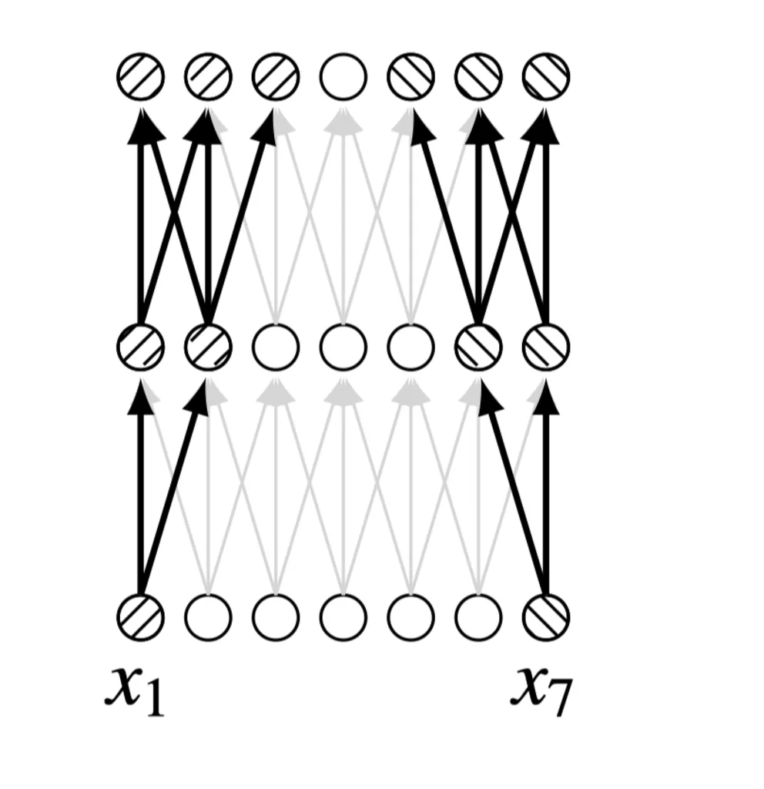
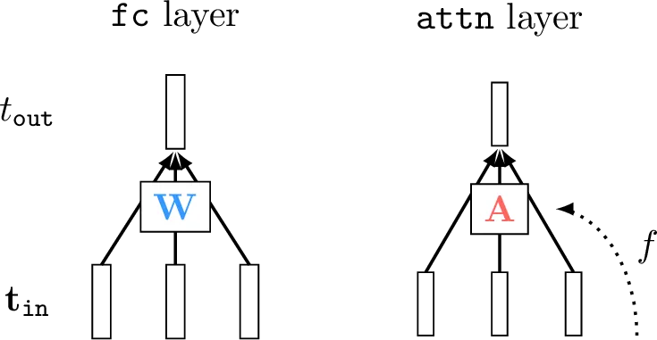
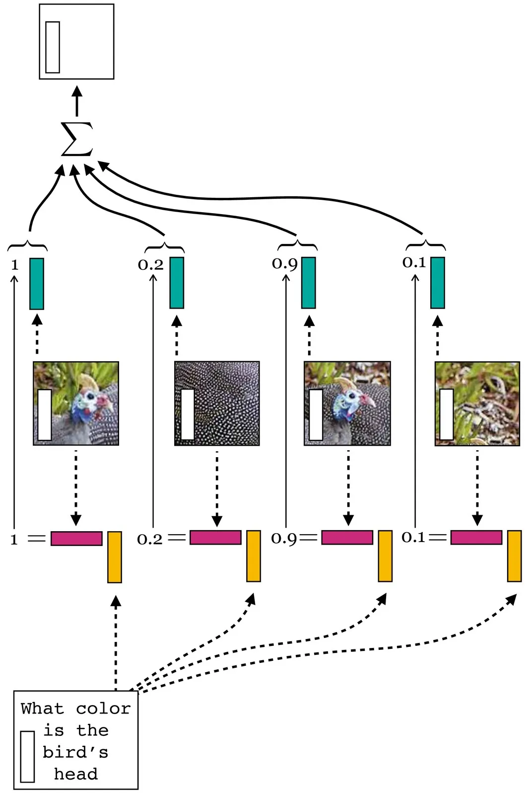
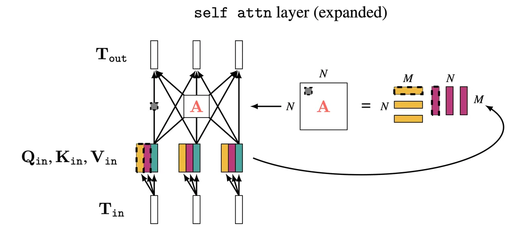
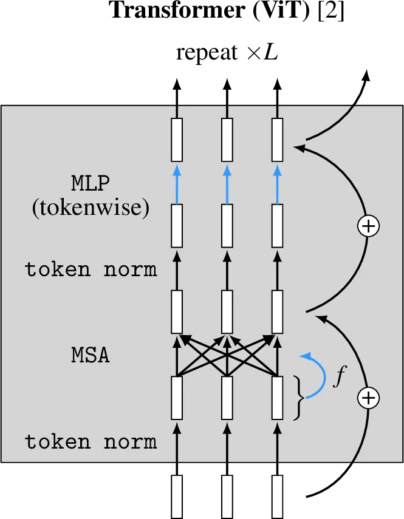
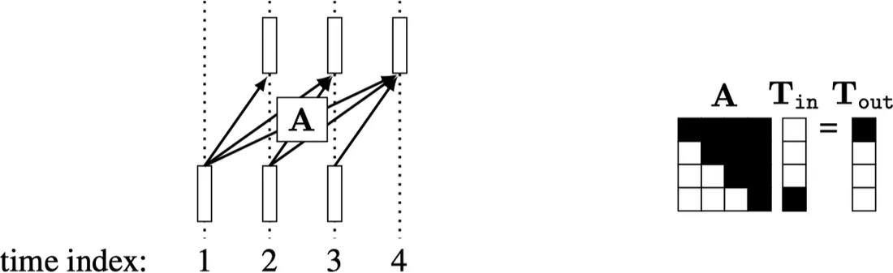
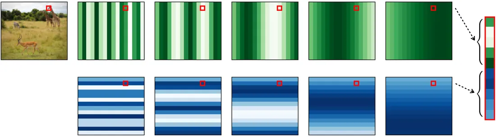

# 第 26 章 · Transformer

本页为《Foundations of Computer Vision》第 26 章的<b>学习笔记摘要</b>，由 AI 辅助整理，<b>非原文翻译</b>。原书 © 2024 Antonio Torralba、Phillip Isola、William T. Freeman，MIT Press 出版，<a href="https://visionbook.mit.edu/transformers.html" target="_blank" rel="noopener">官网免费公开</a>，采用 <a href="https://creativecommons.org/licenses/by-nc-nd/4.0/" target="_blank" rel="noopener">CC BY-NC-ND 4.0</a> 授权。插图版权归原作者所有，此处仅作非商业学习引用。

## 本章定位

全书深度学习部分的收官架构。第 25 章的 RNN 用循环连接处理序列，但串行计算慢且难以并行；本章的 Transformer 用「token + 注意力」把序列建模变成并行计算。它是 CNN（第 23 章）思想的推广：既保留「切成小块、独立同构处理」的分块范式，又新增跨块混合信息的注意力层。如今 Transformer 是计算机视觉乃至人工智能大多数领域的主导架构，也可视为图神经网络（GNN）的特例。

## 本篇要点

- Transformer 把信号切成 patch 并表示为 **token**（内部是一个向量的信息组）；两类核心操作是 token 的加权混合与逐 token 非线性变换。
- 注意力层 = 数据依赖的全连接层：权重矩阵 $\mathbf{A}$ 由输入数据算出而非自由参数，$\mathbf{T}_{\texttt{out}}=\mathbf{A}\mathbf{T}_{\texttt{in}}$。
- 自注意力：所有 token 既做查询方也做被匹配方；$\mathbf{A}=\texttt{softmax}(\mathbf{Q}\mathbf{K}^\mathsf{T}/\sqrt{m})$，$\mathbf{T}_{\texttt{out}}=\mathbf{A}\mathbf{V}$，其中 Q/K/V 是 token 的线性投影。
- 多头自注意力（MSA）并行运行 $k$ 个注意力头，拼接后投影回 $d$ 维，使网络可同时按颜色、纹理、形状等多种方式度量相似性。
- Transformer 对输入 token 的排列是**置换等变**的，因此图像等有空间结构的数据必须外加**位置编码**。
- 大部分 Transformer 层都能写成卷积（核大小 1）；与 CNN 的真正区别在注意力层的全局混合能力。

## 关键插图

原书标注为最高优先级（三星）的核心插图，共 7 幅。

<figure class="book-fig">

<figcaption>图 26.1：考虑一个核大小为 3 的 2 层 CNN，要求比较 x_1 与 x_7。它做不到：没有神经元同时连接到 x_1 和 x_7。斜线标记分别指出与 x_1 和 x_7 相连的神经元。</figcaption>
</figure>

💡 为什么重要：这张图是整章的存在理由——「卷积只看感受野」的短视问题，直接引出全局混合层（注意力）的设计动机。

<figure class="book-fig">

<figcaption>图 26.6：全连接层与注意力层对比。</figcaption>
</figure>

💡 为什么重要：「权重本身是数据的函数」这一句话区分了注意力与前几章所有层，是 Transformer 全部表达力的来源。

<figure class="book-fig">

<figcaption>图 26.8：注意力层的工作机制。来自问题的查询与表示 impala 的 token 的键匹配；impala token 的值向量对求和贡献最大，得到 t_out 的码向量。（本例省略 softmax。）</figcaption>
</figure>

💡 为什么重要：这是「数据库类比」的计算图落地——q·k 打分、softmax 归一、对 v 加权求和，三步必须能在脑子里逐框走完。

<figure class="book-fig">

<figcaption>图 26.10：自注意力层展开。虚线框出的节点互相对应，表示一个查询与一个键匹配得到标量相似度值（灰框中），该值在 A 计算的加权和中作为权重。</figcaption>
</figure>

💡 为什么重要：这张 QKV 计算图是把式 26.5/26.6 落成代码的蓝图——每个框架的 `F.scaled_dot_product_attention` 内部就是这张图。

<figure class="book-fig">

<figcaption>图 26.14：ViT Transformer 架构。这组层构成一个计算块（灰色阴影），可重复 L 次得到深度为 L 的 ViT。为标明参数所在，所有带可学习参数的边涂成蓝色（注意 MSA 的合并矩阵也是可学习的，但未在图中显式画出）。</figcaption>
</figure>

💡 为什么重要：这是工程上最常用的 Transformer 蓝图——token norm → MSA → 残差 → token norm → tokenwise MLP → 残差，重复 L 次。读代码、改模型都对照这张图。

<figure class="book-fig">

<figcaption>图 26.18：掩码注意力一次做出多个因果预测。黑色单元被掩码（填零）。</figcaption>
</figure>

💡 为什么重要：这个下三角矩阵是所有自回归生成（GPT 式训练）的效率核心——训练时一次矩阵乘监督全部前缀，推理时才逐 token 生成。

<figure class="book-fig">

<figcaption>图 26.20：位置码。</figcaption>
</figure>

💡 为什么重要：没有位置码，ViT 连「天空在上、草地在下」都不知道；多尺度正弦波让模型能同时表示粗位置与细位置。

## 本章小结

- 截至目前，Transformer 是计算机视觉乃至人工智能大多数领域的主导架构。
- 它们融合了早期架构的诸多精华——卷积式的逐块处理、残差连接、relu 非线性、归一化层——与若干新创新：向量值 token、注意力层、位置码。
- Transformer 也可视为**图神经网络**（graph neural network，GNN）的特例。本书不为 GNN 单设一章，因为除 Transformer 外，GNN 在计算机视觉尚未流行。GNN 是非常一般化的架构类别，用于在集合上构造操作图来处理集合。Transformer 正是如此：取一组输入 token，逐层在这组 token 上施加变换网络，足够多层后读出最终表示或预测。

## 复习自检清单

- ☐ 能解释 CNN 为什么难以全局化信息（图 26.1），以及全连接层为什么不是好答案
- ☐ 能写出 token 线性组合与 token 全连接层的方程（26.1/26.2），说明 token 与神经元的区别
- ☐ 能写出单 token 的 q/k/v 投影、softmax 加权和（26.3/26.4），并解释「数据库」类比
- ☐ 能推出自注意力的矩阵形式 $\mathbf{A}=\texttt{softmax}(\mathbf{Q}\mathbf{K}^\mathsf{T}/\sqrt{m})$、$\mathbf{T}_{\texttt{out}}=\mathbf{A}\mathbf{V}$（26.5/26.6），并说明 Q/K/V 三个矩阵的维度约束
- ☐ 能写出 $s_{ij}=\mathbf{t}_i^\mathsf{T}\mathbf{S}\mathbf{t}_j$（$\mathbf{S}=\mathbf{W}_q^\mathsf{T}\mathbf{W}_k$），解释单头为何只以一种方式度量相似性
- ☐ 能写出 MSA 的拼接-投影方程（26.7），说明为什么值向量可以换成别的维度
- ☐ 能描述 ViT 一个 block 的结构（token norm → MSA → 残差 → token norm → tokenwise MLP → 残差），并说出输出如何转成分类 logits
- ☐ 能解释置换等变性（26.8）及其后果：为什么视觉任务必须加位置编码
- ☐ 能把 token 化、QKV 投影、tokenwise MLP 分别写成等价的卷积（核 $K$ / 核 1 / 核 1）
- ☐ 能解释因果掩码为什么能用一次矩阵乘完成 $N$ 个「下一 token」预测

---

原文：[Transformers](https://visionbook.mit.edu/transformers.html)
