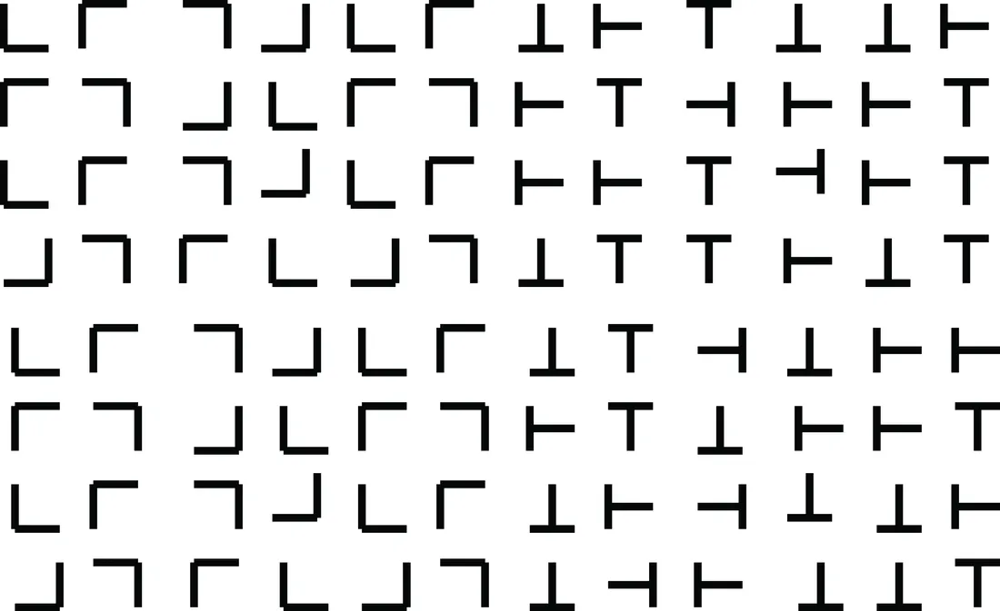
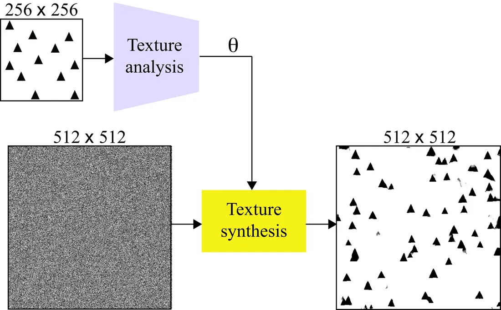
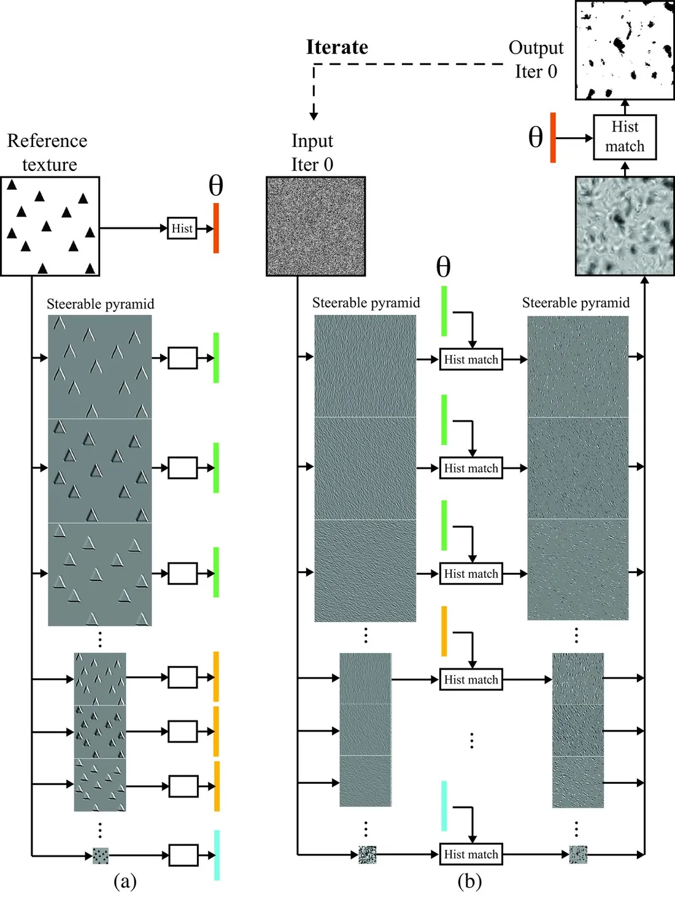
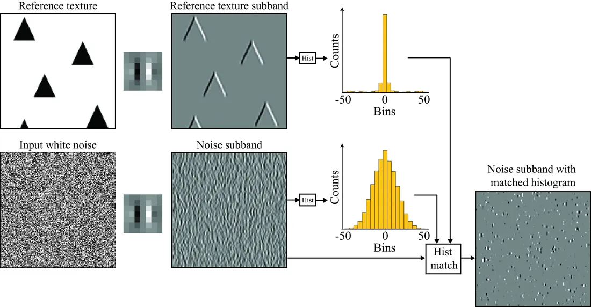

# 第 28 章 · 纹理

本页为《Foundations of Computer Vision》第 28 章的<b>学习笔记摘要</b>，由 AI 辅助整理，<b>非原文翻译</b>。原书 © 2024 Antonio Torralba、Phillip Isola、William T. Freeman，MIT Press 出版，<a href="https://visionbook.mit.edu/textures.html" target="_blank" rel="noopener">官网免费公开</a>，采用 <a href="https://creativecommons.org/licenses/by-nc-nd/4.0/" target="_blank" rel="noopener">CC BY-NC-ND 4.0</a> 授权。插图版权归原作者所有，此处仅作非商业学习引用。

## 本章定位

本章进入全书后段的纹理与统计图像模型部分，是第 27 章（基于马尔可夫随机场的统计图像模型）的延续，又为第 32-33 章的深度生成模型埋下伏笔。要回答的问题是：如何表示「材料」——木头、草地、砖墙——这类没有清晰物体边界的 stuff？本章以纹理分析（texture analysis）与纹理合成（texture synthesis）为双线载体，先借人类感知实验建立直觉，再精讲两个经典模型（Heeger-Bergen、Efros-Leung），它们正是现代纹理生成与风格迁移的思想源头。

## 本篇要点

- 纹理表示只保存构成元素的统计信息，不保存单个元素本身——这是纹理区别于「物体」的本质。
- 人类视觉天生是统计的：超过 4-5 个元素就被当作「集合」处理（subitizing 的极限、拥挤效应），且能前注意地（pre-attentively）判别纹理差异。
- Julesz 提出纹理由纹理基元（textons）之间的统计关系决定；滤波器组（filter bank）响应统计能解释大量前注意判别实验，是 Heeger-Bergen 的直接先声。
- Heeger-Bergen：用可操纵金字塔的子带直方图作为参数 $\theta$，合成时反复做「直方图匹配」把白噪声逼成纹理；不捕获跨尺度相关，大尺度结构差。
- Efros-Leung：非参数 MRF，「表示」就是参考图像本身；按扫描序为每个像素在参考图中找最相似邻域、随机拷贝一个像素值。邻域窗口是核心权衡：越大越保结构，但越容易重复。
- 本章两个模型分别是自回归模型、扩散模型/GAN 的思想原型；纹理建模 = 对 patch 分布建模，生成建模 = 对整图分布建模。

## 关键插图

原书标注为最高优先级（三星）的核心插图，共 4 幅。

<figure class="book-fig">

<figcaption>图 28.4：使用纹理基元（textons）的纹理判别。</figcaption>
</figure>

💡 为什么重要：这张图直观展示了前注意纹理判别——不费吹灰之力就能看出两块纹理之间的边界，这正是任何纹理表示都必须解释的核心现象。

<figure class="book-fig">

<figcaption>图 28.5：参考纹理图像经纹理分析（编码器）转换为一种表示；纹理合成过程以一张目标输出尺寸的随机噪声图像和参考图像的参数 θ 为输入。</figcaption>
</figure>

💡 为什么重要：这是全章的框架图——纹理表示 θ 是连接分析与合成的桥梁；本章及后续所有生成模型，都是对「θ 应该是什么」的不同回答。

<figure class="book-fig">

<figcaption>图 28.7：(a) 用 6 方向 3 尺度可操纵金字塔做纹理分析（编码器）。输出表示为 18 个子带直方图、低通残差直方图与输入图像直方图的拼接。(b) 纹理合成，图中仅示一步迭代。每次迭代把输出放回输入端，重复 N 次。该图对应图 28.6 中函数 f_θ 的实现。</figcaption>
</figure>

💡 为什么重要：这是 Heeger-Bergen 的核心架构图——分析端提取哪些统计量、合成端如何施加约束，全在这张图里。

<figure class="book-fig">

<figcaption>图 28.8：对其中一个子带做直方图匹配。对所有子带独立执行同样的操作。</figcaption>
</figure>

💡 为什么重要：一眼看清「直方图匹配」到底做了什么——把高斯分布的子带系数逐点重映射成参考纹理的拉普拉斯形状分布；整个算法的全部机制就在这一张图里。

## 本章小结

- 纹理表示的本质：保存构成元素的统计量，不保存单个元素；人类视觉正是这样处理纹理的（集合感知、拥挤效应、前注意判别）。
- 前注意纹理判别是纹理表示的试金石：Julesz 的纹理基元统计关系，与能解释大量判别实验的滤波器组响应统计（Heeger-Bergen 的先声）。
- Heeger-Bergen：$\theta$ = 可操纵金字塔子带直方图 + 低通残差直方图 + 像素直方图；合成 = 在像素域/子带域反复做直方图匹配的迭代优化。缺陷：不捕获跨尺度相关，大尺度结构差。
- Efros-Leung：$\theta$ = 参考图像本身（非参数 MRF）；合成 = 按扫描序为每个像素在参考图中找最相似邻域并随机拷贝。核心权衡：邻域窗口增大 → 结构保真度提高、重复也增多。
- 参数化模型（约 1000 维）流行至 2000 年，随后非参数模型主流化，2014 年后神经网络生成模型登场；本章两个模型分别是自回归模型与扩散模型/GAN 的思想原型。
- 一句话：纹理建模 = 对 patch 分布建模，生成建模 = 对整图分布建模。

## 复习自检清单

- ☐ 能解释「纹理表示只含统计信息」的含义，并举一个本章的人类感知实验佐证
- ☐ 能区分即刻数数（subitizing）与逐个计数，说出各自适用的元素数量范围
- ☐ 能解释拥挤效应为什么不能归因于周边视觉分辨率下降
- ☐ 能说出 Julesz 的纹理基元（textons）是什么、弱点是什么，以及滤波器组方法如何取而代之
- ☐ 能写出 Heeger-Bergen 的纹理表示 $\theta$ 由哪些直方图组成，并描述一步合成迭代中的两类直方图匹配
- ☐ 能解释为什么白噪声子带经直方图匹配后会变稀疏
- ☐ 能描述 Efros-Leung 的单像素合成步骤，并解释邻域窗口大小带来的「结构保真 vs 元素重复」权衡
- ☐ 能说出本章两个模型分别对应哪类现代生成模型（自回归 / 扩散 / GAN）

---

原文：[Textures](https://visionbook.mit.edu/textures.html)
