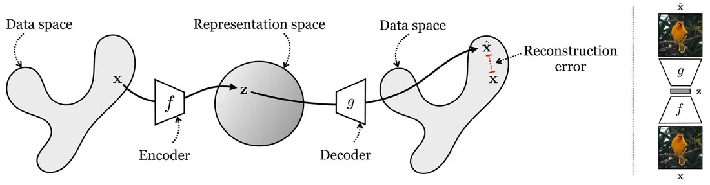
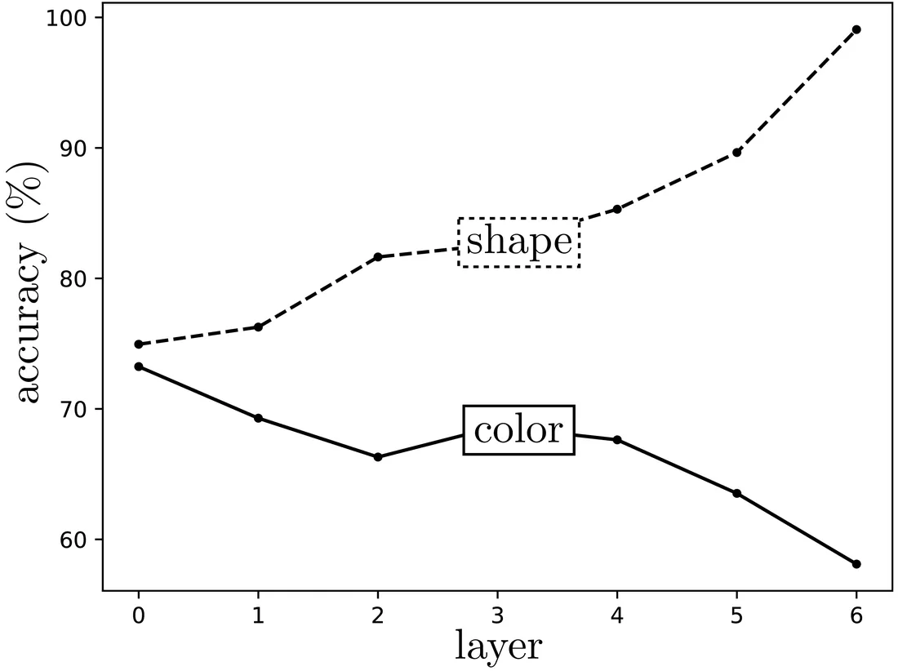
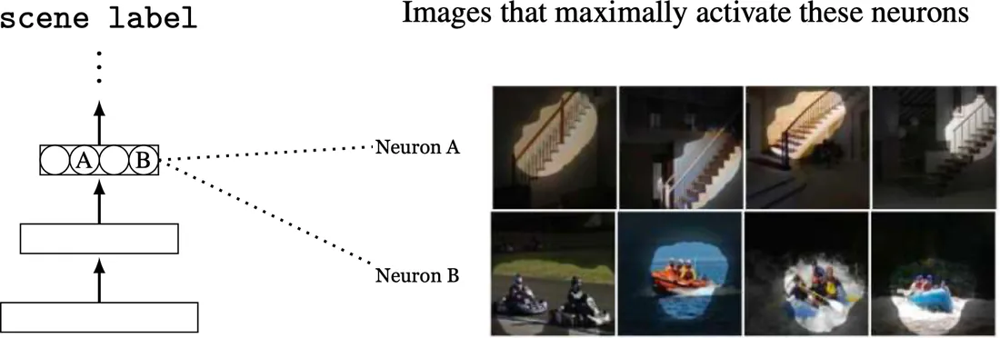
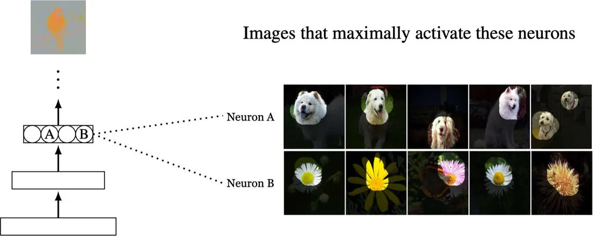
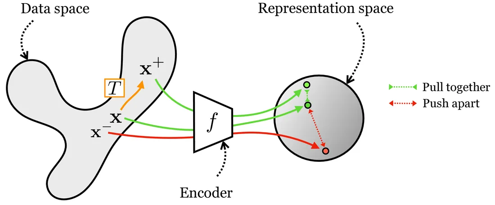
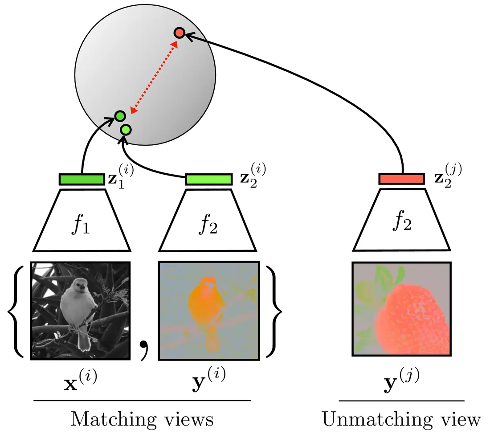
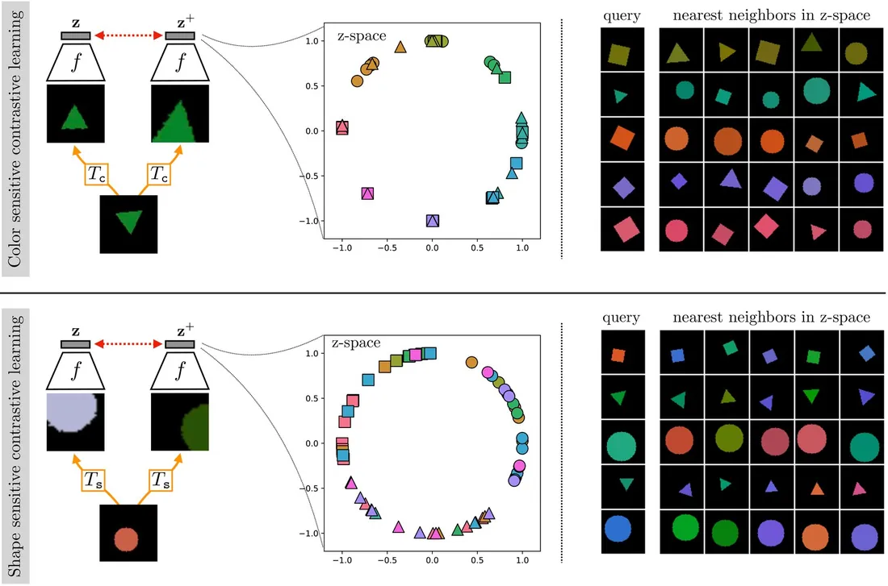

# 第 30 章 · 表示学习

本页为《Foundations of Computer Vision》第 30 章的<b>学习笔记摘要</b>，由 AI 辅助整理，<b>非原文翻译</b>。原书 © 2024 Antonio Torralba、Phillip Isola、William T. Freeman，MIT Press 出版，<a href="https://visionbook.mit.edu/representation_learning.html" target="_blank" rel="noopener">官网免费公开</a>，采用 <a href="https://creativecommons.org/licenses/by-nc-nd/4.0/" target="_blank" rel="noopener">CC BY-NC-ND 4.0</a> 授权。插图版权归原作者所有，此处仅作非商业学习引用。

## 本章定位

本章开启 Part IX「生成模型与表示学习」。此前各部分建立了图像形成、特征、识别与几何的完整工具链，但表示大多靠人工设计或任务监督；本章第一次把「表示本身的质量」当作优化目标，围绕压缩与预测两大原则，组织自编码器、预测式/自监督学习、聚类、对比学习四类方法。这些概念也是后续生成模型（GMM、VAE 等）章节的接口。

## 本篇要点

- 好表示的两大核心标准：压缩（低维、简单、把干扰因素挡在门外）与可预测性（好表示是预测世界属性的基底）；解耦、可解释、可执行等目标与之重叠而非对立。
- 自编码器用「编码—瓶颈—解码重建」实现压缩，线性时等价于 PCA；L2 损失只逐像素惩罚，重建偏模糊。
- 预测式/自监督学习把预测当作借口任务（pretext task）：预测未来帧、下一像素、旋转角度、相对位置、语义类别等——要的不是任务本身，而是副产品编码器；物体检测器会从场景分类、上色等任务中涌现。
- 聚类是离散化的压缩：K-Means = 离散瓶颈的自编码器，用块坐标下降（分配 ↔ 更新均值）优化，也是 GMM 的朴素版。
- 对比学习用「正样本对齐 + 负样本推开」显式监督不变性；只用对齐会表示坍缩；三大代表损失是 Hadsell 对比损失、三元组损失、InfoNCE。
- 没有普遍最好的表示：自编码器越深越抽象（擅长形状、不擅长颜色），用哪一层应由任务探针实测决定。

## 关键插图

原书标注为最高优先级（三星）的核心插图，共 7 幅。

<figure class="book-fig">

<figcaption>图 30.2：(左) 自编码器把数据空间中的点映射到表示空间中的点，再映射回来。(右) 在一张鸟类图像上运行自编码器的例子。</figcaption>
</figure>

💡 为什么重要：这是全书后续一切「编码器—解码器」结构的原型；看懂左图「数据空间 → 表示空间 → 数据空间」的环路，就理解了自编码器乃至后续 VAE、CycleGAN 的共同骨架。

<figure class="book-fig">

<figcaption>图 30.5 (b)：在自编码器编码器各层嵌入上，1-最近邻颜色分类器（8 类）与形状分类器（圆/三角/方）的准确率。</figcaption>
</figure>

💡 为什么重要：它给出全书最重要的实验直觉之一——不存在普遍最好的表示：颜色在原始像素上最分明，形状则越深越清楚。由此应养成「用探针实测选层」的工程习惯，而不是默认越深越好。

<figure class="book-fig">

<figcaption>图 30.7：场景分类神经网络中两个神经感受野的可视化。图像取自 [15]。</figcaption>
</figure>

💡 为什么重要：「只用场景分类监督，隐藏层就涌现出物体检测器」是表示学习领域的标志性发现，说明了借口任务的副产品比任务本身更有价值。

<figure class="book-fig">

<figcaption>图 30.9：[19] 的着色模型中两个神经感受野的可视化。图像由 Andrew Owens 和 Richard Zhang 生成。</figcaption>
</figure>

💡 为什么重要：与图 30.7 对照：上色这种看似低层的任务也涌现出物体检测器，暗示「物体」是世界的内在结构，而非人类感知的怪癖。

<figure class="book-fig">

<figcaption>图 30.12：对比学习：拉近正样本对、推远负样本对。</figcaption>
</figure>

💡 为什么重要：这是对比学习的总框架图；后面所有具体损失（Hadsell 对比损失、三元组损失、InfoNCE）都是这张图的实例化。

<figure class="book-fig">

<figcaption>图 30.13：从数据的多个视图进行对比学习（图中为灰度/彩色两个共现视图）。图受 Tian et al. (2020) 启发。</figcaption>
</figure>

💡 为什么重要：它把对比学习从「变换不变性」推广到「多视图共现」（彩色/灰度、图像/声音），是跨模态表示学习的标准建模范式。

<figure class="book-fig">

<figcaption>图 30.14：在彩色形状数据上，用两种不同变换构造正样本对的对比学习。变换的选择决定了嵌入对哪些特征敏感、对哪些特征不变。</figcaption>
</figure>

💡 为什么重要：嵌入空间的直接可视化：颜色类与形状类分别均匀铺在单位圆上——「变换的选择决定不变性」这一核心思想一张图讲完。

## 本章小结

- 表示学习把「什么是好表示」落到目标函数上：两大核心原则是**压缩**（低维、简单、把干扰因素挡在门外）与**预测**（好表示是预测世界属性的基底）；解耦、可解释、可执行等目标与之重叠而非对立。
- 自编码器 = 编码器 + 瓶颈 + 解码器，最小化重建误差 (30.1)；$f$、$g$ 均为线性时等价于 PCA；$L_2$ 损失只逐像素惩罚，重建偏模糊，可换惩罚高阶统计的损失 [8]。
- 预测式/自监督学习用借口任务（未来帧、下一像素、旋转、相对位置、语义类别）训练编码器；有价值的是副产品 $\mathbf{z}$——物体检测器会从场景分类、上色等任务中涌现。
- 聚类是离散化的压缩：K-Means = 有离散瓶颈的自编码器，用块坐标下降（分配 ↔ 更新均值，(30.2)(30.3)）优化；它与自编码器、GMM、VAE 构成一张关系网。
- 对比学习用正样本对齐 + 负样本推开显式监督不变性；只用对齐损失会导致表示坍缩；三大代表损失为 Hadsell 对比损失、三元组损失、InfoNCE (30.4)。
- InfoNCE 型对比损失产生对齐 + 均匀性；嵌入必须 $L_2$ 归一化，否则均匀性项失效，归一化嵌入趋向超球面上的均匀分布。
- 没有普遍最好的表示：自编码器越深越抽象（擅长形状、不擅长颜色）；用哪一层/哪种表示应由任务探针实测决定。

## 复习自检清单

- ☐ 能解释「压缩」作为好表示标准的三层含义，并说出最小描述长度原则与奥卡姆剃刀的关系
- ☐ 能写出自编码器的组成与学习目标 (30.1)，并解释 $L_2$ 重建损失为什么只惩罚逐像素误差
- ☐ 能复述图 30.5 探针实验的结论（颜色在原始像素上最好、形状随深度变好）及其工程含义
- ☐ 能区分预测式学习、自监督学习、插补三者的关系，并各举一个本章中的例子
- ☐ 能推导 K-Means 的两个更新式 (30.2)(30.3)，并解释为什么它像「离散瓶颈的自编码器」
- ☐ 能写出对比学习正/负样本对的构造方式，并解释只用对齐损失为什么导致表示坍缩
- ☐ 能写出 Hadsell 对比损失、三元组损失、InfoNCE (30.4)，并说明 margin 与温度 $\tau$ 的作用
- ☐ 能解释 alignment 与 uniformity 各自的来源，以及为什么嵌入必须 $L_2$ 归一化

---

原文：[Representation Learning](https://visionbook.mit.edu/representation_learning.html)
