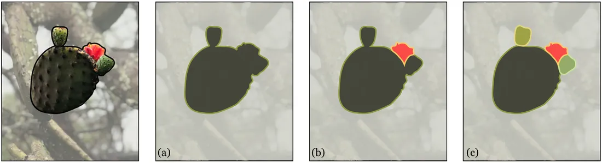
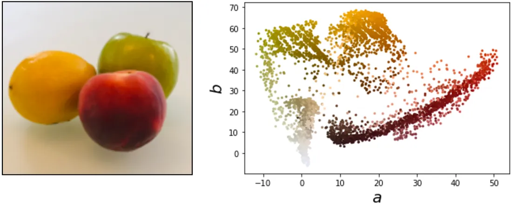
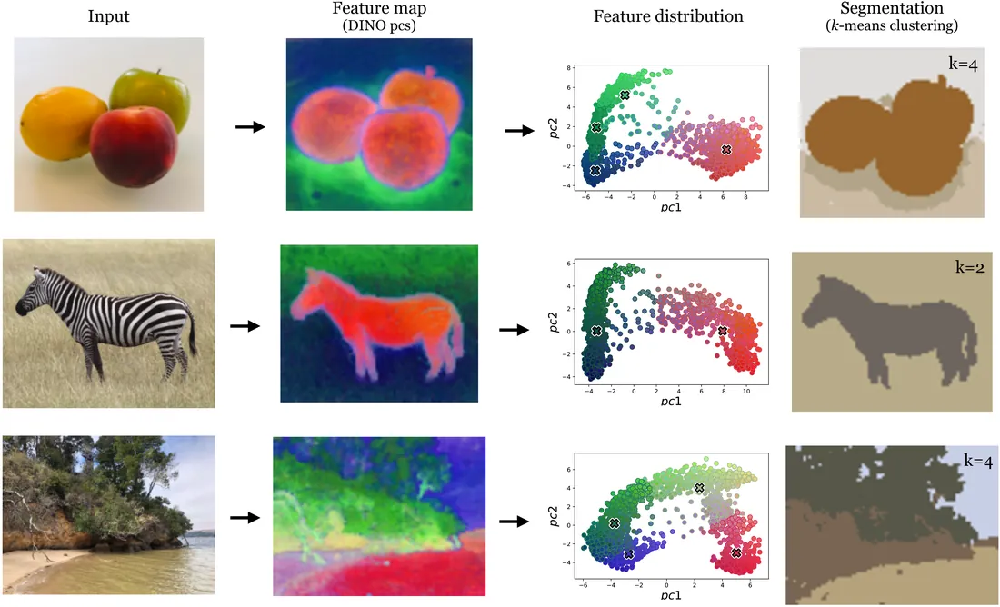

# 第 31 章 · 知觉组织

本页为《Foundations of Computer Vision》第 31 章的<b>学习笔记摘要</b>，由 AI 辅助整理，<b>非原文翻译</b>。原书 © 2024 Antonio Torralba、Phillip Isola、William T. Freeman，MIT Press 出版，<a href="https://visionbook.mit.edu/perceptual_organization.html" target="_blank" rel="noopener">官网免费公开</a>，采用 <a href="https://creativecommons.org/licenses/by-nc-nd/4.0/" target="_blank" rel="noopener">CC BY-NC-ND 4.0</a> 授权。插图版权归原作者所有，此处仅作非商业学习引用。

## 本章定位

上一章讨论如何学到好的视觉表示，本章继续「知觉表示」的话题，但换一个思想流派——它继承自深度学习之前的计算机视觉与人类视觉科学。在这一传统中，「知觉群组」（perceptual group）成为核心研究对象。本章回答：什么是知觉群组、如何找到它们、以及它们与上一章表示学习算法的关系。

## 本篇要点

- 知觉组织研究视觉系统如何把像素组织成更抽象的结构（群组）；格式塔（Gestalt）心理学家是最早研究它的人。
- 分割（segmentation）可表述为聚类问题：把每个像素分到 $k$ 个簇之一；两条主要思路是「相似像素同簇」与「彼此无边界则同簇」。
- $K$-means 在颜色空间（如 $ab$ 色度）上聚类即可得到「恒定颜色区域」式的分割，简单但常出奇有效，也有明显失效场景。
- 基于亲和性（affinity）的分割用对比学习（SimCLR / MoCo / DINO）学一个「同场景像素靠近」的嵌入，再在嵌入空间做 $k$-means——这是当今真正常用的无监督分割流水线。
- 与分割互补的是边界/边缘/轮廓；遮挡轮廓（occluding contour）指示场景中的深度不连续。
- 图层（layers）是一种 2.5D 表示，捕捉深度的序关系而非度量关系；现代网络中的物体、轮廓等结构往往是「涌现」出来的，而非人工设计。

## 关键插图

原书标注为最高优先级（三星）的核心插图，共 3 幅。

<figure class="book-fig">

<figcaption>图 31.3：任何给定图像都有多种分割方式，每种方式突出世界不同的属性。这根仙人掌分枝可以看作 (a) 一个片段（整根「枝」）、(b) 两个片段（「叶」与「花」），或 (c) 四个片段（主「叶」、两个「花蕾」和「花」）。</figcaption>
</figure>

💡 为什么重要：「没有唯一正确的分割」是分割任务的第一性认知——选哪种粒度完全取决于下游任务，评估指标也因此必须绑定任务定义。

<figure class="book-fig">

<figcaption>图 31.4：图像中连贯的颜色区域对应全部像素 ab 值散点图中的簇。一般地，分割可归结为在某个特征空间（本例是 ab 颜色，但可以是任意逐像素特征）中对像素聚类。</figcaption>
</figure>

💡 为什么重要：这张图是「分割 = 特征空间聚类」这一降维思想的直观呈现——换成任何逐像素特征（DINO、CLIP、深度），套路完全一样。

<figure class="book-fig">

<figcaption>图 31.7：在 DINO [11] 特征上做 k-means 的图像分割。</figcaption>
</figure>

💡 为什么重要：这是本章最接近现代实践的图——「自监督特征 + 简单聚类」至今是无监督/弱监督分割与发现的常用基线，理解它比掌握图割/谱聚类更实用。

## 本章小结

- 知觉群组是「基元的有意义集合」；把像素组织成物体、轮廓、图层等结构，等价于获得一种类文本的、离散语义化的强大表示。
- 分割 = 把像素聚成 $k$ 簇；「相似则同簇」（$k$-means）与「无边界则同簇」（亲和性）是两条基本路线，且分割粒度没有唯一正确答案，取决于任务。
- $ab$ 色度空间 $k$-means 简单有效但只认颜色一致性；要捕获结构/纹理区域，需要非平凡亲和性。
- 对比学习（SimCLR/MoCo/DINO）密集提取特征 + $k$-means，是当前实用的无监督分割流水线。
- 边缘/边界与分割互补；遮挡轮廓 ⟂ 深度不连续；线稿对人类有吸引力但对机器尚未兑现价值。
- 图层（2.5D）捕捉深度序关系而非度量，能表达深度传感器测不出的结构（如一摞纸）。
- 现代系统不再显式做边缘检测/分割，但物体、轮廓等知觉结构会在网络隐藏层中涌现。

## 复习自检清单

- ☐ 能解释知觉组织与表示学习的关系，并说出为什么文本是一种「特别强大」的图像表示
- ☐ 能举出一个图 31.2 式「叫不出名字但明显是连贯群组」的例子，并说明它为什么超出语言边界
- ☐ 能把分割问题写成聚类问题，并说清两条思路（相似性 vs 无边界）的差别
- ☐ 能完整描述「$ab$ 颜色散点图 + $k$-means」分割流程，并解释斑马为何成功、海滩为何失败
- ☐ 能画出「自监督对比嵌入密集提取 → 特征图 → $k$-means」的分割流水线，并说明为什么颜色距离下学嵌入没有意义
- ☐ 能解释遮挡轮廓与场景深度不连续性之间的联系
- ☐ 能解释多平面相机如何制造视差、2.5D 表示捕捉什么，并举一个「图层比深度数值更重要」的例子
- ☐ 能解释什么是涌现群组，并举出一个「网络为别的任务训练却内部出现物体检测器」的例子

---

原文：[Perceptual Grouping](https://visionbook.mit.edu/perceptual_organization.html)
