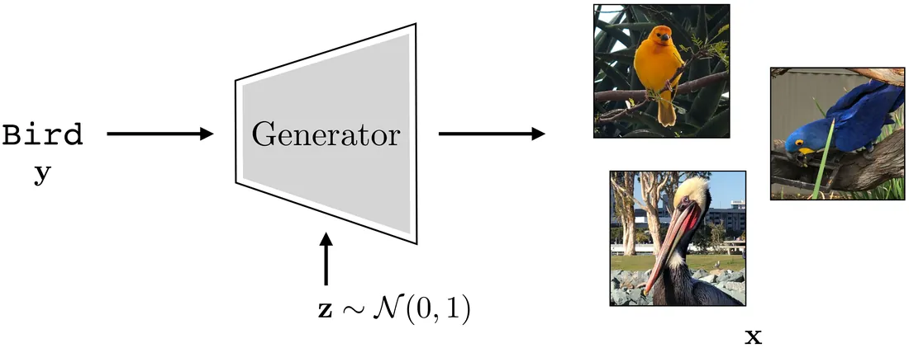
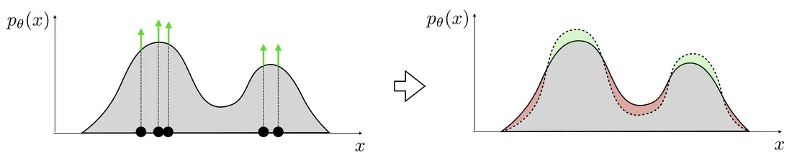
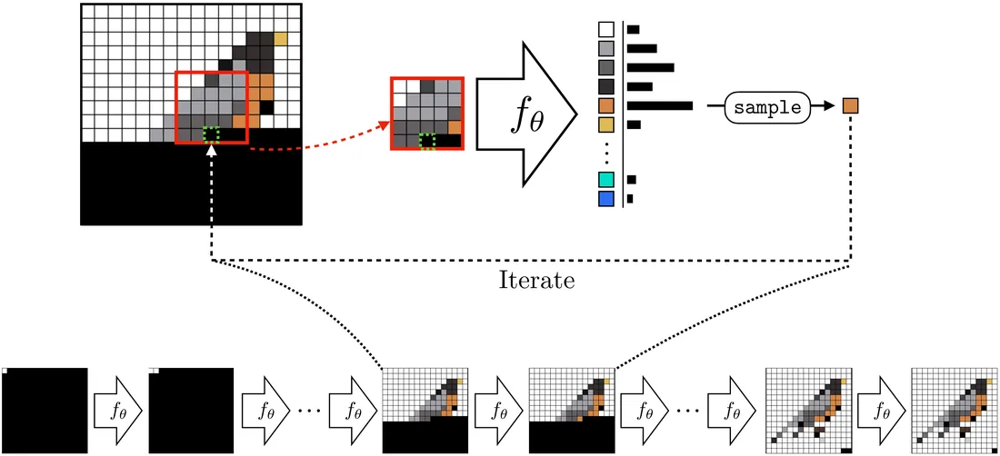
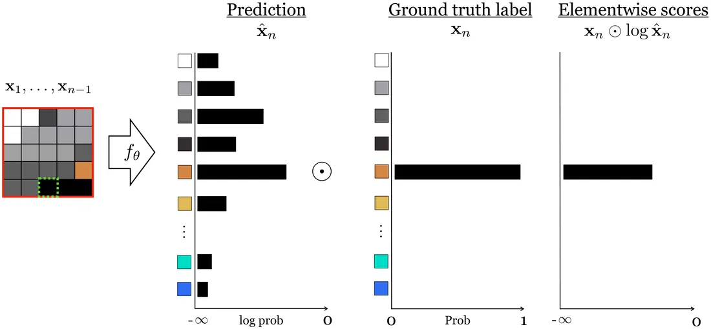
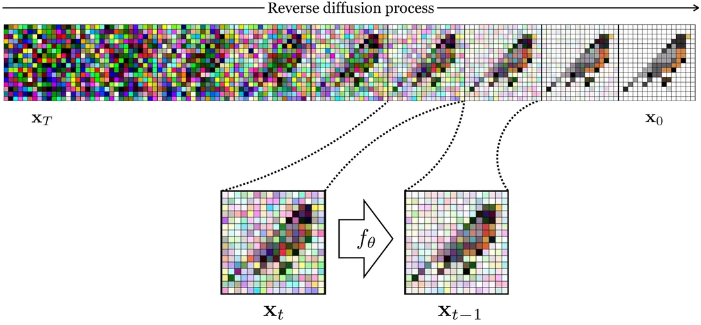
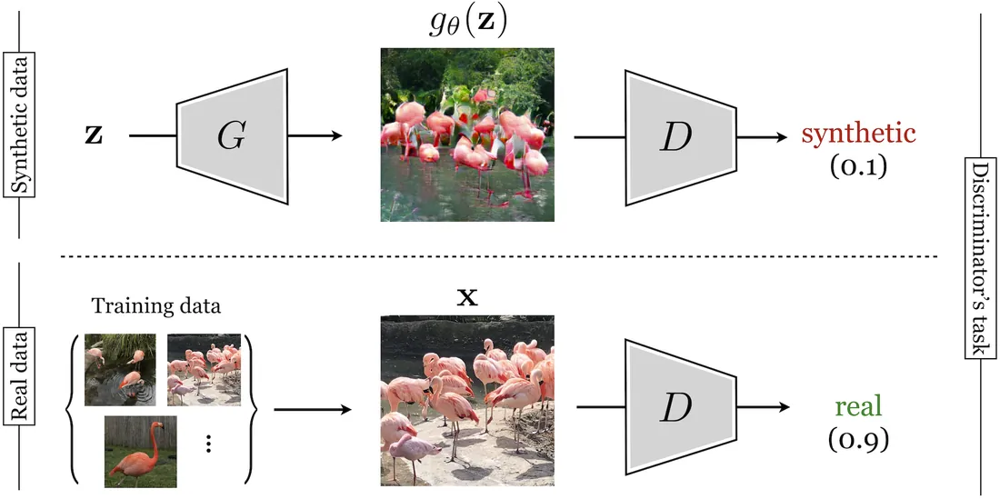

# 第 32 章 · 生成模型

本页为《Foundations of Computer Vision》第 32 章的<b>学习笔记摘要</b>，由 AI 辅助整理，<b>非原文翻译</b>。原书 © 2024 Antonio Torralba、Phillip Isola、William T. Freeman，MIT Press 出版，<a href="https://visionbook.mit.edu/generative_models.html" target="_blank" rel="noopener">官网免费公开</a>，采用 <a href="https://creativecommons.org/licenses/by-nc-nd/4.0/" target="_blank" rel="noopener">CC BY-NC-ND 4.0</a> 授权。插图版权归原作者所有，此处仅作非商业学习引用。

## 本章定位

本章切换到与判别模型相反的方向——不是从图像推断标签，而是从标签/噪声合成数据。生成模型（generative model）在概念上是「数据的合成器」，它把第 30 章的表示学习、第 27 章的统计图像模型串成一条线，并为第 33 章（VAE 等）、第 34 章（条件生成）打基础。

## 本篇要点

- 分类器是 $f:\mathcal{X}\to\mathcal{Y}$ 的多对一函数；生成器 $g:\mathcal{Z}\times\mathcal{Y}\to\mathcal{X}$ 是一对多的随机函数——靠潜变量 $\mathbf{z}$ 采样实现「一个输入、多种输出」。
- 生成模型分**直接法**（学生成器 $G:\mathcal{Z}\to\mathcal{X}$）与**间接法**（学打分函数 $E:\mathcal{X}\to\mathbb{R}$，再找高分样本）；密度模型与基于能量的模型（EBM）都属间接法。
- 密度模型用极大似然（等价于最小化前向 KL）拟合归一化密度；EBM 学未归一化能量 $E_\theta$，用对比散度训练。
- 自回归模型把联合分布按链式法则分解为逐像素 softmax 回归，天然给出显式密度；扩散模型把「数据变噪声」的前向过程反过来，训练去噪器；GAN 用生成器—判别器博弈一步出样本。
- 各类模型在「表示学习 / 似然估计 / 高效建模未归一化密度」三方面各有取舍，没有全能选手。

## 关键插图

原书标注为最高优先级（三星）的核心插图，共 6 幅。

<figure class="book-fig">

<figcaption>图 32.3：以随机变量为条件，使生成器具有随机性。同一标签「bird」下采样不同的 z，得到不同的鸟。</figcaption>
</figure>

💡 为什么重要：这是全书生成模型的「总结构图」——噪声 z + 条件 y → 图像，后续所有模型（AR、扩散、GAN）都是这一框架的变体。

<figure class="book-fig">

<figcaption>图 32.8：把极大似然密度模型拟合到数据。灰色区域持有恒定总量（可想象为一堆土）；要把土堆到绿色箭头所指的数据点处，就必须从其他区域挖走土（红色区域）。</figcaption>
</figure>

💡 为什么重要：一张图讲透「归一化密度的零和博弈」——抬数据点密度必然压低无数据区域的密度，这正是泛化性的来源。

<figure class="book-fig">

<figcaption>图 32.10：一个逐像素生成图像的自回归模型 f_θ。黑像素是待合成的剩余像素。可与图 28.10 的 Efros-Leung 模型对比。</figcaption>
</figure>

💡 为什么重要：这是自回归家族的「总结构图」——红框上下文、绿框预测位、滑窗推进，现代 PixelCNN/PixelTransformer 与 LLM 都是这一模式的化身。

<figure class="book-fig">

<figcaption>图 32.11：自回归预测作为下一像素分类：网络输出 256 路 softmax 分布，与真实像素值计算交叉熵。</figcaption>
</figure>

💡 为什么重要：一旦看穿「自回归生成 = 分类」，训练目标、损失曲线调试、teacher forcing 等全套分类技能直接迁移到生成任务。

<figure class="book-fig">

<figcaption>图 32.15：反向扩散过程。前向过程制造监督信号，用于训练反向过程。</figcaption>
</figure>

💡 为什么重要：扩散模型的全部精髓在这张图里——「把数据变噪声很容易，正好免费造出『噪声→数据』的监督对」，这是它与自回归、GAN 最本质的差别。

<figure class="book-fig">

<figcaption>图 32.16：训练生成火烈鸟图像的 GAN 架构。本例中合成图像由 BigGAN [7] 生成。</figcaption>
</figure>

💡 为什么重要：这是「用博弈代替似然」的标志性结构图——生成器与判别器的输入输出关系、梯度如何互通，看这一张图就够。

## 本章小结

- 生成模型是数据合成器：$g:\mathcal{Z}\times\mathcal{Y}\to\mathcal{X}$，靠潜变量 $\mathbf{z}$ 把一对多映射变成随机函数；无条件模型去掉 $\mathbf{y}$，建模 $p(X)$。
- 直接法学生成器；间接法（密度模型、EBM）学打分函数再找高分样本；间接法更经典，直接法随 GAN/扩散流行。
- 密度模型：参数化归一化 pdf 族 + 极大似然（= 最小化前向 KL）；抬数据点密度必须挖别处密度，这就是泛化来源。高斯模型有解析解（经验均值/方差）。
- EBM：学未归一化能量，$p \propto e^{-E}$；只需相对概率即可采样/异常检测/优化；用对比散度训练（正项压低数据能量、负项抬高模型能量）。
- 自回归：链式法则分解联合分布 + 逐像素 softmax 回归（=下一像素分类）；给出显式密度、无潜变量；类型 2 重叠批次可共享计算。
- 扩散：前向加噪造监督对、反向学去噪器；主流技巧是预测噪声而非信号；可框架为 VAE。
- GAN：生成器—判别器极小极大博弈，一步出样本；与 Heeger-Bergen 统计匹配一脉相承，但判别器是学出来的且优化被摊销。
- 没有模型同时擅长表示学习、似然估计、未归一化密度建模三件事；选择模型就是选择这三者的权衡。

## 复习自检清单

- ☐ 能写出生成过程 $\mathbf{z}\sim p(Z),\ \mathbf{x}=g(\mathbf{z},\mathbf{y})$，并解释为什么生成器必须是随机函数
- ☐ 能区分直接法与间接法，并各举一个本章模型例子
- ☐ 能从 KL 散度推出极大似然目标（式 32.1），并说明前向 KL 与反向 KL 的区别及可计算性
- ☐ 能解释图 32.8「土堆」比喻，说明归一化密度为何天然带来泛化
- ☐ 能写出 $p_\theta = e^{-E_\theta}/Z(\theta)$，说明 $Z(\theta)$ 为何只依赖 $\theta$ 不依赖 $\mathbf{x}$，以及 EBM 能做什么、不能做什么
- ☐ 能复述对比散度的正项/负项机制，并解释为何 $\nabla_{\mathbf{x}}\log p_\theta = -\nabla_{\mathbf{x}}E_\theta$
- ☐ 能由链式法则写出式 (32.5)，说明逐像素 softmax 回归为何构成合法密度模型
- ☐ 能解释类型 2 训练批次为何高效，以及它与因果注意力 KV cache 的关系
- ☐ 能写出前向扩散的噪声递推式，说明「预测噪声再减去」的重参数化技巧
- ☐ 能写出 GAN 的极小极大目标（式 32.6），并解释 $K$ 步交替更新的含义

---

原文：[Generative Models](https://visionbook.mit.edu/generative_models.html)
