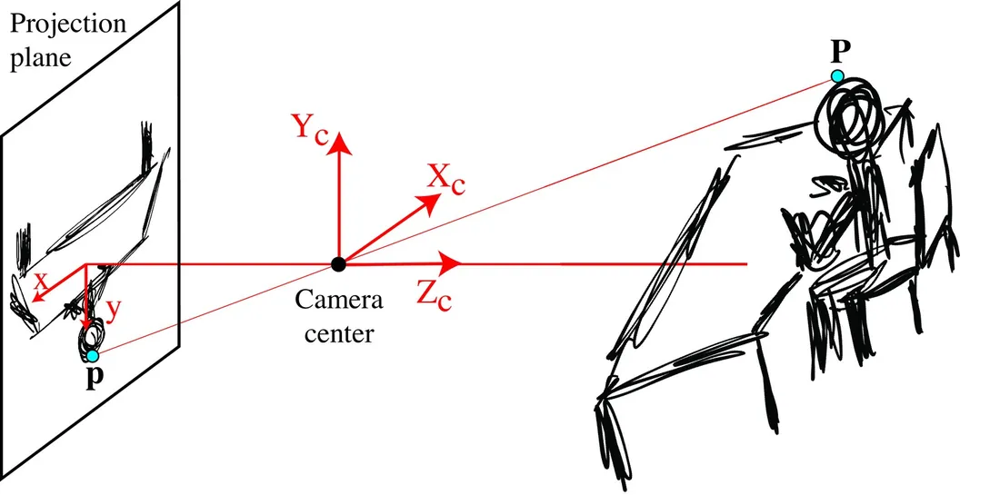
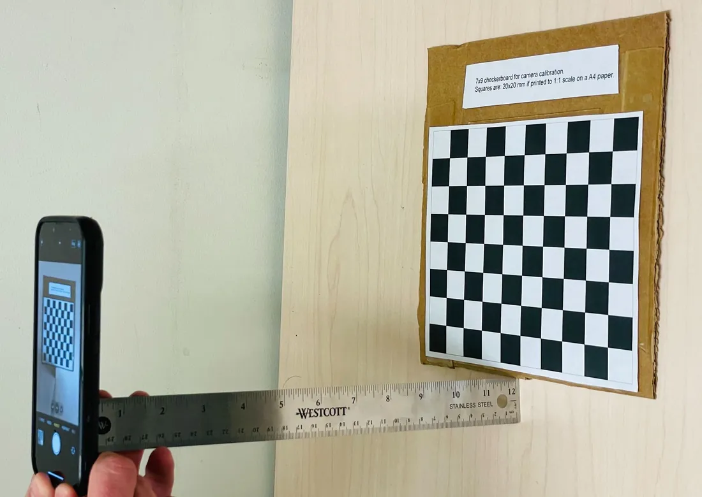
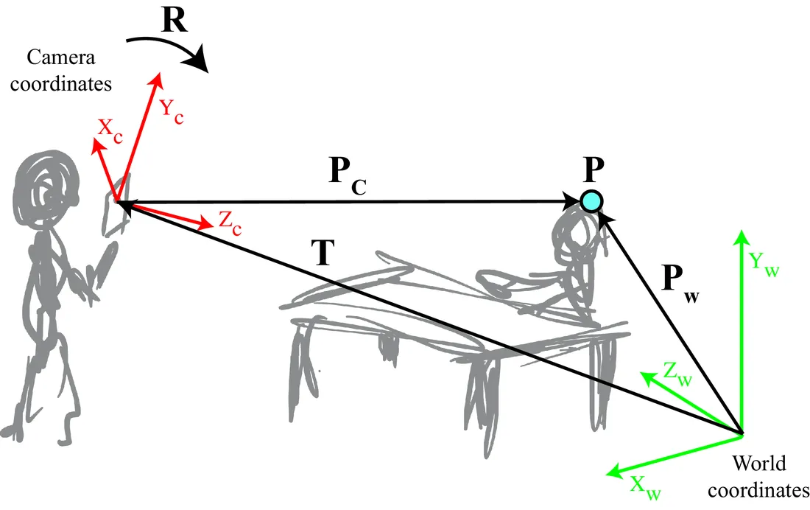
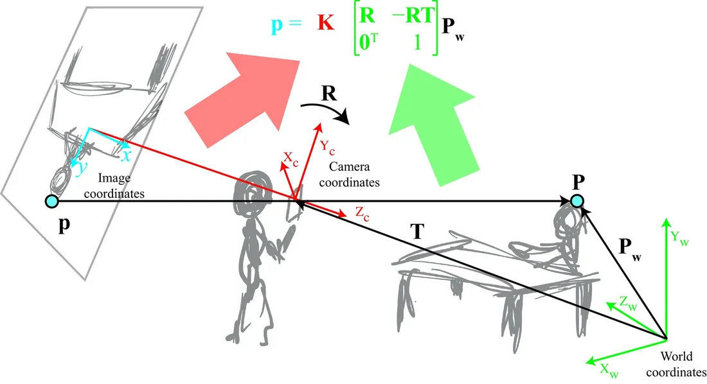
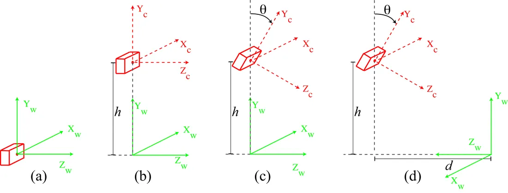
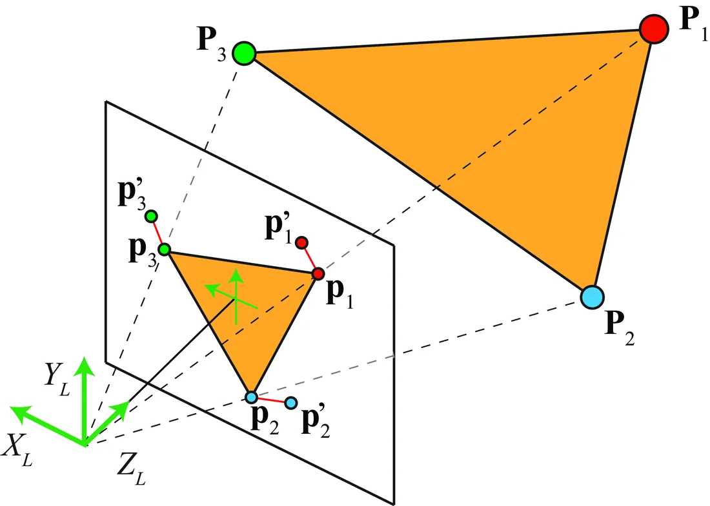

# 第 39 章 · 相机建模与标定

本页为《Foundations of Computer Vision》第 39 章的<b>学习笔记摘要</b>，由 AI 辅助整理，<b>非原文翻译</b>。原书 © 2024 Antonio Torralba、Phillip Isola、William T. Freeman，MIT Press 出版，<a href="https://visionbook.mit.edu/imaging_geometry.html" target="_blank" rel="noopener">官网免费公开</a>，采用 <a href="https://creativecommons.org/licenses/by-nc-nd/4.0/" target="_blank" rel="noopener">CC BY-NC-ND 4.0</a> 授权。插图版权归原作者所有，此处仅作非商业学习引用。

## 本章定位

第 5 章把世界坐标系原点放在针孔处，建立了最简单的投影模型；本章放宽这一假设，借助齐次坐标（第 38 章）把透视投影写成线性矩阵乘法，并把相机参数系统地分解为内参（intrinsic）与外参（extrinsic）。$\mathbf{K}[\mathbf{R}\mid-\mathbf{R}\mathbf{T}]$ 这一分解是全书后续几何章节的通用语言，在经典计算机视觉方法与深度学习架构中同样无处不在。

## 本篇要点

- 齐次坐标下透视投影是线性的：$\mathbf{K}\mathbf{P}=\lambda[x,y,1]^\mathsf{T}$，被除的 $Z$ 藏进了齐次化；齐次量只在相差一个全局尺度的意义下确定。
- 内参矩阵 $\mathbf{K}$（像素单位的焦距、主点、像素缩放/倾斜）描述相机自身；外参 $(\mathbf{R},\mathbf{T})$ 描述相机在世界中的位姿；完整投影矩阵 $\mathbf{M}=\mathbf{K}[\mathbf{R}\mid-\mathbf{R}\mathbf{T}]$ 一步把世界坐标映射到像素。
- 像素可反投为射线 $\lambda(x,y,f)$：标定后每个像素对应一条已知方向的视线，只差深度。
- 标定路线：直接线性变换（DLT）解 $3\times4$ 投影矩阵 → 由 $\mathbf{T}=-\mathbf{B}^{-1}\mathbf{b}$ 与 QR 分解恢复 $\mathbf{K},\mathbf{R},\mathbf{T}$ → 最小化重投影误差精修；张正友（Zhang）平面标定法最常用。
- 本章用四个递进位姿实例（相机在原点 / 抬高 / 俯仰 / 第 2 章式布局）完整走一遍矩阵推导，值得亲手复算。

## 关键插图

原书标注为最高优先级（三星）的核心插图，共 6 幅。

<figure class="book-fig">

<figcaption>图 39.3：透视投影。由相似三角形，x/f=X/Z、y/f=Y/Z。</figcaption>
</figure>

💡 为什么重要：这是全书几何部分的最小完整模型——后续所有多视几何、三维重建的方程都从这两个比例式出发。

<figure class="book-fig">

<figcaption>图 39.7：一个简单的标定场景。</figcaption>
</figure>

💡 为什么重要：标定三要素——已知尺寸的标定板、测得的距离、一张照片——全部体现在这一张图里；a=ZL/W 是每个工程师都该会手推的 sanity check。

<figure class="book-fig">

<figcaption>图 39.8：世界坐标系与相机坐标系。世界坐标 P_W 中的三维点，可通过对点坐标施加平移 T 与旋转 R，表示为相机坐标 P_c。</figcaption>
</figure>

💡 为什么重要：外参的物理意义（相机在哪、朝向哪）全在这张图里；后面所有「世界 → 相机 → 像素」的两段式变换都基于它。

<figure class="book-fig">

<figcaption>图 39.9：点投影到像平面的全过程。本图综合了图 39.3 与图 39.8：先用外参模型，把点所在的世界坐标系变换到相机坐标系；再用内参模型，把它投影到相机平面。</figcaption>
</figure>

💡 为什么重要：一张图记住全章主线——「世界 →(R,T)→ 相机 →(K)→ 像素」，标定就是求出这两段矩阵。

<figure class="book-fig">

<figcaption>图 39.10：相机相对于世界坐标系的四个位姿示例，复杂度递增；正文逐一推导每种场景的投影矩阵。</figcaption>
</figure>

💡 为什么重要：这四个场景（相机在原点 / 抬高 / 俯仰 / 第 2 章式布局）覆盖了工程中最常见的布置，推导过程是把本章所有矩阵练熟的最佳习题。

<figure class="book-fig">

<figcaption>图 39.14：像平面上用红线标出的重投影误差。</figcaption>
</figure>

💡 为什么重要：标定优化的目标函数就是它——Σ_i\|p_i-p'_i\|^2；调试标定时第一件事就是看这个误差的量级与分布。

## 本章小结

- 齐次坐标把透视投影变成线性矩阵乘法：$\mathbf{K}\mathbf{P}=\lambda[x,y,1]^\mathsf{T}$，全局尺度不定——这是本章全部内容的代数基础。
- 内参 $\mathbf{K}$（像素单位的焦距 $a$、主点 $(c_x,c_y)$、非方像素的 $a/b$、倾斜）描述相机自身；外参 $(\mathbf{R},\mathbf{T})$ 描述相机在世界中的位姿；$\mathbf{M}=\mathbf{K}[\mathbf{R}\mid-\mathbf{R}\mathbf{T}]$ 一步完成「世界 → 像素」。
- 换 $\mathbf{K}$ 即可切换针孔、正交、弱透视、仿射等相机模型；本章四个递进实例完整演示了具体场景下 $\mathbf{M}$ 的推导，并可复现第 2 章简单视觉系统的方程。
- 像素可反投为射线 $\lambda(x,y,f)$：标定后每个像素对应一条已知方向的视线，只差深度（第 43 章续）。
- 标定流程：DLT（每对点贡献 2 个线性方程，$\mathbf{A}\mathbf{m}=\mathbf{0}$ 取最小特征向量，点不能共面）→ $\mathbf{T}=-\mathbf{B}^{-1}\mathbf{b}$ 与 $\mathbf{B}^{-1}$ 的 QR 分解恢复 $\mathbf{K}$、$\mathbf{R}$（注意符号歧义）→ 最小化重投影误差 (39.24) 精修。
- 张正友平面标定法（多视角平面标定板）是当今最常用的标定路线；简单棋盘格测距法（$a=ZL/W$）可作为快速 sanity check。
- 地平线位置 $y_h=a\tan\theta$：已标定时可反推俯仰角，已知 $\theta$ 时可估 $a$。

## 复习自检清单

- ☐ 能写出针孔相机的齐次投影矩阵 $\mathbf{K}$，并解释为什么透视投影在齐次坐标下是线性的、齐次量的尺度自由度体现在哪
- ☐ 能由 $a=fN/w$ 说明焦距（米）如何变成像素单位的 $a$，并说明主点 $(c_x,c_y)$ 与坐标系平移的关系
- ☐ 能推导「像素 → 射线」：给定像素 $(x,y)$ 与深度 $Z$，写出对应三维点 $(Z/f)(x,y,f)$，并说明何时要把 $f$ 换成 $a$
- ☐ 能推出外参矩阵 $[\mathbf{R}\mid-\mathbf{R}\mathbf{T}]$ 的构造（先平移 $-\mathbf{T}$ 再旋转 $\mathbf{R}$），并说清 $\mathbf{T}$、$\mathbf{R}$ 的物理含义与常见误用（$\mathbf{R}$ 与 $\mathbf{R}^\mathsf{T}$ 混淆）
- ☐ 能独立推出场景 (b)：相机抬高 $h$ 平行于地面时 $x=aX/Z$、$y=a(Y-h)/Z$，并解释等高者的眼睛为何总投在画面中部
- ☐ 能由式 (39.19) 推出地平线位置 $y=a\tan\theta$，并用 $y_h=-798$、$a=3{,}103$ 复算 $\theta\approx14.6^\circ$
- ☐ 能描述 DLT 的方程构造（每对对应点贡献 2 个线性方程，$\mathbf{A}\mathbf{m}=\mathbf{0}$ 的最小特征向量解）及其退化条件（所有点共面）
- ☐ 能说明如何从 $\mathbf{M}$ 恢复 $\mathbf{T}$、$\mathbf{K}$、$\mathbf{R}$（$\mathbf{T}=-\mathbf{B}^{-1}\mathbf{b}$、对 $\mathbf{B}^{-1}$ 做 QR 分解），以及符号歧义如何利用「$\mathbf{K}$ 对角元为正」来消除

---

原文：[Camera Modeling and Calibration](https://visionbook.mit.edu/imaging_geometry.html)
