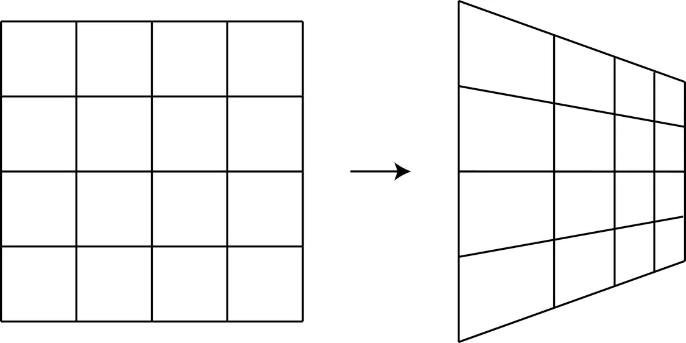
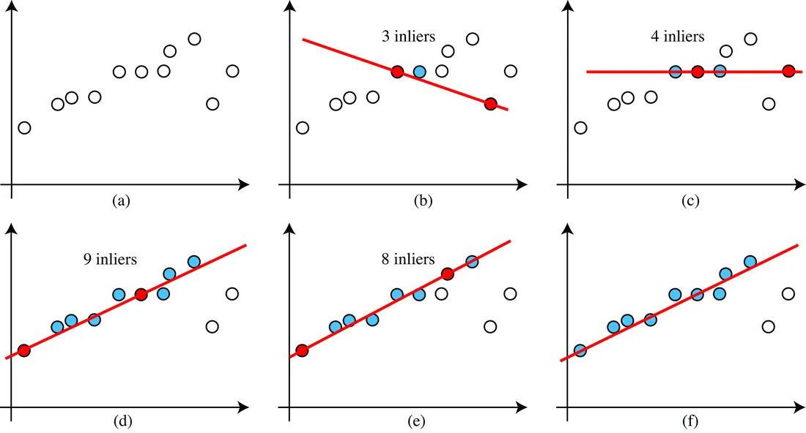
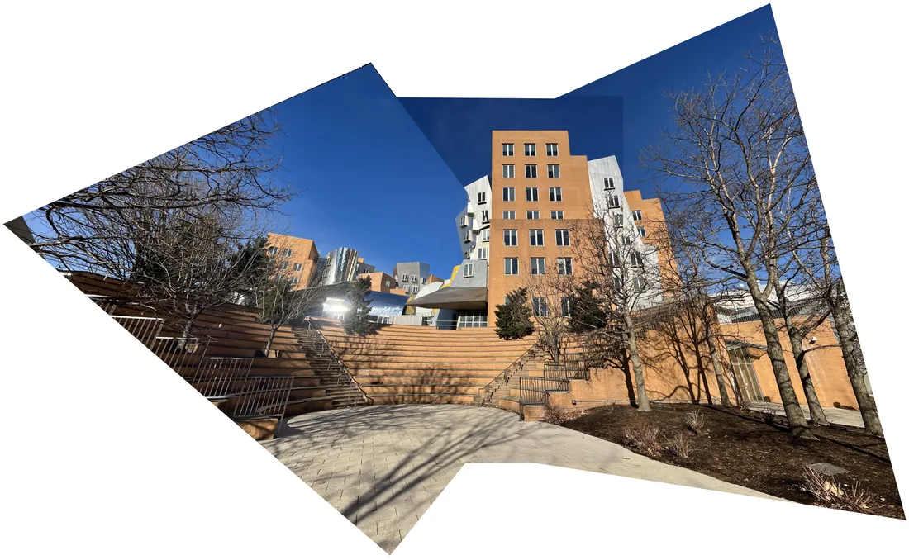

# 第 41 章 · 单应矩阵

本页为《Foundations of Computer Vision》第 41 章的<b>学习笔记摘要</b>，由 AI 辅助整理，<b>非原文翻译</b>。原书 © 2024 Antonio Torralba、Phillip Isola、William T. Freeman，MIT Press 出版，<a href="https://visionbook.mit.edu/homography.html" target="_blank" rel="noopener">官网免费公开</a>，采用 <a href="https://creativecommons.org/licenses/by-nc-nd/4.0/" target="_blank" rel="noopener">CC BY-NC-ND 4.0</a> 授权。插图版权归原作者所有，此处仅作非商业学习引用。

## 本章定位

Part XI「理解几何」中从「表示」走向「应用」的一章。第 38 章建立了齐次坐标下的 2D 变换工具箱，第 39-40 章给出相机模型与对极几何；本章把两者接上，介绍比仿射更一般的保线变换——单应矩阵（homography）：当场景为平面或两相机仅差旋转时，对应点被一个 $3\times3$ 矩阵直接联系。它是透视校正、鸟瞰图、增强现实与全景拼接的核心。

## 本篇要点

- 单应矩阵 $\mathbf{p}'=\mathbf{H}\mathbf{p}$，$\mathbf{H}$ 为 $3\times3$、8 个自由度（整体缩放不变）；保直线（共线点仍共线），但不保长度、角度与平行性。
- 两个典型来源：两相机仅差一个旋转时 $\mathbf{H}=\mathbf{K}\mathbf{R}\mathbf{K}^{-1}$（与深度无关）；场景为平面时像点与平面点之间满足 $\lambda[x\;y\;1]^\mathsf{T}=\mathbf{H}[X\;Y\;1]^\mathsf{T}$，其中 $\mathbf{H}=\mathbf{K}[\mathbf{c}_1\;\mathbf{c}_2\;\mathbf{t}]$。
- 由对应点估计 $\mathbf{H}$：DLT 把问题化为 $\mathbf{A}\mathbf{h}=\mathbf{0}$（$N$ 对点给 $2N\times9$ 方程，至少 4 对；解为 $\mathbf{A}^\mathsf{T}\mathbf{A}$ 最小特征向量），之后应再最小化重投影误差精化。
- 特征匹配必有误匹配：RANSAC 每次随机抽 4 点拟合、按内点投票，迭代数 $k=\log(1-p)/\log(1-w^n)$。
- 全景拼接流程：特征检测匹配（如 SURF）→ DLT + RANSAC 估计两两单应 → warp 到参考相机 → 融合。

## 关键插图

原书标注为最高优先级（三星）的核心插图，共 3 幅。

<figure class="book-fig">

<figcaption>图 41.2：单应矩阵。共线点变换后仍共线，但直线间的夹角不再保持。</figcaption>
</figure>

💡 为什么重要：一张网格图同时展示「保线」与「不保角/不保平行」两半性质，是单应矩阵定义的最佳视觉锚点。

<figure class="book-fig">

<figcaption>图 41.8：用 RANSAC 稳健估计直线参数。(a) 待稳健拟合直线的数据点。(b) 随机选取两个点（蓝色），足以估计直线模型参数；计算该模型的内点数。(c–e) 重复 k 次。(f) 最后选取内点数最多的模型。</figcaption>
</figure>

💡 为什么重要：RANSAC 是视觉工程里出现频率最高的稳健估计器（直线、基础矩阵、单应、PnP 全靠它），这张六格图把「采样-拟合-投票-重拟合」的循环讲得一目了然。

<figure class="book-fig">

<figcaption>图 41.9：由图 41.3 中三张有重叠图像拼成的全景图。</figcaption>
</figure>

💡 工程师视角：真实拼接管线还会做：所有单应对参考帧的全局联合优化（bundle adjustment，抑制 pairwise-to-reference 的漂移）、柱面/球面展开、接缝处的多频段曝光融合。单应只对「旋转 + 平面」成立，手持平移拍摄的场景要用对极/基础矩阵或直接全局 BA。

## 本章小结

- 单应矩阵 $\mathbf{p}'=\mathbf{H}\mathbf{p}$：$3\times3$、8 自由度、保直线；不保长度、角度、平行。
- 两大来源：纯旋转（$\mathbf{H}=\mathbf{K}\mathbf{R}\mathbf{K}^{-1}$，与深度无关、两相机内参可不同）；平面场景（$\mathbf{H}=\mathbf{K}[\mathbf{c}_1\ \mathbf{c}_2\ \mathbf{t}]$，世界系可置于平面上）。
- 单应比对极约束强，但条件苛刻；对极约束恒成立。
- 估计：DLT（$\mathbf{A}\mathbf{h}=\mathbf{0}$，≥4 对点，最小特征向量解）→ 重投影误差精化；鲁棒化靠 RANSAC（$k=\log(1-p)/\log(1-w^n)$）。
- 全景拼接 = 特征匹配 + 单应估计 + 翘曲 + 融合。

## 复习自检清单

- ☐ 能写出单应矩阵的定义（式 41.1/41.2），并用 $\boldsymbol{l}^\mathsf{T}\mathbf{p}=0$ 证明共线保持
- ☐ 能推导纯旋转两相机的 $\mathbf{H}=\mathbf{K}\mathbf{R}\mathbf{K}^{-1}$，并说明为何与场景深度无关
- ☐ 能推导平面场景的 $\mathbf{H}=\mathbf{K}[\mathbf{c}_1\ \mathbf{c}_2\ \mathbf{t}]$，解释世界坐标系为何能放到平面上
- ☐ 能解释单应与对极约束的强弱关系及各自适用条件
- ☐ 能由 $N$ 对对应点写出 DLT 的 $\mathbf{A}\mathbf{h}=\mathbf{0}$，说明 8 自由度与最少 4 对点的来源
- ☐ 能写出 RANSAC 迭代数公式 (41.8)，并估算给定 $w,p$ 下的 $k$
- ☐ 能描述全景拼接的完整流程，并指出流程中抗误匹配的手段

---

原文：[Homographies](https://visionbook.mit.edu/homography.html)
