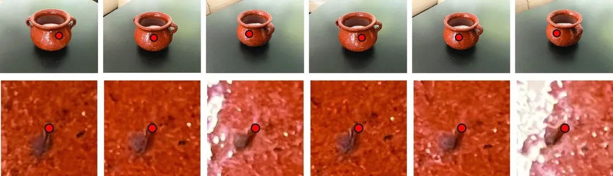
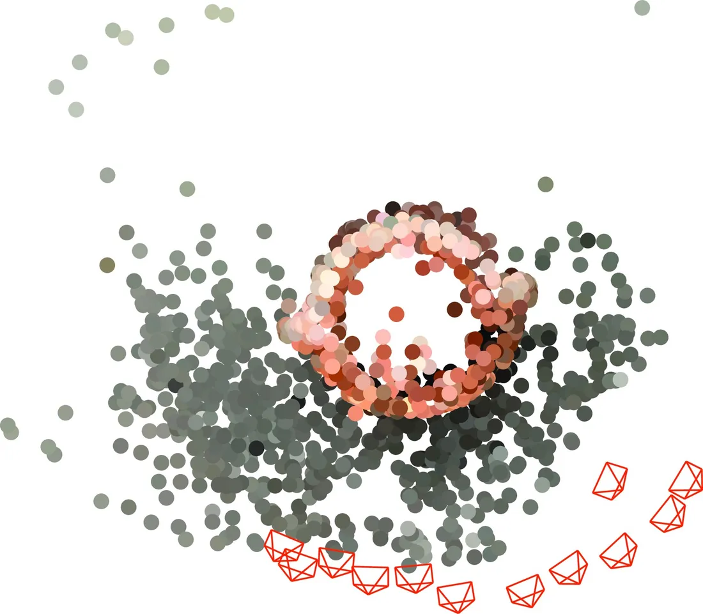
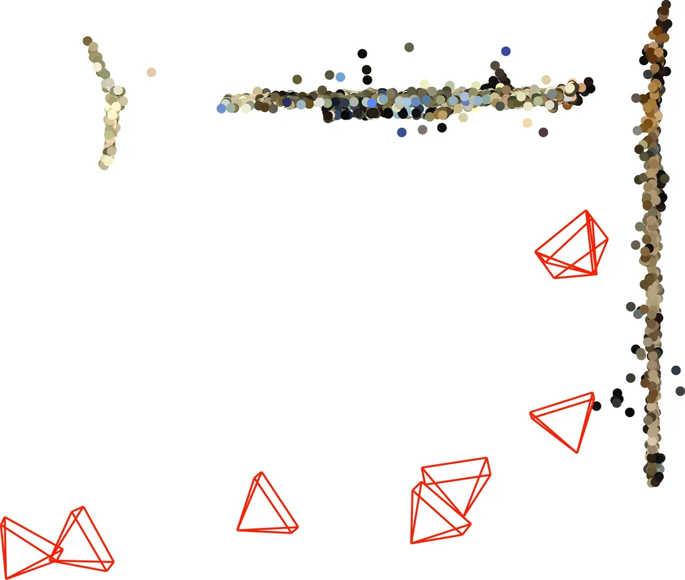

# 第 44 章 · 多视图几何与运动恢复结构

本页为《Foundations of Computer Vision》第 44 章的<b>学习笔记摘要</b>，由 AI 辅助整理，<b>非原文翻译</b>。原书 © 2024 Antonio Torralba、Phillip Isola、William T. Freeman，MIT Press 出版，<a href="https://visionbook.mit.edu/multiview.html" target="_blank" rel="noopener">官网免费公开</a>，采用 <a href="https://creativecommons.org/licenses/by-nc-nd/4.0/" target="_blank" rel="noopener">CC BY-NC-ND 4.0</a> 授权。插图版权归原作者所有，此处仅作非商业学习引用。

## 本章定位

本章是几何部分（第 38–45 章）的集大成章，把第 39 章的相机模型、第 40 章的双视几何与三角化、第 41 章的 RANSAC 稳健估计组装成完整流水线，从多幅有重叠的图像中同时恢复稀疏三维点云与每幅图像的相机位姿。它与第 42 章（单视图、靠消失点与先验）互为两极：一个视图是「不够」，多个视图是「足够」——本章讲如何把「足够」组织成算法。

## 本篇要点

- 稀疏 SfM：给定 $M$ 幅有重叠图像中的匹配点 $\mathbf{p}^{(j)}_i$，恢复 $N$ 个三维点 $\mathbf{P}_i$ 与每相机的 $\mathbf{K},\mathbf{R},\mathbf{T}$；可解性条件 $2NM \geq 3N+6(M-1)-1$。
- 核心代价是重投影误差（式 44.2，含可见性项 $v_i^{(j)}$），其非线性优化即光束法平差（bundle adjustment，BA）——优化「相机中心到三维点的光线束」。
- BA 无法消除全局平移/旋转、全局尺度，以及 $\mathbf{K}$ 未知时的射影歧义；增量式流水线中可见性不足会造成尺度漂移。
- 标准增量流水线：兴趣点检测（Harris/SuperPoint）→ 描述子（SIFT/SURF/ORB）+ 匹配（暴力/SuperGlue）→ 双视基础矩阵/本质矩阵（RANSAC）→ 三角化 → BA 细化（Huber 稳健核）。
- 批量式 SFM 的 BA 只跑一次，但新图像要全量重跑；增量式周期性 BA，适合图像陆续到达或实时场景。
- 稠密 SfM 优化光度误差而非重投影误差，更慢、假设更多（朗伯表面、小基线）。

## 关键插图

原书标注为最高优先级（三星）的核心插图，共 3 幅。

<figure class="book-fig">

<figcaption>图 44.8：不同视角下的关键点匹配。每个子图顶行是一个匹配关键点在若干视图中的位置；底行是关键点周围 129×129 像素的裁剪。</figcaption>
</figure>

💡 为什么重要：SfM 的第一道生死关就是匹配——这一步的召回率直接决定三维重建的完整度，是整个流水线中最值得投入的模块。

<figure class="book-fig">

<figcaption>图 44.9：糖盒的三维重建。图中展示两个不同视角与恢复的相机位置。(a) 鸟瞰。(b) 侧视。</figcaption>
</figure>

💡 为什么重要：这是稀疏 SfM 流水线的标准输出形态——稀疏点云 + 相机位姿；先建立这个「终点图景」，再倒推每个模块的作用。

<figure class="book-fig">

<figcaption>图 44.10：广场的三维重建。图中展示两个不同视角与恢复的相机位置。(a) 鸟瞰。(b) 任意视角。</figcaption>
</figure>

## 本章小结

- 多视图几何研究 $N>2$ 个相机下的三维重建；SfM 从有重叠图像的匹配点同时恢复三维点云与相机内外参。
- 刚性假设（Ullman 1979）是 SfM 的理论起点；Tomasi-Kanade 用正交投影做出首个算法，Sturm-Triggs 扩展到透视投影。
- 可解性：$2NM \geq 3N+6(M-1)-1$；未标定相机再加 $3M$ 个未知数；可见性不足会造成尺度漂移。
- 核心代价是重投影误差 (44.2)（含可见性项），其优化即光束法平差；无法消除的歧义：全局平移/旋转/尺度，以及内参未知时的射影歧义。
- 标准增量流水线：兴趣点（Harris/SuperPoint）→ 描述子（SIFT/SURF/ORB）+ 匹配（暴力/SuperGlue）→ 双视 F/E（RANSAC）→ 三角化 → BA（Huber 核）细化。
- 批量式 BA 只跑一次但新数据要全量重跑；增量式周期性 BA，适合图像陆续到达或实时场景。稠密 SfM 优化光度误差而非重投影误差，更慢、假设更多。

## 复习自检清单

- ☐ 能数出稀疏 SfM 的未知数（$3N+6(M-1)-1$）与观测数（$2NM$），写出可解条件并解释 $M=1$ 为何无解
- ☐ 能写出带可见性项的重投影误差 (44.2)，并说明 BA 优化的「光线束」是什么
- ☐ 能列出 BA 无法消除的歧义（全局平移/旋转/尺度、内参未知时的射影歧义），并解释尺度漂移如何产生
- ☐ 能复述增量式 SfM 流水线的每一步：双视 F/E + RANSAC → 三角化 → 逐图加入 → BA 细化
- ☐ 能解释对极约束、基础矩阵与本质矩阵在流水线中的分工（未标定/已标定双视），以及为什么必须用 RANSAC
- ☐ 能比较手工与学习式关键点检测器/描述子的优劣，并说明 SuperPoint 的训练数据如何增广
- ☐ 能区分批量式与增量式 SFM 的适用场景与 BA 运行时机
- ☐ 能对比稀疏 SfM 与稠密 SfM 的优化目标（重投影误差 vs 光度误差）与各自假设

---

原文：[Multiview Geometry and Structure from Motion](https://visionbook.mit.edu/multiview.html)
