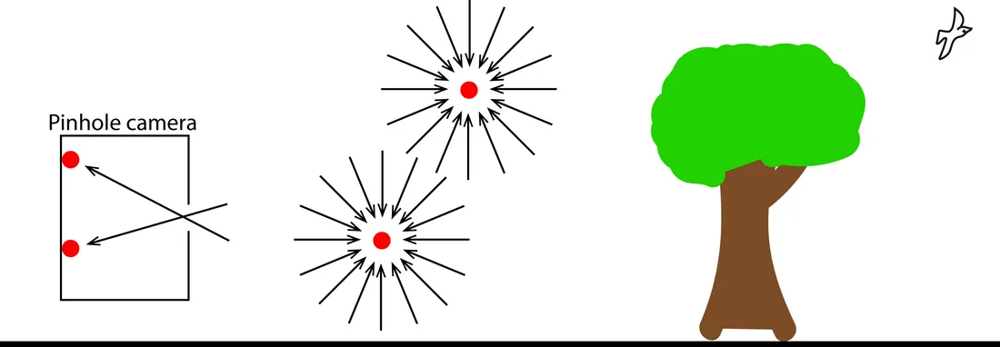
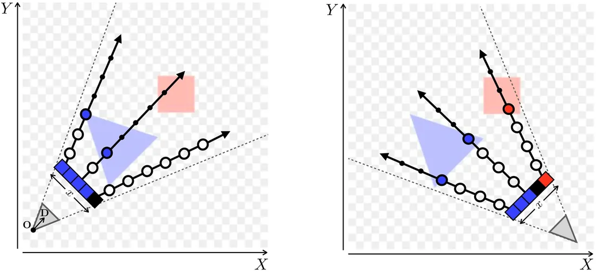
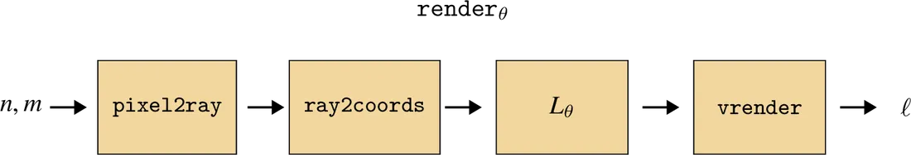

# 第 45 章 · 辐射场

本页为《Foundations of Computer Vision》第 45 章的<b>学习笔记摘要</b>，由 AI 辅助整理，<b>非原文翻译</b>。原书 © 2024 Antonio Torralba、Phillip Isola、William T. Freeman，MIT Press 出版，<a href="https://visionbook.mit.edu/nerf.html" target="_blank" rel="noopener">官网免费公开</a>，采用 <a href="https://creativecommons.org/licenses/by-nc-nd/4.0/" target="_blank" rel="noopener">CC BY-NC-ND 4.0</a> 授权。插图版权归原作者所有，此处仅作非商业学习引用。

## 本章定位

Part XI 的收官章。第 1 章讲过希腊人「眼睛发射光线」的外发射说，本章借用这个类比回到起点：用可微的神经场表示「空间每点的颜色与密度」，再用体渲染把它投影回图像，最后用梯度下降从照片反推出这个场。基于几何的视觉与机器学习在这里正式会师——多视几何、信号处理、神经网络几乎全部基础知识都在本章汇合。

## 本篇要点

- 全光函数（plenoptic function）$L(X,Y,Z,\psi,\phi,\lambda,t)$ 是「给定时空点、方向、波长的光强」的完整描述；一幅图像 = 对它沿每个传感器方向求和得到的一个切片。
- 辐射场把全光函数的一个子集参数化为 $L: X,Y,Z,\psi,\phi \rightarrow r,g,b,\sigma$：每个 3D 点有颜色和体密度。
- NeRF 用带位置编码（positional encoding）的 MLP 实现该映射；$\sigma$ 走 ReLU 保非负，rgb 走 sigmoid 收 $[0,1]$。
- 渲染走体渲染方程 (45.1)：沿每条像素射线对「颜色 × 密度 × 透射率 $\alpha$」积分，离散化为 $T$ 点求和即可反传。
- 拟合是反问题：$\{$图像, 相机内外参$\} \rightarrow L_\theta$，最小化重建误差，端到端反传；体渲染的软遮挡带来连续梯度，是优化可行的关键。
- 局限：体渲染不建模多次反弹，阴影/反射被「画」进颜色；更一般的模型是 Kajiya 渲染方程 (45.2)。

## 关键插图

原书标注为最高优先级（三星）的核心插图，共 3 幅。

<figure class="book-fig">

<figcaption>图 45.1：全光函数 [1]。图中展示了全光函数在四个位置的切片。其中两个位置位于自由空间，另两个位于针孔相机内部。</figcaption>
</figure>

💡 为什么重要：这是全章的思想起点——「一个区域里充满的光到底携带了什么信息」；辐射场本质上就是全光函数的一个可学习子集。

<figure class="book-fig">

<figcaption>图 45.7：平面国辐射场的体渲染。图中是该场景的 2D 辐射场，我们从上方俯瞰它。两台相机（角落里的灰色三角形）观看该场景，相机传感器画成一行 5 个像素、用坐标 x 索引。我们从相机原点穿过每个像素向场景发出射线以查询场景。每条射线在画成圆圈的点上被采样：圆圈的大小表示 α 值，圆圈的颜色/透明度表示该点处辐射场的颜色/密度。本场景中有实体，所以密度在物体内部为无穷大，射线一旦命中物体，所有剩余点都被遮挡（α 对剩余点变为零，如圆圈变小所示）。</figcaption>
</figure>

💡 为什么重要：这张图把体渲染的整条射线积分过程画成了一眼能懂的「射线—采样点—α 衰减」链条，是理解式 (45.1) 的钥匙。

<figure class="book-fig">

<figcaption>图 45.11：渲染一幅图像的完整 NeRF 流水线。注意相机参数还需要输入 `pixel2ray`；`vrender` 还要接收由 `ray2coords` 计算出的方向 D 与采样点 t。</figcaption>
</figure>

💡 为什么重要：这是全章的总装图——`pixel2ray → ray2coords → NeRF(L_θ) → vrender` 全链路可微，所以整张图能直接反传优化。

## 本章小结

- 辐射场 = 全光函数的可微参数化子集：$L: X,Y,Z,\psi,\phi \rightarrow r,g,b,\sigma$，场景被表示为一团带颜色与密度的粒子云；颜色依赖视角、密度不依赖。
- NeRF = 带傅里叶位置编码的 MLP；$\sigma$ 走 ReLU 保非负，rgb 走 sigmoid 收 $[0,1]$；在网格上批量查询时等价于 1x1 卷积 CNN。
- 渲染 = 体渲染方程 (45.1)：沿每条像素射线对「颜色 × 密度 × 透射率 $\alpha$」积分，离散化为 $T$ 点求和；射线切区间、区间内均匀扰动采样。
- 拟合 = 反问题：$\{$图像, 相机内外参$\} \rightarrow L_\theta$，最小化重建误差；`pixel2ray → ray2coords → NeRF → vrender` 全链路可微，端到端反传，约 2,500 步即收敛。
- 体渲染的两大红利：能建模半透明 / 次表面效应；遮挡是「软」的，梯度小且连续，优化可行（光线投射全有全无，难以优化）。
- 局限与出路：阴影 / 反射被画进颜色、不支持改变光源重打光；更一般的 Kajiya 渲染方程 (45.2) 建模多次反弹，是更贵也更物理正确的方向。

## 复习自检清单

- ☐ 能写出全光函数的定义 $L(X,Y,Z,\psi,\phi,\lambda,t)$，并解释为什么「一幅图像 = 对全光函数的一个切片求和」
- ☐ 能写出辐射场的定义 $L: X,Y,Z,\psi,\phi \rightarrow r,g,b,\sigma$，说明颜色与密度为什么必须分开表示
- ☐ 能写出体渲染方程 (45.1) 及其离散化求和形式，解释 $\alpha_i$ 与 $(1-e^{-L^\sigma(\mathbf{R}_i)\delta_i})$ 各自的含义
- ☐ 能推导采样点公式 $\mathbf{R}_i = \mathbf{O} + t_i\mathbf{D}$ 与 $t_i \sim \mathcal{U}[i-1,i]\cdot\frac{t_f-t_n}{T}+t_n$，并说明区间内扰动采样的作用
- ☐ 能解释傅里叶位置编码为什么能帮助 MLP 拟合高频细节（笛卡尔坐标的频谱偏置问题）
- ☐ 能按顺序说出完整 NeRF 流水线（图 45.11）每个模块的输入输出，以及相机参数在哪几处被使用
- ☐ 能解释为什么体渲染比光线投射更适合梯度优化（软遮挡 vs 全有全无），以及这对 NeRF 训练意味着什么
- ☐ 能写出渲染方程 (45.2)，逐项说明 $g$、$e$、$\rho$ 的作用，并说出它比辐射场强在哪、贵在哪

---

原文：[Radiance Fields](https://visionbook.mit.edu/nerf.html)
