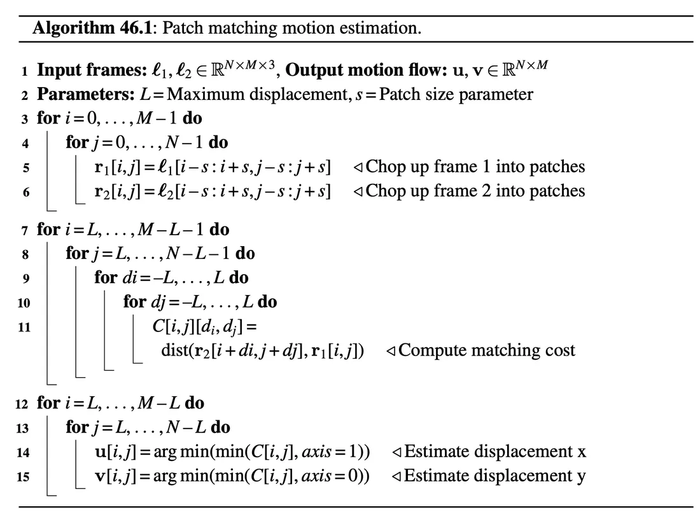
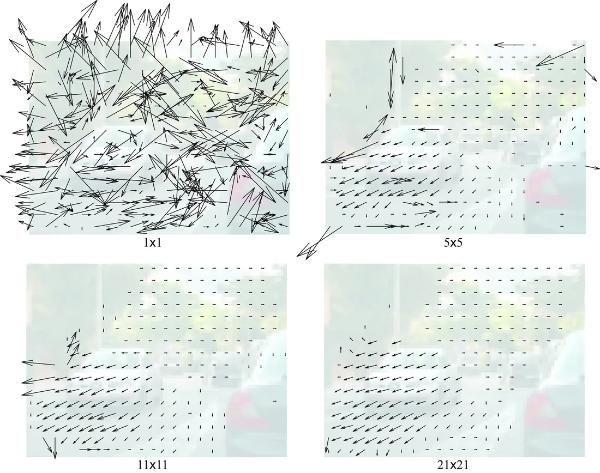
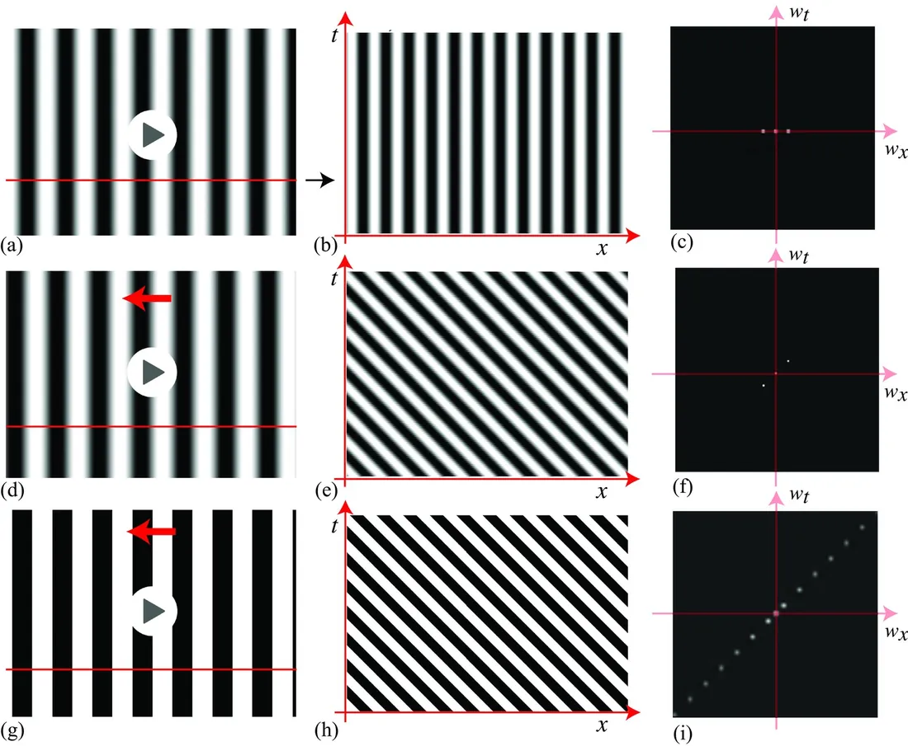
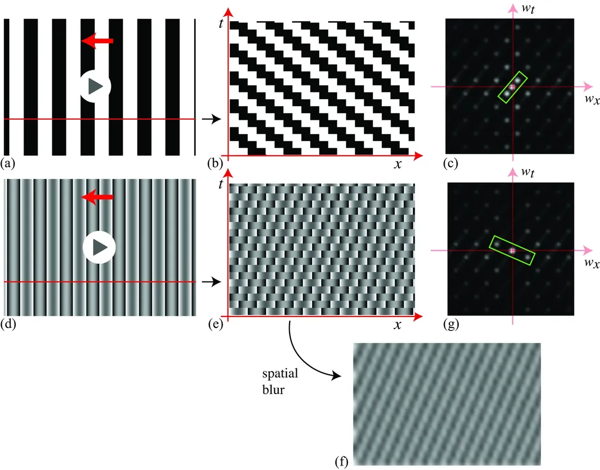

# 第 46 章 · 运动估计

本页为《Foundations of Computer Vision》第 46 章的<b>学习笔记摘要</b>，由 AI 辅助整理，<b>非原文翻译</b>。原书 © 2024 Antonio Torralba、Phillip Isola、William T. Freeman，MIT Press 出版，<a href="https://visionbook.mit.edu/motion_estimation_intro.html" target="_blank" rel="noopener">官网免费公开</a>，采用 <a href="https://creativecommons.org/licenses/by-nc-nd/4.0/" target="_blank" rel="noopener">CC BY-NC-ND 4.0</a> 授权。插图版权归原作者所有，此处仅作非商业学习引用。

## 本章定位

本章开启 Part XII「理解运动」。人类与计算机视觉的共同任务是理解图像（及其背后的场景）如何随时间变化；运动告诉我们物体如何运动、我们又如何相对场景移动，是分组、事件理解与三维结构感知的核心线索。本章先建立对人类运动感知的直觉，再动手实现最朴素的运动估计算法——图像块匹配，并借 Adelson–Bergen 的经典错觉讨论「相关匹配」与「时空滤波」两大算法范式。至于「估计出的像素位移究竟对应什么 3D 运动」，留给第 47 章回答。

## 本篇要点

- 世界大多是静止的，有东西动起来才会吸引注意；运动是强分组线索（一起动的场景点大概率属于同一物体），还能分割物体、理解事件、预测未来。
- 帧间运动估计与立体视差估计步骤相似，但光流不假设世界静止、没有对极约束可依赖，且默认帧间位移很小。
- 最直接的算法：每个像素用一个 $(2s{+}1)\times(2s{+}1)$ 的 RGB 图像块表示，在第二帧 $L\times L$ 邻域内找欧氏距离最近的块，记录相对位移（算法 46.1）。
- 块大小 $s$ 是最关键参数：太小则判别力不足（$s=0$ 完全失败），太大则过度平滑，把物体的运动涂抹到均匀背景上。
- 「槽方波错觉」的证据支持人类视觉系统使用时空滤波（能量模型）而非相关匹配：视觉系统看的是最低时空频率分量的取向。
- 块匹配不依赖场景内容、不做预分割，因此估计出的运动本身可以作为新的分组线索。

## 关键插图

原书标注为最高优先级（三星）的核心插图，共 4 幅。

<figure class="book-fig">

</figure>

<figure class="book-fig">

<figcaption>图 46.5：块大小参数 s 对估计光流的影响。当块只有一个像素（s=0）时方法失败——场景中许多不同位置存在相似的像素；只有块足够大时，图像匹配才对应同一场景元素。大块是必要的，但过大的块会导致过度平滑。</figcaption>
</figure>

💡 为什么重要：这张图把匹配类方法的核心矛盾一眼讲透——块大抗混淆但抹平运动边界，块小保细节却匹配失败；后续由粗到细的金字塔策略正是为化解这一矛盾。

<figure class="book-fig">

<figcaption>图 46.6：为「槽方波运动错觉」搭建的时空信号。第一行是静止正弦波：(a) 静止正弦波的视频；(b) 时空图只有竖直结构；(c) 时空傅里叶变换的全部能量都在零时间频率轴上，因为什么都没动。第二行是运动正弦波：(d) 运动正弦波的视频；(e) 时空图中速度对应局部取向；(f) 傅里叶变换的能量按正弦波的速度发生剪切。第三行是运动方波：(g)–(i) 构成方波所需的额外谐波在 (i) 的时空傅里叶变换中清晰可见。</figcaption>
</figure>

💡 为什么重要：记住 (b)(c)(e)(f) 的对应关系——时空图中的斜条纹取向就是运动方向，这是「时空取向编码运动」的直觉起点。

<figure class="book-fig">

<figcaption>图 46.7：「槽方波错觉」的推导，接续图 46.6。第一行：方波每次跳 1/4 个波长，而非连续运动；这种错步运动产生了 (c) 中额外的时空频率，而最低时空频率（绿色框）仍表示向左的运动。第二行：若把方波中最低的空间频率正弦分量去掉，得到「槽方波」（fluted square wave），则最低时空频率反向；这从 (e) 时空图、尤其是 (f) 时空低通滤波后的版本可以清楚看到。</figcaption>
</figure>

💡 为什么重要：这张图是整个第 46 章的高潮——同一个信号，相关匹配说向左、能量模型说向右，而人的感知跟随能量模型。

## 本章小结

- 运动是分组线索、分割线索和理解 3D 结构与物理过程的线索；帧间运动估计与立体视差估计步骤相似，但光流没有对极约束、不假设世界静止，且默认帧间位移很小。
- 块匹配算法：RGB 图像块 + 小邻域搜索 + 欧氏距离；块大小 $s$ 是最关键参数，过小匹配失败、过大过度平滑。
- 缺陷：位移被量化到整数（无亚像素精度）、运动不连续处效果差、理想 $s$ 依赖具体序列。
- 优点：与场景物体无关、无需预分割，估计出的运动可反哺分组。
- 人类运动感知：V1 方向选择性神经元 → MT/MST；「槽方波错觉」证明视觉系统按最低时空频率分量的取向解释运动，支持能量模型而非相关匹配。

## 复习自检清单

- ☐ 能解释为什么单像素颜色匹配不够、必须用图像块，以及参数 $s$ 与 $L$ 各自的影响
- ☐ 能复述算法 46.1 的三个步骤，并说出块匹配的三个主要缺陷
- ☐ 能比较运动估计与立体视差估计的异同（对极约束、位移大小、是否假设世界静止）
- ☐ 能解释静止/运动正弦波与运动方波的时空傅里叶变换形态，并说明「时空取向 = 运动方向」
- ☐ 能用「槽方波错觉」论证人类视觉系统更支持时空滤波（能量模型）而非相关匹配
- ☐ 能说出人类视觉系统中与运动相关的结构（V1 方向选择性、MT、MST）及其模块化组织方式

---

原文：[Motion Estimation](https://visionbook.mit.edu/motion_estimation_intro.html)
