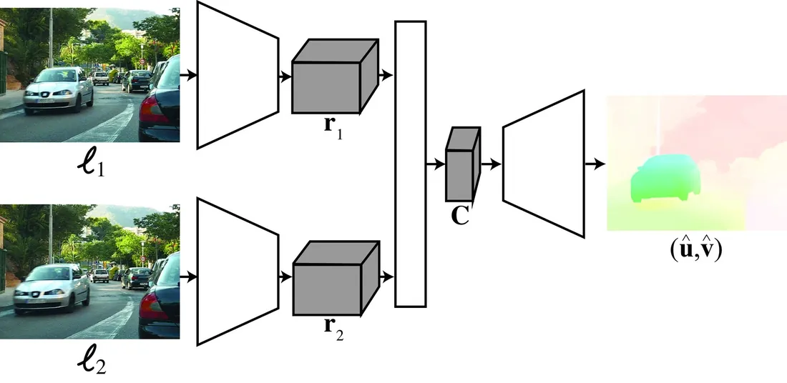

# 第 49 章 · 学习估计运动

本页为《Foundations of Computer Vision》第 49 章的<b>学习笔记摘要</b>，由 AI 辅助整理，<b>非原文翻译</b>。原书 © 2024 Antonio Torralba、Phillip Isola、William T. Freeman，MIT Press 出版，<a href="https://visionbook.mit.edu/motion_estimation.html" target="_blank" rel="noopener">官网免费公开</a>，采用 <a href="https://creativecommons.org/licenses/by-nc-nd/4.0/" target="_blank" rel="noopener">CC BY-NC-ND 4.0</a> 授权。插图版权归原作者所有，此处仅作非商业学习引用。

## 本章定位

第 48 章介绍的经典光流方法无需训练，但依赖一系列并不总成立的假设。本章转向数据驱动的路线：如何用深度学习从帧对中回归运动。按是否需要真值（ground truth）分为两大分支——有监督学习与无监督学习。二者共同构成当前运动估计的最高水平（state of the art），但作者强调：免训练的物理驱动算法仍不应被放弃。

## 本篇要点

- 引入学习的动因：解析模型的假设（亮度恒定、无遮挡、运动平滑）在真实场景频繁失效，且大量语义先验（建筑不动、墙无纹理、树叶多遮挡）无法手写建模，却可以被学习。
- 有监督：训练函数 $[\hat{\mathbf{u}}, \hat{\mathbf{v}}] = h_\theta(\boldsymbol\ell_1, \boldsymbol\ell_2)$ 端到端回归光流；两大架构——FlowNet 式直接估计，以及「特征提取 → 3D 代价体积 → CNN 聚合 → 由粗到精精化」的模块化流水线。
- 有监督的瓶颈是真值光流极难获取；合成数据集（Flying Chairs、MPI Sintel、Middlebury）与真实采集（KITTI 配激光雷达）各有权衡。
- 有监督损失为端点误差（endpoint error）；遮挡像素会污染损失，需让网络同时输出遮挡图 $\hat{\mathbf{o}}$。
- 无监督：不看真值，靠光度重建损失 + 亮度恒定 + 区域平滑（遮挡边界处允许突变）在大量视频上训练；可用遮挡权重、L1/鲁棒范数、多帧输入缓解。
- 作者立场：有监督与无监督方法都还未给出完全准确的解，物理驱动算法与学习方法两条路线都应坚持。

## 关键插图

原书标注为最高优先级（三星）的核心插图，共 1 幅。

<figure class="book-fig">

<figcaption>图 49.2：运动估计。(1) 从每幅图像提取特征；(2) 计算 3D 代价体积；(3) 聚合代价体积，为每个像素估计最佳光流。</figcaption>
</figure>

💡 为什么重要：这一「特征金字塔 → 代价体积 → 学习型聚合 → 由粗到精」的流水线是 PWC-Net、RAFT 等主流光流网络的共同骨架；读后续论文时，识别出这四个模块即可快速定位创新点在哪一步。

## 本章小结

- 基于学习的方法动因：解析模型假设频繁失效，且语义先验（建筑不动、墙无纹理、树叶多遮挡等）可被隐式学习。
- 有监督光流：训练 $[\hat{\mathbf{u}}, \hat{\mathbf{v}}] = h_\theta(\boldsymbol\ell_1, \boldsymbol\ell_2)$ 端到端回归；FlowNet 式直接法与「特征提取 → 3D 代价体积 → CNN 聚合 → 由粗到精」模块化流水线两大架构，可用 CNN 或 Transformer 实现。
- 有监督损失为端点误差；遮挡需网络额外输出遮挡图 $\hat{\mathbf{o}}$ 联合处理。
- 真值极难获取是最大瓶颈：Middlebury（6 序列，荧光纹理跟踪得真值）、KITTI（车载激光雷达）、MPI Sintel（逼真合成）、Flying Chairs（贴图 + 仿射变换，量大但不真实）。
- 无监督：假设运动来自相机、外观不变（亮度恒定）、区域平滑（遮挡边界除外），用光度重建损失在大量视频上训练；可用遮挡权重、鲁棒范数、多帧输入。
- 结论：有监督与无监督方法已是当前最高水平，但准确解仍未出现；应同时坚持物理驱动与学习两条路线。

## 复习自检清单

- ☐ 能写出有监督光流的函数形式 $[\hat{\mathbf{u}}, \hat{\mathbf{v}}] = h_\theta(\boldsymbol\ell_1, \boldsymbol\ell_2)$ 与端点误差损失公式
- ☐ 能描述模块化架构的四个步骤（共享权重特征提取/特征金字塔、3D 代价体积、CNN 聚合、由粗到精 warp 精化），并说出它与传统方法步骤的对应关系
- ☐ 能解释为什么遮挡像素需要单独处理，以及网络如何联合输出 $[\hat{\mathbf{u}}, \hat{\mathbf{v}}, \hat{\mathbf{o}}]$
- ☐ 能比较 Middlebury、KITTI、MPI Sintel、Flying Chairs 四个数据集的真值来源、真实感与规模权衡
- ☐ 能写出无监督训练的光度损失 $L_{photo}$，并说明亮度恒定、平滑性假设在其中的角色
- ☐ 能解释为什么「建筑不动、墙无纹理」这类语义先验能被学习模型隐式利用，而难以手写进解析模型
- ☐ 能说明大位移、遮挡、光照变化为何会破坏无监督光度损失，以及至少两种工程缓解手段

---

原文：[Learning to Estimate Motion](https://visionbook.mit.edu/motion_estimation.html)
