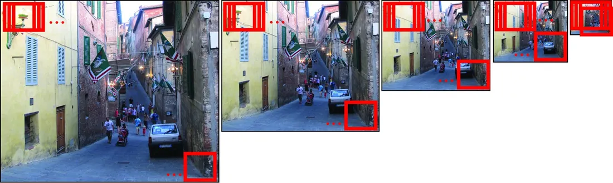
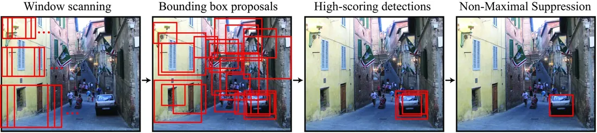
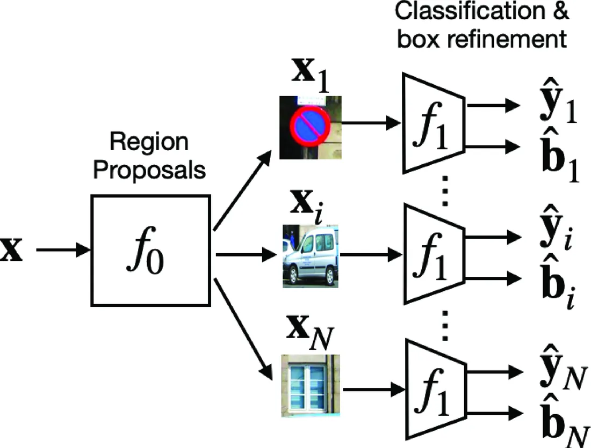
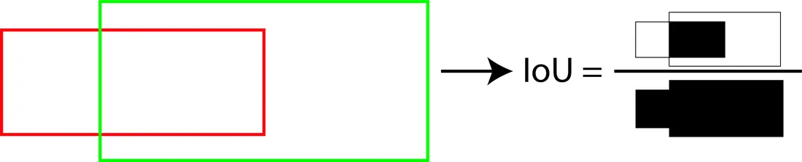
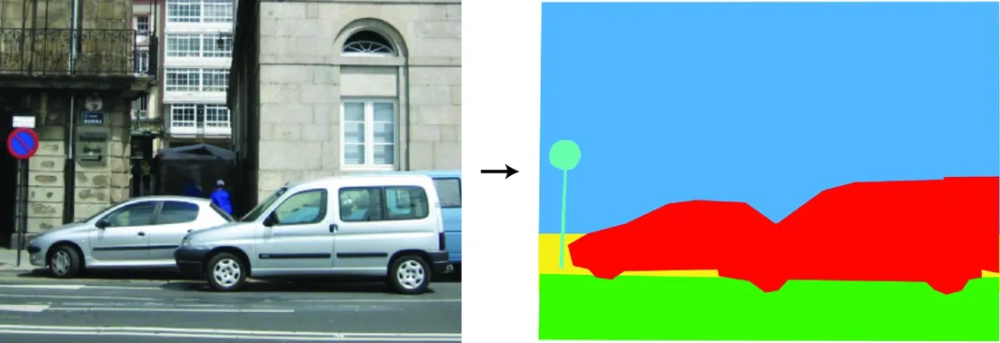
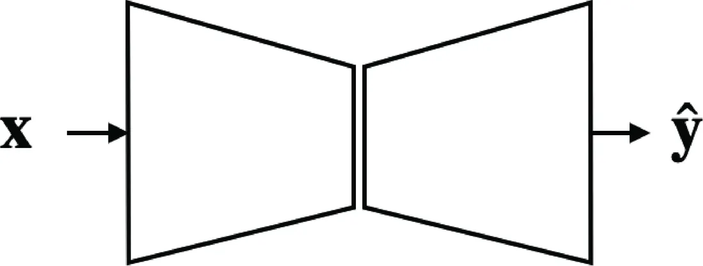
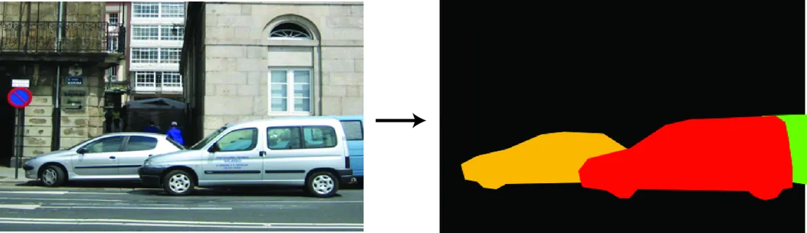
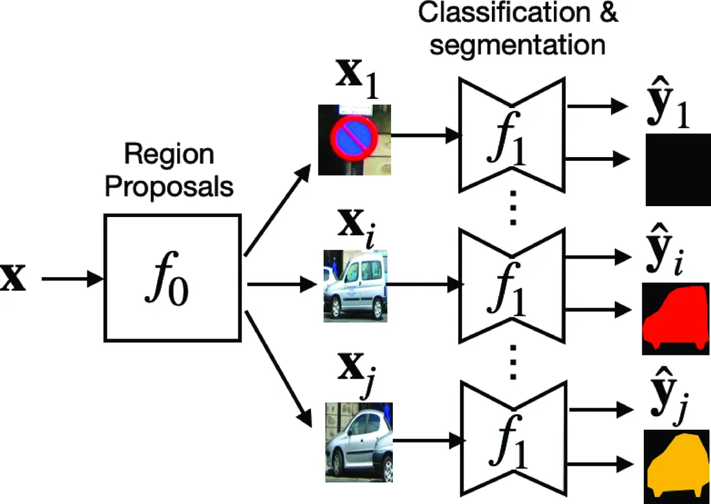

# 第 50 章 · 目标识别

本页为《Foundations of Computer Vision》第 50 章的<b>学习笔记摘要</b>，由 AI 辅助整理，<b>非原文翻译</b>。原书 © 2024 Antonio Torralba、Phillip Isola、William T. Freeman，MIT Press 出版，<a href="https://visionbook.mit.edu/object_recognition_v3.html" target="_blank" rel="noopener">官网免费公开</a>，采用 <a href="https://creativecommons.org/licenses/by-nc-nd/4.0/" target="_blank" rel="noopener">CC BY-NC-ND 4.0</a> 授权。插图版权归原作者所有，此处仅作非商业学习引用。

## 本章定位

本篇（Part XIII「场景理解」）的开篇。前面各部分分别解决了成像、几何、特征与学习等基础问题，本章第一次正面回答「图中有什么」：把识别拆成一组描述力递增的任务——图像分类、目标定位、类别分割、实例分割，并给出它们共同的形式化、损失与评估框架。后续的检测、分割与更高级的场景理解章节都沿用这套语言。

## 本篇要点

- 目标识别是一族任务而非单一任务，描述力依次增强：分类（有无）→ 定位（边界框在哪里）→ 语义分割（逐像素类别）→ 实例分割（可数、可分离的掩码）。
- 检测的三段式范式：候选区域提议 → 候选框内分类/边框回归 → NMS 去重；滑动窗口、选择性搜索、分类器级联是这一范式的不同具体化，YOLO 代表「全局回归」的另一条路线。
- 人类视觉的两条关键观察：基于部件（Geon）的组合式表示；对视角、光照、遮挡、形变的近似不变性（心理旋转实验）。
- 类别有层级（上位/基本/下位）与原型结构，但自然类别边界模糊；用语言定义类别会引入歧义与语境依赖。
- 检测损失 = 分类交叉熵 + IoU（或 L2）定位损失；评估用 PASCAL 式匹配 + 精确率-召回率曲线，以 AP 概括。

## 关键插图

原书标注为最高优先级（三星）的核心插图，共 8 幅。

<figure class="book-fig">

</figure>

<figure class="book-fig">

<figcaption>图 50.13：第一个分类器选出候选边界框；第二个更强的分类器做出最终检测（如汽车）。非极大值抑制（NMS）去除重叠的检测。</figcaption>
</figure>

💡 为什么重要：一张图讲清「廉价提议 + 昂贵判别」的两阶段哲学——这是 R-CNN 系列乃至今天多数工业检测器的组织原则。

<figure class="book-fig">

<figcaption>图 50.14：选择性搜索架构示意。图像先被分解为候选区域，然后每个区域分别用分类器和回归处理。</figcaption>
</figure>

💡 为什么重要：f_0（提议）/ f_1（分类 + 回归）的分解是检测器的标准抽象。把本图与图 50.24（实例分割）对照看，能看出整个识别家族都在复用同一组积木。

<figure class="book-fig">

</figure>

<figure class="book-fig">

<figcaption>图 50.21：语义分割。每个像素都标注了语义标签（红=汽车，蓝=建筑，绿=道路，黄=人行道，青=标志牌）。</figcaption>
</figure>

💡 为什么重要：这是「分类思想的空间化」——输出从整图一个标签变成每像素一个标签，是从识别通往场景密集理解的枢纽图。

<figure class="book-fig">

<figcaption>图 50.22：语义分割的编码器-解码器架构示意。</figcaption>
</figure>

💡 为什么重要：编码器把空间信息压缩成语义特征、解码器逐级恢复分辨率——这个「先理解后定位」的骨架，是 U-Net、DeepLab 等一大家族的共同祖先。

<figure class="book-fig">

<figcaption>图 50.23：实例分割。汽车类别的每个实例被赋予不同颜色。</figcaption>
</figure>

💡 为什么重要：掩码同时给出「是什么」与「确切是哪些像素」，还能天然区分重叠实例——这是检测与分割两条线索的汇合点。

<figure class="book-fig">

<figcaption>图 50.24：实例分割架构。该架构组合了前面见过的若干组件：图像先被分解为重叠区域，然后对每个区域分别应用类别分割。</figcaption>
</figure>

💡 为什么重要：把它与图 50.14 并置，能清楚看到「提议 + 框内精细处理」这一范式如何从检测平移到分割——Mask R-CNN 即此路线的集大成者。

## 本章小结

- 目标识别是一族描述力递增的任务：分类（封闭词表，互斥或多标签）、定位（边界框 + 类别）、语义分割（逐像素类别）、实例分割（可数掩码）；四者共享图像分类器、区域提议、逐像素分类器、边框回归四块积木。
- 检测范式：滑动窗口（穷举）→ 选择性搜索（廉价提议 + 昂贵判别）→ 分类器级联（复杂度递增的序列）；NMS 去重是共同的后处理；YOLO 代表全局回归路线。
- 人类视觉启发：Geon 部件组合、心理旋转（反应时 ∝ 旋转角）、类别层级与原型、语境依赖的偶发含义。
- 损失：分类用交叉熵（互斥 = softmax + 式 50.3 的似然；多标签 = sigmoid + 逐类二值交叉熵）；定位用 $1-$IoU 或 L2；总损失以 $\mathbb{1}(\mathbf{y}_i \neq 0)$ 屏蔽背景框的定位项。
- 评估：分类看 Top-1/Top-5 与混淆矩阵；检测用 PASCAL 式贪心匹配（IoU 阈值 0.5）+ 精确率-召回率曲线，以 AP 概括；分割看像素准确率与 mIoU。
- 共同的软肋：类别由语言定义带来的歧义、封闭词表、对 3D/物理/动力学世界的一无所知——这些都留待后续章节。

## 复习自检清单

- ☐ 能写出图像分类的形式化 $\hat{\mathbf{y}}=f(\mathbf{x})$，并从输出约束、网络输出层、损失函数三方面区分互斥与多标签两种设置
- ☐ 能由式 (50.3) 的似然推出互斥类别的交叉熵损失，并写出多标签情形对应的二值交叉熵
- ☐ 能计算并解读混淆矩阵：给定 $C_{i,j}$ 公式，说出对角线与非对角线元素各说明什么
- ☐ 能复述检测的三段式流水线，并说明滑动窗口（Levels=1）、选择性搜索（Levels=2）、分类器级联分别是它的哪些特例/扩展
- ☐ 能写出 NMS 的三步迭代流程，解释为什么「命中后移除真值/已选框」是必需的
- ☐ 能写出检测总损失式，说明指示函数 $\mathbb{1}(\mathbf{y}_i\neq 0)$ 与权重 $\lambda$ 的作用；能比较 IoU 损失与 L2 损失的尺度性质与梯度缺陷
- ☐ 能按 PASCAL 协议手工走一遍「检测 ↔ 真值匹配」，并写出 Precision、Recall、AP 的定义
- ☐ 能区分语义分割与实例分割：对 $K$ 个相互接触的同类别物体，两者输出分别是什么；能解释为什么像素准确率会被大物体主导、mIoU 为何更好

---

原文：[Object Recognition](https://visionbook.mit.edu/object_recognition_v3.html)
