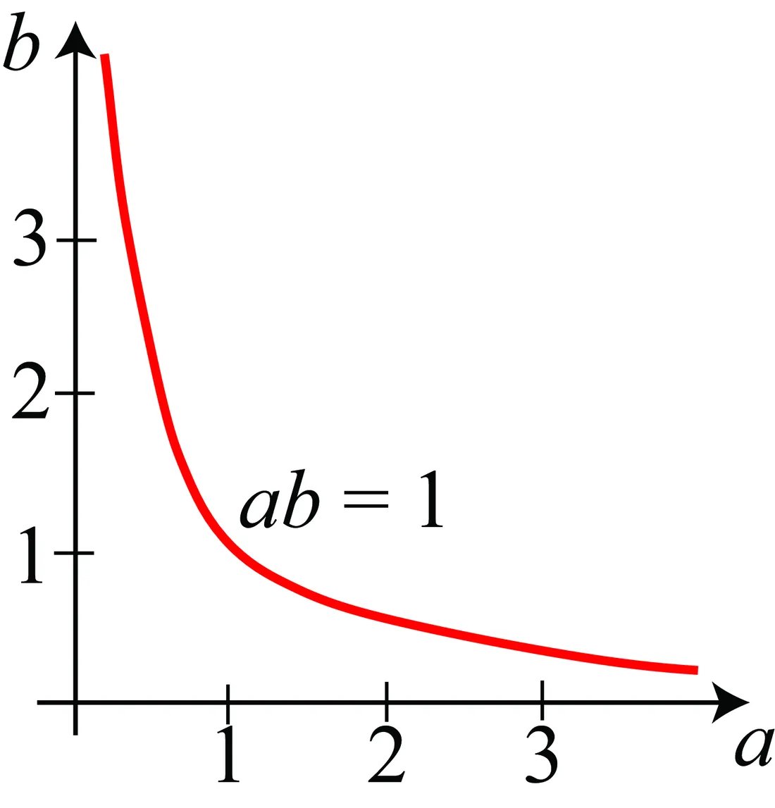

# 第 52 章 · 如何做研究

本页为《Foundations of Computer Vision》第 52 章的<b>学习笔记摘要</b>，由 AI 辅助整理，<b>非原文翻译</b>。原书 © 2024 Antonio Torralba、Phillip Isola、William T. Freeman，MIT Press 出版，<a href="https://visionbook.mit.edu/how_to_do_research.html" target="_blank" rel="noopener">官网免费公开</a>，采用 <a href="https://creativecommons.org/licenses/by-nc-nd/4.0/" target="_blank" rel="noopener">CC BY-NC-ND 4.0</a> 授权。插图版权归原作者所有，此处仅作非商业学习引用。

## 本章定位

Part XIV「研究、写作与演讲」的开篇。前面 51 章讲的是视觉的「硬知识」，从本章起转为「软方法」：如何把知识组织成研究、如何调试研究本身。本章以导师给研究生的建议口吻写成，覆盖节奏、验证、汇报方式、玩具模型、合作与署名。

## 本篇要点

- 核心口号「慢下来，才能快起来」（Slow down to speed up）：课程世界有标准答案，研究没有；一次只改一个变量，弄清每个实验的含义。
- 汇报问题不说「它不工作」，而是「已经把问题缩小到第 B 步、排除了 W 和 Z」。
- 用「抓住核心思想的最简玩具模型」（toy model）建立直觉，再迁移到真实问题。
- 强弱研究生的分野不在聪明，而在努力程度与「导航」能力：马达与舵缺一不可。
- 合作看贡献的洞察力/基础性/影响力：伟大论文的 1/10 作者，胜过无关紧要论文的独立作者。

## 关键插图

原书标注为最高优先级（三星）的核心插图，共 1 幅。

<figure class="book-fig">

<figcaption>图 52.2：色彩恒常性问题的玩具模型：y = a × b。图中画出 y=1 时 a 和 b 所有可能的解。</figcaption>
</figure>

💡 为什么重要：一条双曲线 a=1/b 就把「观测信息不足、解空间无限」讲透了——玩具模型的意义正在于用最小结构暴露问题本质。

## 本章小结

- 研究的世界没有标准答案：慢下来，验证假设，一次只改一个变量。
- 汇报 = 定位问题边界：把失败缩小到具体某一步，并说明排除了什么。
- 最简玩具模型（如 $y = a \times b$、单个凸起）是建立直觉、预判方法可行性的利器。
- 强弱研究生的差别：执行 + 在 ε 邻域内自主修正方向；聪明不再是区分度。
- 努力打底、定期「导航」；以可持续的节奏工作，保护时间就是保护研究。
- 合作看贡献质量不看人头；署名涵盖实验、关键思想、写作，乃至「试过错路」。

## 复习自检清单

- ☐ 下次实验失败时，写一段「问题定位」：正常到哪一步、坏在哪一步、排除了哪些原因，而不是只说「不工作」
- ☐ 为手头的问题构造一个最简玩具模型（如 $y = a \times b$），先用它推演可行性，再上真数据
- ☐ 导师/同事给的方案失效时，先在 ε 邻域内找可行变体并汇报，而不是原样回报失败
- ☐ 盘点自己的长处（广/创造力/实现/理论），围绕长处选下一个问题
- ☐ 每周围自己留一次「抬头看路」：确认在做的事仍然是对的问题

---

原文：[How to Do Research](https://visionbook.mit.edu/how_to_do_research.html)
