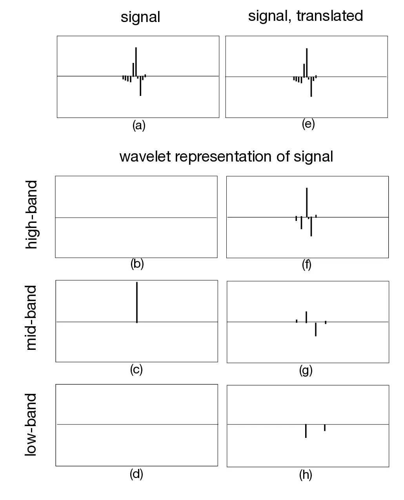
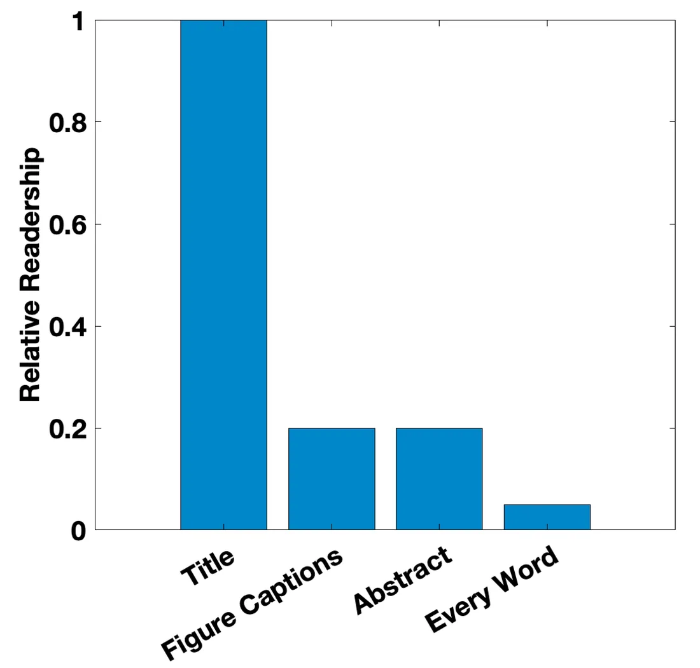

# 第 53 章 · 如何写论文

本页为《Foundations of Computer Vision》第 53 章的<b>学习笔记摘要</b>，由 AI 辅助整理，<b>非原文翻译</b>。原书 © 2024 Antonio Torralba、Phillip Isola、William T. Freeman，MIT Press 出版，<a href="https://visionbook.mit.edu/how_to_write_papers.html" target="_blank" rel="noopener">官网免费公开</a>，采用 <a href="https://creativecommons.org/licenses/by-nc-nd/4.0/" target="_blank" rel="noopener">CC BY-NC-ND 4.0</a> 授权。插图版权归原作者所有，此处仅作非商业学习引用。

## 本章定位

Part XIV「研究、写作与演讲」第二章。第 52 章讲如何「做出」研究，本章讲如何「写出」研究——研究只有被清晰传达才会产生影响力。内容覆盖论文组织结构、引言/核心思想/实验/收尾各环节的写法，以及标题、图注、公式、语气、署名、避免被拒等通用写作建议。

## 本篇要点

- 只有好论文对职业生涯有意义；学会把任何一段研究写成尽可能好的论文。
- 经典结构：说问题（让读者在乎）→ 现有方案为何不行 → 你的方案并比较 → 相关工作总结。
- 多数读者只略读：标题、图注、摘要必须自足地讲出论文故事。
- 简洁即清晰：与页数限制搏斗的年代，少写废话等于多放内容。
- 结尾总结贡献、回答「世界因此有何不同」，不要罗列未来工作；语气诚恳可靠，自己指出缺陷。

## 关键插图

原书标注为最高优先级（三星）的核心插图，共 2 幅。

<figure class="book-fig">

<figcaption>图 53.2：平移对信号小波表示的影响（图与图注转绘自 [5]）。(a) 输入信号。(b–d) 小波子带分解中的高、中、低频段系数。(e) 同一输入信号向右平移一个采样点。(f–h) 平移后信号在同样三个频段上的分解。注意平移引起的变换系数的剧烈变化。</figcaption>
</figure>

💡 为什么重要：这是「一张图讲清核心思想」的范本——写论文、做报告都该先问：我最关键的那张图是什么？

<figure class="book-fig">

<figcaption>图 53.4：计算机科学论文的推测阅读量（相对数量的推测）。许多人会读标题，但少得多的人会读摘要或看图；更少的人会读论文的每一个字。你应该让读者在每个参与层级上都能从论文中有所收获。</figcaption>
</figure>

💡 为什么重要：读者按「标题 → 摘要 → 图 → 全文」分层进入你的论文，任何一层断链，工作就等于没发表。

## 本章小结

- 只有好论文对职业生涯有意义；任何研究工作都值得被写成尽可能好的论文。
- 组织结构四步：问题（读者为何在乎）→ 他人方案为何不行 → 你的方案与比较 → 相关工作总结。
- 多数读者只略读：标题、图注、摘要分层自足；公式行文「换成 blah 也流畅」，引用公式带短语指认。
- 简洁即清晰且省版面：149 词可砍到 88 词而不丢信息。
- 结尾讲贡献与世界的变化，不罗列未来工作；诚恳可靠的语气是长期资产。
- 避开六类「现成拒稿理由」；警惕蟑螂（太增量）与六趾幼犬（显眼缺陷）两类边缘论文。

## 复习自检清单

- ☐ 用 Adelson 四步检查论文结构：问题（读者为何在乎）→ 他人方案为何不行 → 你的方案与比较 → 相关工作总结
- ☐ 只读标题、摘要和图注，检查论文故事是否完整——这是多数读者看到的全部
- ☐ 把最长的段落按「用更少的词」砍掉 30% 字数，确认信息无损
- ☐ 通读公式：每句引用都带短语指认而非裸编号；把公式替换成「blah」后句子仍然通顺
- ☐ 投稿前对照六条拒稿理由逐项自查，并给论文贴「蟑螂 / 六趾幼犬」标签，决定先修什么

---

原文：[How to Write Papers](https://visionbook.mit.edu/how_to_write_papers.html)
